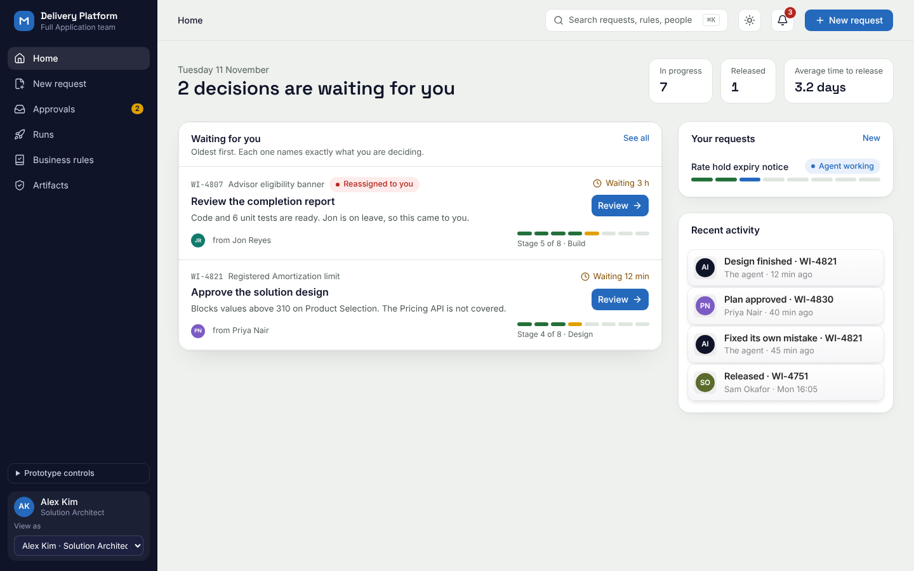

# Step 6 of 31: Theme, shared UI and the app frame

Light/dark theme, then the shared pieces every screen uses: Avatar, Pill, Stepper, Card and the Shell (sidebar + top bar).

## What to tell Copilot

Open this file in the editor, then paste this into Copilot Chat (Agent or Edit mode):

```text
Using #file:06-theme-and-shell.md, create 3 files exactly as given in the "Files" section: src/v3/theme.jsx, src/v3/ui.jsx, src/v3/protomenu.jsx.
Copy the code character for character. Do not rename, reformat, shorten, "improve" or convert to TypeScript.
Do not leave placeholders such as "// rest of the code". When done, list the files you created with their line counts.
```

## What it should look like

Reference screenshots (1440 × 900):

- `../screens/01-home.png`
- `../screens/29-home-dark.png`



## Files

Create these files with **exactly** this content.

### File: `src/v3/theme.jsx` (42 lines)

`````jsx
// Light / dark / system theme for the product. "System" follows the page's data-theme (set by the host
// when someone picks a theme there) and otherwise the operating system. The choice is remembered per viewer.
import { createContext, useContext, useEffect, useState } from 'react';
import { Sun, Moon, Monitor } from 'lucide-react';

const KEY = 'delivery-theme';
const read = () => { try { return localStorage.getItem(KEY) || 'system'; } catch { return 'system'; } };
const systemMode = () => {
  const host = document.documentElement.getAttribute('data-theme');
  if (host === 'dark' || host === 'light') return host;
  return typeof matchMedia !== 'undefined' && matchMedia('(prefers-color-scheme: dark)').matches ? 'dark' : 'light';
};

const Ctx = createContext({ mode: 'system', resolved: 'light', setMode: () => {} });
export function ThemeProvider({ children }) {
  const [mode, setModeState] = useState(read);
  const [sys, setSys] = useState(systemMode);
  useEffect(() => {
    const mq = matchMedia('(prefers-color-scheme: dark)'); const f = () => setSys(systemMode());
    mq.addEventListener('change', f);
    const mo = new MutationObserver(f); mo.observe(document.documentElement, { attributes: true, attributeFilter: ['data-theme'] });
    return () => { mq.removeEventListener('change', f); mo.disconnect(); };
  }, []);
  const setMode = m => { setModeState(m); try { localStorage.setItem(KEY, m); } catch { /* not stored; still applies for this visit */ } };
  const resolved = mode === 'system' ? sys : mode;
  useEffect(() => { document.body.style.background = resolved === 'dark' ? '#0d111d' : '#eef1ed'; }, [resolved]);
  return <Ctx.Provider value={{ mode, resolved, setMode }}>{children}</Ctx.Provider>;
}
export const useTheme = () => useContext(Ctx);

const ORDER = ['light', 'dark', 'system'];
const ICON = { light: Sun, dark: Moon, system: Monitor };
const LABEL = { light: 'Light', dark: 'Dark', system: 'System' };
export function ThemeToggle() {
  const { mode, setMode } = useTheme();
  const I = ICON[mode]; const next = ORDER[(ORDER.indexOf(mode) + 1) % 3];
  return (
    <button onClick={() => setMode(next)} aria-label={`Theme: ${LABEL[mode]}. Switch to ${LABEL[next]}`} title={`Theme: ${LABEL[mode]}`} className="grid size-9 place-items-center rounded-lg border border-[var(--v-line)] bg-[var(--v-surface)] text-[var(--v-ink-2)] hover:bg-[var(--v-sunken)]">
      <I className="size-[18px]" />
    </button>
  );
}
`````

### File: `src/v3/ui.jsx` (146 lines)

`````jsx
// v3 shared UI: one coherent product built on the client's existing console tokens.
import { useEffect, useState } from 'react';
import { cn } from '@/lib/utils';
import { CommandPalette, Notifications } from './overlays';
import { useProto } from './store';
import { TourBar, Welcome } from './tour';
import { PrototypeMenu } from './protomenu';
import { useTheme, ThemeToggle } from './theme';
import { Home, FilePlus2, Inbox, Rocket, BookCheck, ShieldCheck, Search, Settings, Check, X, LayoutDashboard, UsersRound, Scale, Contact, Plug, KeyRound, History } from 'lucide-react';

export const PEOPLE = {
  priya: { name: 'Priya Nair', role: 'Product Owner', init: 'PN', hue: '#7c5cc4' },
  alex:  { name: 'Alex Kim', role: 'Solution Architect', init: 'AK', hue: '#2469bc' },
  jon:   { name: 'Jon Reyes', role: 'Engineering Lead', init: 'JR', hue: '#0f7b6c' },
  mara:  { name: 'Mara Lopez', role: 'Quality Lead', init: 'ML', hue: '#b4541f' },
  sam:   { name: 'Sam Okafor', role: 'Release Manager', init: 'SO', hue: '#5a6b2b' },
  agent: { name: 'Delivery agent', role: 'AI', init: 'AI', hue: '#101429' },
  dana:  { name: 'Dana Whitfield', role: 'Platform Admin', init: 'DW', hue: '#a0306a' },
  ravi:  { name: 'Ravi Shah', role: 'Solution Architect', init: 'RS', hue: '#3b6fb6' },
  lena:  { name: 'Lena Brooks', role: 'Engineering Lead', init: 'LB', hue: '#12806f' },
  tom:   { name: 'Tom Iverson', role: 'Integration Lead', init: 'TI', hue: '#6d5a2b' },
  ana:   { name: 'Ana Costa', role: 'Quality Lead', init: 'AC', hue: '#a84a1f' },
  ines:  { name: 'Ines Duarte', role: 'Auditor', init: 'ID', hue: '#55607a' },
};
export const STAGES = [
  ['Plan','priya'],['Specify','priya'],['Impact',null],['Design','alex'],['Build','jon'],['Integrate','tom'],['Validate','mara'],['Release','sam'],
];

export const Avatar = ({ p, size = 28, ring }) => {
  const x = PEOPLE[p];
  return <span title={`${x.name}, ${x.role}`} className={cn('inline-grid shrink-0 place-items-center rounded-full font-semibold text-white', ring && 'ring-2 ring-white')} style={{ width: size, height: size, background: x.hue, fontSize: size * 0.38 }}>{x.init}</span>;
};

const TONE = {
  you:  'bg-[var(--v-amber-soft)] text-[var(--v-amber)]',
  wait: 'bg-[var(--v-amber-soft)] text-[var(--v-amber)]',
  work: 'bg-[var(--v-blue-soft)] text-[var(--v-blue)]',
  done: 'bg-[var(--v-green-soft)] text-[var(--v-green)]',
  bad:  'bg-[var(--v-red-soft)] text-[var(--v-red)]',
  mute: 'bg-[var(--v-sunken)] text-[var(--v-ink-2)]',
};
export const Pill = ({ tone = 'mute', dot = true, children, className }) => (
  <span className={cn('inline-flex h-6 items-center gap-1.5 whitespace-nowrap rounded-full px-2.5 text-[12.5px] font-medium', TONE[tone], className)}>
    {dot && <span className={cn('size-1.5 rounded-full bg-current', tone === 'work' && 'animate-pulse')} />}{children}
  </span>
);

/* Stage stepper. states: d done, w waiting on a person, a agent working, '' upcoming. */
export function Stepper({ s, compact, label }) {
  const cur = Math.max(s.length, 1);
  if (compact && label) return (
    <div className="flex flex-col gap-1"><Stepper s={s} compact /><span className="text-[12px] text-[var(--v-ink-3)]">Stage {cur} of 8 · {STAGES[cur - 1][0]}</span></div>
  );
  if (compact) return (
    <div className="flex items-center gap-1" role="img" aria-label={`Stage ${cur} of 8, ${STAGES[cur - 1][0]}`}>
      {STAGES.map(([n], i) => <span key={n} title={n} className={cn('h-1.5 flex-1 rounded-full', s[i] === 'd' ? 'bg-[var(--v-green)]' : s[i] === 'w' ? 'bg-[#e0a000]' : s[i] === 'a' ? 'bg-[var(--v-blue)]' : s[i] === 'f' ? 'bg-[var(--v-red)]' : 'bg-[var(--v-line)]')} />)}
    </div>
  );
  return (
    <ol className="grid grid-cols-8" aria-label="Delivery stages">
      {STAGES.map(([n, who], i) => {
        const k = s[i];
        return (
          <li key={n} className="relative flex flex-col items-center gap-2 text-center">
            {i > 0 && <span aria-hidden="true" className={cn('absolute top-[13px] right-1/2 h-0.5 w-full', k ? 'bg-[var(--v-green)]' : 'bg-[var(--v-line)]')} />}
            <span className={cn('relative z-10 grid size-7 place-items-center rounded-full border-2 text-[12px] font-semibold',
              k === 'd' && 'border-[var(--v-green)] bg-[var(--v-green)] text-white',
              k === 'w' && 'border-[#e0a000] bg-[var(--v-amber-soft)] text-[var(--v-amber)] ring-4 ring-[#e0a000]/20',
              k === 'a' && 'border-[var(--v-blue)] bg-[var(--v-surface)] text-[var(--v-blue)]',
              k === 'f' && 'border-[var(--v-red)] bg-[var(--v-red)] text-white ring-4 ring-[var(--v-red)]/20',
              !k && 'border-[var(--v-line)] bg-[var(--v-surface)] text-[var(--v-ink-3)]')}>
              {k === 'd' ? <Check className="size-4" strokeWidth={3} /> : k === 'f' ? <X className="size-4" strokeWidth={3} /> : i + 1}
            </span>
            <span className={cn('text-[13px]', k === 'w' ? 'font-semibold' : k === 'f' ? 'font-semibold text-[var(--v-red)]' : 'text-[var(--v-ink-2)]')}>{n}{k === 'f' && <span className="sr-only"> (failed)</span>}</span>
            {who ? <span className="flex items-center gap-1 text-[11.5px] text-[var(--v-ink-3)]"><Avatar p={who} size={16} />{PEOPLE[who].name.split(' ')[0]}</span> : <span className="text-[11.5px] text-[var(--v-ink-3)]">Automatic</span>}
          </li>
        );
      })}
    </ol>
  );
}

export const Card = ({ className, children, ...r }) => <section className={cn('rounded-2xl border border-[var(--v-line)] bg-[var(--v-surface)] shadow-[0_1px_2px_rgba(16,20,41,.04),0_8px_24px_-12px_rgba(16,20,41,.10)]', className)} {...r}>{children}</section>;
export const CardHead = ({ title, sub, right }) => <header className="flex items-start gap-3 px-5 pt-4 pb-3"><div className="min-w-0 flex-1"><h2 className="text-[15px] font-semibold">{title}</h2>{sub && <p className="text-[13px] text-[var(--v-ink-3)]">{sub}</p>}</div>{right}</header>;

const CRUMB = { Home: '#v3-home', Requests: '#v3-runs', Runs: '#v3-runs', Approvals: '#v3-approvals', Admin: '#v3-admin', Squads: '#v3-squads', 'Business rules': '#v3-rules', 'WI-4821': '#v3-run-wi-4821', 'WI-4807': '#v3-run-wi-4807', 'WI-4772': '#v3-run-wi-4772', 'WI-4799': '#v3-run-wi-4799' };
const NAV = [['home','Home',Home],['new','New request',FilePlus2],['approvals','Approvals',Inbox,3],['run','Runs',Rocket],['rules','Business rules',BookCheck],['artifacts','Artifacts',ShieldCheck]];
const ADMIN_NAV = [['admin','Governance',LayoutDashboard,'squads.manage'],['squads','Squads',UsersRound,'squads.manage'],['people','People and access',Contact,'people.manage'],['roles','Roles and permissions',KeyRound,'roles.manage'],['policies','Policies',Scale,'policies.manage'],['connections','Connections',Plug,'connections.manage'],['audit','Audit log',History,'audit.view']];
export function Shell({ active, crumbs = [], actions, children, admin, user }) {
  const me = useProto().me;
  const [cp, setCp] = useState(false);
  const proto = useProto();
  const { resolved } = useTheme();
  useEffect(() => {
    const k = e => {
      const typing = /INPUT|TEXTAREA|SELECT/.test(document.activeElement?.tagName || '');
      if ((e.key === 'k' || e.key === 'K') && (e.metaKey || e.ctrlKey)) { e.preventDefault(); setCp(true); }
      else if (e.key === '/' && !typing) { e.preventDefault(); setCp(true); }
    };
    addEventListener('keydown', k); return () => removeEventListener('keydown', k);
  }, []);
  return (
    <div className="v3 grid min-h-screen grid-cols-[248px_1fr]" data-mode={resolved}>
      <a href="#v3main" className="sr-only focus:not-sr-only focus:fixed focus:top-2 focus:left-2 focus:z-50 focus:rounded-md focus:bg-[var(--v-surface)] focus:px-3 focus:py-2">Skip to content</a>
      <aside aria-label="Sidebar" className="sticky top-0 flex h-screen flex-col gap-1 bg-[var(--v-side)] px-3 py-4 text-[#c8cde0]">
        <div className="mb-5 flex items-center gap-2.5 px-2.5">
          <span className="grid size-8 place-items-center rounded-lg bg-[var(--v-blue)]"><svg viewBox="0 0 20 20" className="size-5" aria-hidden="true"><path d="M4 15V5l6 5 6-5v10" fill="none" stroke="#fff" strokeWidth="2.2" strokeLinejoin="round" strokeLinecap="round"/></svg></span>
          <div className="leading-tight"><div className="font-display text-[15px] font-semibold text-white">Delivery Platform</div><div className="text-[12px] text-[#8f97b3]">Full Application team</div></div>
        </div>
        <nav aria-label="Primary" className="-mx-1 flex min-h-0 flex-1 flex-col gap-1 overflow-y-auto px-1 pb-3">
        {NAV.map(([k, l, I, n0]) => { const n = k === 'approvals' ? proto.mine.length : n0; return (
          <a key={k} href={{run:'#v3-runs'}[k] || `#v3-${k}`} aria-current={active === k ? 'page' : undefined} className={cn('flex h-9 items-center gap-3 rounded-lg px-2.5 text-[14px] transition-colors hover:bg-white/5 hover:text-white', active === k && 'bg-white/10 font-medium text-white')}>
            <I className="size-[18px]" strokeWidth={1.8} />{l}{n > 0 && <span className="ml-auto rounded-full bg-[#e0a000] px-1.5 text-[11.5px] font-semibold text-[var(--v-ink)]">{n}</span>}
          </a>); })}
        {ADMIN_NAV.some(x => proto.can(x[3])) && <>
          <div className="mt-5 mb-1 px-2.5 text-[12px] font-medium text-[#8f97b3]">Admin</div>
          {ADMIN_NAV.filter(x => proto.can(x[3])).map(([k, l, I]) => (
            <a key={k} href={`#v3-${k}`} aria-current={active === k ? 'page' : undefined} className={cn('flex h-9 items-center gap-3 rounded-lg px-2.5 text-[14px] transition-colors hover:bg-white/5 hover:text-white', active === k && 'bg-white/10 font-medium text-white')}><I className="size-[18px]" strokeWidth={1.8} />{l}</a>))}
        </>}
        </nav>
        <PrototypeMenu />
        <div className="flex shrink-0 flex-col gap-1.5 rounded-xl bg-white/5 px-2.5 py-2">
          <div className="flex items-center gap-2.5"><Avatar p={me} size={32} /><div className="min-w-0 leading-tight"><div className="truncate text-[14px] font-medium text-white">{PEOPLE[me].name}</div><div className="truncate text-[12px] text-[#8f97b3]">{proto.myRole}</div></div></div>
          <label htmlFor="viewas" className="text-[11.5px] text-[#8f97b3]">View as</label>
          <select id="viewas" value={me} onChange={e => { proto.setMe(e.target.value); location.hash = 'v3-home'; }} className="h-8 rounded-md border border-white/15 bg-[#1c2140] px-2 text-[13px] text-white">
            <option value="alex">Alex Kim · Solution Architect</option><option value="priya">Priya Nair · Product Owner</option><option value="sam">Sam Okafor · Release Manager</option><option value="jon">Jon Reyes · Engineering Lead</option><option value="tom">Tom Iverson · Integration Lead</option><option value="mara">Mara Lopez · Quality Lead</option><option value="ines">Ines Duarte · Auditor</option><option value="dana">Dana Whitfield · Platform Admin</option>
          </select>
        </div>
      </aside>
      <div className="flex min-w-0 flex-col">
        <header className="sticky top-0 z-20 flex h-16 items-center gap-4 border-b border-[var(--v-line)] bg-[var(--v-bg)]/90 px-8 backdrop-blur">
          <nav aria-label="Breadcrumb"><ol className="flex min-w-0 items-center gap-2 text-[14px] text-[var(--v-ink-3)]">{crumbs.map((c, i) => { const last = i === crumbs.length - 1; const href = CRUMB[c]; return <li key={c} className="flex items-center gap-2">{i > 0 && <span aria-hidden="true">/</span>}{last ? <span aria-current="page" className="font-medium text-[var(--v-ink)]">{c}</span> : href ? <a href={href} className="rounded hover:text-[var(--v-ink)] hover:underline">{c}</a> : <span>{c}</span>}</li>; })}</ol></nav>
          <div className="flex-1" />
          <button onClick={() => setCp(true)} aria-keyshortcuts="Control+K Meta+K /" className="flex h-9 w-72 items-center gap-2 rounded-lg border border-[var(--v-line)] bg-[var(--v-surface)] px-3 text-[13.5px] text-[var(--v-ink-3)] hover:border-[var(--v-line-strong)]"><Search className="size-4" />Search requests, rules, people<kbd className="ml-auto rounded border border-[var(--v-line)] px-1.5 font-mono text-[11px]">⌘K</kbd></button>
          <ThemeToggle />
          <Notifications />
          {actions}
        </header>
        <TourBar />
        <main id="v3main" className="flex-1 px-8 py-7">{children}</main>
        <Welcome />
        <CommandPalette open={cp} onClose={() => setCp(false)} />
      </div>
    </div>
  );
}
`````

### File: `src/v3/protomenu.jsx` (17 lines)

`````jsx
// The prototype's own controls (reset, tour, jump to a screen), kept in the sidebar so they never cover the product.
import { useProto } from './store';

const JUMP = [['v3-home', 'Home'], ['v3-approvals', 'Approvals'], ['v3-runs', 'Runs'], ['v3-approve', 'Design'], ['v3-clarify', 'Questions'], ['v3-review', 'Code'], ['v3-release', 'Release'], ['v3-artifacts', 'Artifacts'], ['v3-admin', 'Governance'], ['v3-squads', 'Squads'], ['v3-roles', 'Roles'], ['v3-audit', 'Audit']];
export function PrototypeMenu() {
  const { reset, tour, setTour } = useProto();
  return (
    <details className="mb-2 shrink-0 rounded-lg border border-white/10 text-[12.5px] text-white">
      <summary className="cursor-pointer px-3 py-1.5 font-medium text-[#c8cde0] hover:text-white">Prototype controls</summary>
      <div className="flex flex-col gap-1 p-2 pt-0">
        <button onClick={() => setTour(!tour)} className="rounded-md bg-white/10 px-2 py-1.5 text-left hover:bg-white/20">{tour ? 'Hide the guided tour' : 'Show the guided tour'}</button>
        <button onClick={() => { reset(); location.hash = 'v3-home'; }} className="rounded-md bg-white/10 px-2 py-1.5 text-left hover:bg-white/20">Reset demo data</button>
        <nav aria-label="Jump to screen" className="flex flex-wrap gap-0.5 pt-1">{JUMP.map(([k, l]) => <a key={k} href={`#${k}`} className="rounded px-1.5 py-1 text-[#c8cde0] hover:bg-white/15 hover:text-white">{l}</a>)}</nav>
      </div>
    </details>
  );
}
`````

## Check before the next step

- [ ] `ui.jsx` exports `PEOPLE`, `STAGES`, `Avatar`, `Pill`, `Stepper`, `Card`, `CardHead`, `Shell`.
- [ ] The sidebar is 248px wide and lists 6 primary items plus the Admin group.

## Specification

This explains what the code above does, in words. If you later change the screen, keep to these rules.

### 4.1 Avatar

- Props: `p` (person key), `size` (default 28), `ring` (adds `ring-2 ring-white`).
- Circle, background = person hue (§9.2), white initials, font size = `size × 0.38`, `font-semibold`.
- `title="<Name>, <Role>"`.
- Sizes used: 16 (stepper), 18 (record lists), 20 (chips), 22 (lists), 24 (tables), 26, 28, 30, 32 (sidebar), 34 (run header).

### 4.3 Pill (status badge)

`inline-flex h-6 items-center gap-1.5 whitespace-nowrap rounded-full px-2.5 text-[12.5px] font-medium` + tone:

| Tone | Classes |
|---|---|
| `you`, `wait` | `bg-[var(--v-amber-soft)] text-[var(--v-amber)]` |
| `work` | `bg-[var(--v-blue-soft)] text-[var(--v-blue)]` (dot `animate-pulse`) |
| `done` | `bg-[var(--v-green-soft)] text-[var(--v-green)]` |
| `bad` | `bg-[var(--v-red-soft)] text-[var(--v-red)]` |
| `mute` | `bg-[var(--v-sunken)] text-[var(--v-ink-2)]` |

Leading dot `size-1.5 rounded-full bg-current` unless `dot={false}`.

### 4.4 Theme: ThemeProvider and ThemeToggle

- Modes: `light`, `dark`, `system`. Stored in `localStorage['delivery-theme']` (default `system`; wrap in try/catch).
- `system` resolves from the host page's `<html data-theme>` if set to `light|dark`, otherwise `prefers-color-scheme`. Listen to both (media query `change` + MutationObserver on `data-theme`).
- `resolved` is written to `data-mode` on the `.v3` root, and to `document.body.style.background`.
- Toggle: `grid size-9 place-items-center rounded-lg border border-[--v-line] bg-[--v-surface] text-[--v-ink-2] hover:bg-[--v-sunken]`, icon 18px: Sun (light) → Moon (dark) → Monitor (system), cycling in that order. `aria-label="Theme: Light. Switch to Dark"`, `title="Theme: Light"`.

### 4.5 Shell (app frame)

```
┌────────────┬──────────────────────────────────────────────────────────────────┐
│ ▣ Delivery │ Runs / WI-4821            [⌕ Search requests, rules, people ⌘K] ☀ 🔔3 (Action) │ ← top bar h-16, sticky, blur
│   Platform │──────────────────────────────────────────────────────────────────│
│ Full App…  │ [Guided tour bar — only when the tour is on]                     │ ← sticky top-16
│            │                                                                  │
│ ⌂ Home     │   <main id="v3main" class="px-8 py-7"> page content </main>      │
│ ⊕ New req. │                                                                  │
│ ⇩ Approvals 2                                                                 │
│ 🚀 Runs     │                                                                  │
│ 📖 Business rules                                                             │
│ 🛡 Artifacts│                                                                  │
│            │                                                                  │
│ Admin      │   (admin group only if the person has any admin permission)      │
│ ▦ Governance                                                                  │
│ 👥 Squads   │                                                                  │
│ ☎ People and access                                                           │
│ 🔑 Roles and permissions                                                      │
│ ⚖ Policies │                                                                  │
│ 🔌 Connections                                                                │
│ ⟲ Audit log│                                                                  │
│            │                                                                  │
│ ▸ Prototype controls                                                          │
│ ┌────────┐ │                                                                  │
│ │AK Alex Kim                                                                  │
│ │ Solution Architect                                                          │
│ │ View as [Alex Kim · Solution Architect ▾]                                   │
│ └────────┘ │                                                                  │
└────────────┴──────────────────────────────────────────────────────────────────┘
   248px                                1fr
```

- Root: `v3 grid min-h-screen grid-cols-[248px_1fr]`, `data-mode={resolved}`.
- **Skip link** first: "Skip to content" → `#v3main` (`sr-only focus:not-sr-only focus:fixed focus:top-2 focus:left-2 focus:z-50`).
- **Sidebar** `<aside aria-label="Sidebar">`: `sticky top-0 flex h-screen flex-col gap-1 bg-[var(--v-side)] px-3 py-4 text-[#c8cde0]`.
  - Brand block `mb-5 px-2.5`: 32px blue rounded-lg tile with a white "M" polyline (`M4 15V5l6 5 6-5v10`, stroke 2.2), then "Delivery Platform" (display 15px white) over "Full Application team" (12px `#8f97b3`).
  - `<nav aria-label="Primary">` scrolls (`overflow-y-auto`). Item: `flex h-9 items-center gap-3 rounded-lg px-2.5 text-[14px] hover:bg-white/5 hover:text-white`; active `bg-white/10 font-medium text-white` and `aria-current="page"`. Icon 18px, stroke 1.8.
  - Primary items: Home `#v3-home` (Home icon) · New request `#v3-new` (FilePlus2) · Approvals `#v3-approvals` (Inbox, badge = number of decisions waiting for me) · Runs `#v3-runs` (Rocket) · Business rules `#v3-rules` (BookCheck) · Artifacts `#v3-artifacts` (ShieldCheck).
  - Badge: `ml-auto rounded-full bg-[#e0a000] px-1.5 text-[11.5px] font-semibold text-[var(--v-ink)]`, hidden when 0.
  - Admin group label "Admin" (`mt-5 mb-1 px-2.5 text-[12px] font-medium text-[#8f97b3]`) and items, each shown only if the person holds its permission: Governance (LayoutDashboard, `squads.manage`) · Squads (UsersRound, `squads.manage`) · People and access (Contact, `people.manage`) · Roles and permissions (KeyRound, `roles.manage`) · Policies (Scale, `policies.manage`) · Connections (Plug, `connections.manage`) · Audit log (History, `audit.view`).
  - Prototype controls (§4.24), then the **user block** `rounded-xl bg-white/5 px-2.5 py-2`: Avatar 32 + name (14px white) + role (12px `#8f97b3`); label "View as"; `<select id="viewas">` `h-8 rounded-md border-white/15 bg-[#1c2140] text-[13px] text-white`. Changing it calls `setMe(person)` and navigates to `#v3-home`. Options in order: Alex Kim · Solution Architect, Priya Nair · Product Owner, Sam Okafor · Release Manager, Jon Reyes · Engineering Lead, Tom Iverson · Integration Lead, Mara Lopez · Quality Lead, Ines Duarte · Auditor, Dana Whitfield · Platform Admin.
- **Top bar** `<header>`: `sticky top-0 z-20 flex h-16 items-center gap-4 border-b border-[--v-line] bg-[--v-bg]/90 px-8 backdrop-blur`.
  - Breadcrumb `<nav aria-label="Breadcrumb"><ol>` 14px `--v-ink-3`, "/" separators `aria-hidden`; last item `aria-current="page"` in `--v-ink` medium; earlier items link where known: Home, Requests/Runs → `#v3-runs`, Approvals, Admin → `#v3-admin`, Squads, Business rules, and run IDs → that run.
  - Search button `h-9 w-72 rounded-lg border bg-surface px-3 text-[13.5px] text-ink-3`: Search icon, "Search requests, rules, people", `<kbd>⌘K</kbd>` at right. `aria-keyshortcuts="Control+K Meta+K /"`. Opens the palette.
  - ThemeToggle, Notifications bell (§4.17), then the page's `actions` slot.
- Global keys: Ctrl/⌘+K opens the palette; `/` opens it unless focus is in an input, textarea or select.
- Below the header: TourBar (§4.23), then `<main>`, then the Welcome dialog and the palette.

### 4.6 Card and CardHead

- `Card` = `<section>` with the card classes in §3.6. Optional `className` (e.g. `overflow-hidden`, `p-5`).
- `CardHead({ title, sub, right })`: `flex items-start gap-3 px-5 pt-4 pb-3`; `<h2>` 15px semibold; sub 13px `--v-ink-3`; `right` slot (link, Pill or small button). Links in `right` are 13px medium `--v-blue`.

### 4.7 Stepper (stage progress)

Stage string `s`: one character per stage reached; `d` done, `w` waiting on a person, `a` agent working, `f` failed; positions beyond `s.length` are upcoming. Current stage = `max(s.length,1)`.

**Full** (run page):
```
 ✓───────✓───────✓───────④───────⑤───────⑥───────⑦───────⑧
Plan  Specify  Impact  Design  Build Integrate Validate Release
●Priya ●Priya Automatic ●Alex  ●Jon   ●Tom    ●Mara    ●Sam
```
- `<ol class="grid grid-cols-8" aria-label="Delivery stages">`. Connector `absolute top-[13px] right-1/2 h-0.5 w-full`, green if the stage has a state else `--v-line`.
- Node `size-7 rounded-full border-2 text-[12px] font-semibold`: `d` green filled with Check (strokeWidth 3); `w` `border-[#e0a000] bg-amber-soft text-amber ring-4 ring-[#e0a000]/20` with the number; `a` blue border, surface fill, blue number; `f` red filled with X + `ring-4 ring-red/20`; upcoming line border, ink-3 number.
- Label 13px (`w` semibold, `f` semibold red + sr-only "(failed)"), then Avatar 16 + first name 11.5px, or "Automatic" for Impact.

**Compact**: `flex items-center gap-1`, eight `h-1.5 flex-1 rounded-full` segments: d green, w `#e0a000`, a blue, f red, else line. `role="img" aria-label="Stage 4 of 8, Design"`.

**Compact + label**: compact bar plus "Stage 4 of 8 · Design" (12px ink-3). Used in tables (`w-44`/`w-40`) and Home rows (`w-52`).

### 4.24 Prototype controls (demo only; remove in production)

`<details>` in the sidebar above the user block, summary "Prototype controls": Show/Hide the guided tour; Reset demo data (restores seed data, keeps `welcomed=true`, goes Home); jump links Home, Approvals, Runs, Design, Questions, Code, Release, Artifacts, Governance, Squads, Roles, Audit; ‹Earlier design rounds›.
