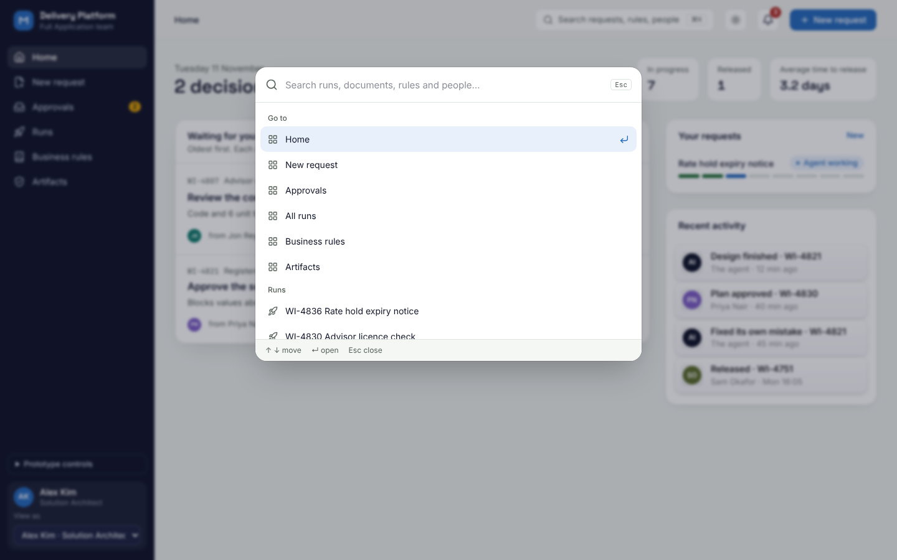

# Step 7 of 31: Search, notifications, welcome and tour

The command palette (Ctrl/⌘+K), the notifications bell, the welcome dialog and the guided tour bar.

## What to tell Copilot

Open this file in the editor, then paste this into Copilot Chat (Agent or Edit mode):

```text
Using #file:07-search-notifications-tour.md, create 2 files exactly as given in the "Files" section: src/v3/overlays.jsx, src/v3/tour.jsx.
Copy the code character for character. Do not rename, reformat, shorten, "improve" or convert to TypeScript.
Do not leave placeholders such as "// rest of the code". When done, list the files you created with their line counts.
```

## What it should look like

Reference screenshots (1440 × 900):

- `../screens/26-command-palette.png`
- `../screens/27-notifications.png`
- `../screens/30-welcome.png`
- `../screens/31-tour-bar.png`



## Files

Create these files with **exactly** this content.

### File: `src/v3/overlays.jsx` (91 lines)

`````jsx
// Command palette (⌘K / Ctrl+K / "/") and notifications panel for the v3 shell.
import { useEffect, useMemo, useRef, useState } from 'react';
import { cn } from '@/lib/utils';
import { useProto } from './store';
import { Search, Bell, CornerDownLeft, FileText, Rocket, BookCheck, User, LayoutGrid, X } from 'lucide-react';

const ITEMS = [
  ['Go to', 'Home', '#v3-home', LayoutGrid], ['Go to', 'New request', '#v3-new', LayoutGrid], ['Go to', 'Approvals', '#v3-approvals', LayoutGrid], ['Go to', 'All runs', '#v3-runs', LayoutGrid],
  ['Go to', 'Business rules', '#v3-rules', LayoutGrid], ['Go to', 'Governance (admin)', '#v3-admin', LayoutGrid], ['Go to', 'Policies (admin)', '#v3-policies', LayoutGrid], ['Go to', 'Connections (admin)', '#v3-connections', LayoutGrid], ['Go to', 'Artifacts', '#v3-artifacts', LayoutGrid], ['Go to', 'Squads (admin)', '#v3-squads', LayoutGrid], ['Go to', 'Roles and permissions (admin)', '#v3-roles', LayoutGrid], ['Go to', 'Audit log (admin)', '#v3-audit', LayoutGrid],
  ['Runs', 'WI-4821 Registered Amortization limit', '#v3-run-wi-4821', Rocket], ['Runs', 'WI-4807 Advisor eligibility banner', '#v3-run-wi-4807', Rocket], ['Runs', 'WI-4772 Fee schedule update', '#v3-run-wi-4772', Rocket], ['Runs', 'WI-4799 Statement export format', '#v3-run-wi-4799', Rocket],
  ['Documents', 'ADR-0173 Enforce the Registered Amortization maximum', '#v3-approve', FileText], ['Documents', 'How the WI-4821 design was made', '#v3-evidence', FileText],
  ['Business rules', 'RA-MAX Registered Amortization must be 310 or less', '#v3-rules', BookCheck], ['Business rules', 'RATE-H Rate holds last at most 120 days', '#v3-rules', BookCheck],
  ['People', 'Priya Nair · Product Owner', '#v3-people', User], ['People', 'Jon Reyes · Engineering Lead (on leave)', '#v3-people', User], ['People', 'Lena Brooks · Engineering Lead', '#v3-people', User],
];

export function CommandPalette({ open, onClose }) {
  const { list, can } = useProto();
  // Static destinations plus every run in the prototype state, so new runs are searchable too. Admin pages only for people who can open them.
  const ADMIN = { 'Governance (admin)': 'squads.manage', 'Policies (admin)': 'policies.manage', 'Connections (admin)': 'connections.manage', 'Squads (admin)': 'squads.manage', 'Roles and permissions (admin)': 'roles.manage', 'Audit log (admin)': 'audit.view' };
  const ALLITEMS = useMemo(() => [...ITEMS.filter(x => x[0] !== 'Runs' && (!ADMIN[x[1]] || can(ADMIN[x[1]]))), ...list.map(r => ['Runs', `${r.id} ${r.t}`, `#v3-run-${r.id.toLowerCase()}`, Rocket])], [list, can]);
  const [q, setQ] = useState('');
  const [i, setI] = useState(0);
  const input = useRef(null);
  const res = useMemo(() => { const t = q.trim().toLowerCase(); return t ? ALLITEMS.filter(x => `${x[0]} ${x[1]}`.toLowerCase().includes(t)) : ALLITEMS.filter(x => x[0] === 'Go to' || x[0] === 'Runs').slice(0, 14); }, [q, ALLITEMS]);
  useEffect(() => { if (open) { setQ(''); setI(0); setTimeout(() => input.current?.focus(), 0); } }, [open]);
  useEffect(() => setI(0), [q]);
  if (!open) return null;
  const go = x => { onClose(); location.hash = x[2].slice(1); };
  const key = e => {
    if (e.key === 'ArrowDown') { e.preventDefault(); setI(v => Math.min(v + 1, res.length - 1)); }
    else if (e.key === 'ArrowUp') { e.preventDefault(); setI(v => Math.max(v - 1, 0)); }
    else if (e.key === 'Enter' && res[i]) { e.preventDefault(); go(res[i]); }
    else if (e.key === 'Escape') { e.preventDefault(); onClose(); }
    else if (e.key === 'Tab') e.preventDefault();
  };
  let last = '';
  return (
    <div className="fixed inset-0 z-50 flex items-start justify-center bg-[#101429]/30 px-4 pt-[12vh] backdrop-blur-[2px]" onMouseDown={e => e.target === e.currentTarget && onClose()}>
      <div role="dialog" aria-modal="true" aria-label="Search and go to" className="w-full max-w-[620px] overflow-hidden rounded-2xl bg-[var(--v-surface)] shadow-2xl ring-1 ring-black/10" onKeyDown={key}>
        <div className="flex items-center gap-3 border-b border-[var(--v-line)] px-4">
          <Search className="size-5 text-[var(--v-ink-3)]" />
          <input ref={input} value={q} onChange={e => setQ(e.target.value)} role="combobox" aria-expanded="true" aria-controls="cp-list" aria-activedescendant={res[i] ? `cp-${i}` : undefined} aria-label="Search runs, documents, rules and people" placeholder="Search runs, documents, rules and people…" className="h-14 flex-1 bg-transparent text-[15px] outline-none" />
          <kbd className="rounded border border-[var(--v-line)] px-1.5 font-mono text-[11px] text-[var(--v-ink-3)]">Esc</kbd>
        </div>
        <ul id="cp-list" role="listbox" aria-label="Results" className="max-h-[380px] overflow-y-auto p-2">
          {res.map((x, j) => {
            const head = x[0] !== last; last = x[0]; const I = x[3];
            return (
              <li key={x[1]} role="presentation">
                {head && <div className="px-3 pt-2 pb-1 text-[12px] font-medium text-[var(--v-ink-3)]">{x[0]}</div>}
                <div id={`cp-${j}`} role="option" aria-selected={j === i} onMouseMove={() => setI(j)} onClick={() => go(x)} className={cn('flex cursor-pointer items-center gap-3 rounded-lg px-3 py-2.5 text-[14px]', j === i && 'bg-[var(--v-blue-soft)]')}>
                  <I className="size-4 shrink-0 text-[var(--v-ink-3)]" /><span className="min-w-0 flex-1 truncate">{x[1]}</span>{j === i && <CornerDownLeft className="size-4 text-[var(--v-blue)]" />}
                </div>
              </li>);
          })}
          {!res.length && <li className="px-3 py-8 text-center text-[14px] text-[var(--v-ink-2)]">Nothing matches “{q}”. Try a run ID like WI-4821 or a person’s name.</li>}
        </ul>
        <div className="flex gap-4 border-t border-[var(--v-line)] bg-[var(--v-sunken)] px-4 py-2 text-[12px] text-[var(--v-ink-3)]"><span>↑ ↓ move</span><span>↵ open</span><span>Esc close</span></div>
      </div>
    </div>
  );
}

export function Notifications() {
  const [open, setOpen] = useState(false);
  const { notes, unread, markRead, markOne } = useProto();
  const ref = useRef(null);
  useEffect(() => {
    if (!open) return;
    const off = e => { if (ref.current && !ref.current.contains(e.target)) setOpen(false); };
    const esc = e => e.key === 'Escape' && setOpen(false);
    document.addEventListener('mousedown', off); document.addEventListener('keydown', esc);
    return () => { document.removeEventListener('mousedown', off); document.removeEventListener('keydown', esc); };
  }, [open]);
  return (
    <div ref={ref} className="relative">
      <button aria-label={`Notifications, ${unread} unread`} aria-expanded={open} onClick={() => setOpen(o => !o)} className="relative grid size-9 place-items-center rounded-lg border border-[var(--v-line)] bg-[var(--v-surface)] hover:bg-[var(--v-sunken)]">
        <Bell className="size-[18px]" />{unread > 0 && <span className="absolute -top-1 -right-1 grid h-[18px] min-w-[18px] place-items-center rounded-full bg-[var(--v-red)] px-1 text-[11px] font-semibold text-white">{unread}</span>}
      </button>
      {open && (
        <div role="dialog" aria-label="Notifications" className="absolute right-0 top-11 z-40 w-[380px] overflow-hidden rounded-2xl bg-[var(--v-surface)] shadow-2xl ring-1 ring-black/10">
          <div className="flex items-center justify-between border-b border-[var(--v-line)] px-4 py-3"><b className="font-semibold">Notifications</b><div className="flex items-center gap-1"><button onClick={markRead} className="rounded-md px-2 py-1 text-[13px] font-medium text-[var(--v-blue)] hover:bg-[var(--v-blue-soft)]">Mark all read</button><button aria-label="Close notifications" onClick={() => setOpen(false)} className="rounded-md p-1 hover:bg-[var(--v-sunken)]"><X className="size-4" /></button></div></div>
          <ul className="max-h-[400px] overflow-y-auto">{notes.map(({ id, t, s, a, href, unread: u }) => (
            <li key={id}><a href={href} onClick={() => { markOne(id); setOpen(false); }} className="flex gap-3 border-b border-[var(--v-line)] px-4 py-3 last:border-0 hover:bg-[var(--v-sunken)]">
              <span className={cn('mt-1.5 size-2 shrink-0 rounded-full', u ? 'bg-[var(--v-blue)]' : 'bg-transparent')} aria-hidden="true" />
              <span className="min-w-0 flex-1"><span className={cn('block text-[14px]', u && 'font-semibold')}>{t}</span><span className="block truncate text-[12.5px] text-[var(--v-ink-3)]">{s}</span></span>
              <span className="shrink-0 text-[12px] text-[var(--v-ink-3)]">{a}</span>{u && <span className="sr-only">Unread</span>}</a></li>))}</ul>
        </div>)}
    </div>
  );
}
`````

### File: `src/v3/tour.jsx` (71 lines)

`````jsx
// Guided demo for clients exploring the prototype on their own.
// Steps tick themselves off from the prototype state, so the tour never gets out of sync with what was clicked.
import { useEffect, useRef } from 'react';
import { Button } from '@/components/ui/button';
import { useProto } from './store';
import { Check, ChevronRight, X, Sparkles, PlayCircle, Compass } from 'lucide-react';

export function useSteps() {
  const { raw, order, audit, attention, me } = useProto();
  const newId = order.find(id => raw[id]?.fresh);
  return [
    { t: 'Approve a design', who: 'alex', href: 'v3-approve', hint: 'Read the plain summary, accept the risk, approve.', done: raw['WI-4821'].state !== 'wait' },
    { t: 'Answer the agent’s questions as Priya', who: 'priya', href: 'v3-clarify', hint: 'The requester answers business questions. Pick an option for each and send.', done: raw['WI-4799'].state !== 'wait' },
    { t: 'Review the code as a backup', who: 'alex', href: 'v3-review', hint: 'Open a changed file, then approve the build.', done: raw['WI-4807'].state !== 'wait' },
    { t: 'Start a new request', who: 'alex', href: 'v3-new', hint: 'Draft the plan and watch the agent work.', done: !!newId },
    { t: 'Approve the plan as Priya', who: 'priya', href: newId ? `v3-run-${newId.toLowerCase()}` : 'v3-home', hint: 'Product Owners approve plans.', done: !!newId && raw[newId].s.length > 1 },
    { t: 'Release as Sam', who: 'sam', href: 'v3-release', hint: 'Choose a window and schedule the release.', done: raw['WI-4772'].state !== 'wait' },
    { t: 'Fix a squad as the super admin', who: 'dana', href: 'v3-squads', hint: 'Fix the squad with nobody in Integration Lead.', done: !attention.includes('squad') },
    { t: 'Change a permission, then read the audit log', who: 'dana', href: 'v3-roles', hint: 'Untick any box, then open Audit log.', done: audit.some(e => e.cat === 'rbac' && e.t === 'just now') },
  ].map(s => ({ ...s, current: s.who === me }));
}

export function TourBar() {
  const { tour, setTour, setMe, me } = useProto();
  const steps = useSteps();
  if (!tour) return null;
  const doneN = steps.filter(s => s.done).length;
  const next = steps.find(s => !s.done);
  const go = s => { if (s.who !== me) setMe(s.who); location.hash = s.href; };
  return (
    <div role="region" aria-label="Guided tour" className="sticky top-16 z-10 border-b border-[var(--v-blue-line)] bg-[var(--v-blue-soft)] px-8 py-2.5">
      <div className="flex items-center gap-4">
        <Compass className="size-5 shrink-0 text-[var(--v-blue)]" />
        <div className="flex shrink-0 items-center gap-1" aria-label={`${doneN} of ${steps.length} steps done`}>{steps.map((s, i) => <button key={i} title={s.t} aria-label={`Step ${i + 1}: ${s.t}${s.done ? ', done' : ''}`} onClick={() => go(s)} className={`grid size-6 place-items-center rounded-full text-[11px] font-semibold ${s.done ? 'bg-[var(--v-green)] text-white' : s === next ? 'bg-[var(--v-blue)] text-white ring-4 ring-[var(--v-blue)]/20' : 'bg-[var(--v-surface)] text-[var(--v-ink-3)] ring-1 ring-[var(--v-blue-line)]'}`}>{s.done ? <Check className="size-3.5" strokeWidth={3} /> : i + 1}</button>)}</div>
        <div className="min-w-0 flex-1 text-[14px]">
          {next ? <><b className="font-semibold">Step {steps.indexOf(next) + 1}: {next.t}.</b> <span className="text-[var(--v-ink-2)]">{next.hint}{next.who !== me && ' We will switch you to the right person.'}</span></>
            : <b className="font-semibold text-[var(--v-green)]">Tour complete. You have seen every part of the platform. Use Reset demo data to start again.</b>}
        </div>
        {next && <Button size="sm" className="h-8 shrink-0 rounded-lg" onClick={() => go(next)}>Go<ChevronRight className="size-4" /></Button>}
        <button aria-label="Close the guided tour" onClick={() => setTour(false)} className="shrink-0 rounded-md p-1 text-[var(--v-ink-2)] hover:bg-[var(--v-surface)]"><X className="size-4" /></button>
      </div>
    </div>
  );
}

export function Welcome() {
  const { welcomed, setWelcomed, setTour } = useProto();
  const primary = useRef(null);
  useEffect(() => { if (!welcomed) primary.current?.focus(); }, [welcomed]);
  if (welcomed) return null;
  const close = tour => { setWelcomed(); setTour(tour); };
  return (
    <div className="fixed inset-0 z-50 grid place-items-center bg-[#101429]/45 p-6 backdrop-blur-[2px]">
      <div role="dialog" aria-modal="true" aria-labelledby="wt" onKeyDown={e => e.key === 'Escape' && close(false)} className="w-full max-w-[560px] overflow-hidden rounded-2xl bg-[var(--v-surface)] shadow-2xl">
        <div className="bg-[var(--v-side)] px-7 py-6 text-white">
          <div className="flex items-center gap-2 text-[13px] text-[#c8cde0]"><Sparkles className="size-4" />Clickable prototype</div>
          <h2 id="wt" className="mt-1 font-display text-[24px] font-semibold">Unified Product Delivery Platform</h2>
          <p className="mt-2 text-[14.5px] leading-relaxed text-[#dfe3ef]">A business person describes a change, an AI agent delivers it stage by stage, and the right people approve each step. Everything here works, with sample data. Nothing is sent anywhere.</p>
        </div>
        <ul className="flex flex-col gap-3 px-7 py-5 text-[14px]">
          {[['Decide', 'Approve designs, answer the agent, review code and release.'], ['Switch person', 'Use View as at the bottom of the menu to see what each role can do.'], ['Govern', 'As the super admin, fix squads, change permissions and read the audit log.']].map(([a, b]) => <li key={a} className="flex gap-3"><span className="mt-0.5 grid size-5 shrink-0 place-items-center rounded-full bg-[var(--v-blue-soft)] text-[var(--v-blue)]"><Check className="size-3" strokeWidth={3} /></span><span><b className="font-semibold">{a}.</b> {b}</span></li>)}
        </ul>
        <div className="flex items-center gap-3 border-t border-[var(--v-line)] bg-[var(--v-sunken)] px-7 py-4">
          <Button ref={primary} className="h-10 rounded-lg px-5" onClick={() => close(true)}><PlayCircle className="size-4" />Take the 8-step tour</Button>
          <Button variant="ghost" className="h-10 rounded-lg" onClick={() => close(false)}>Explore on my own</Button>
          <span className="ml-auto text-[12.5px] text-[var(--v-ink-3)]">About 5 minutes</span>
        </div>
      </div>
    </div>
  );
}
`````

## Check before the next step

- [ ] `overlays.jsx` exports `CommandPalette` and `Notifications`.
- [ ] `tour.jsx` exports `useSteps`, `TourBar`, `Welcome`.

## Specification

This explains what the code above does, in words. If you later change the screen, keep to these rules.

### 4.16 Command palette

```
┌──────────────────────────────────────────────────────────┐
│ ⌕ Search runs, documents, rules and people…        [Esc] │ h-14 input, 15px
├──────────────────────────────────────────────────────────┤
│ Go to                                                    │ group label 12px ink-3
│  ▦ Home                                               ↵  │ active row bg-blue-soft
│  ▦ New request                                           │
│ Runs                                                     │
│  🚀 WI-4821 Registered Amortization limit                 │
├──────────────────────────────────────────────────────────┤
│ ↑ ↓ move    ↵ open    Esc close                          │ footer bg-sunken 12px
└──────────────────────────────────────────────────────────┘
```
- Scrim `z-50 bg-[#101429]/30 backdrop-blur-[2px]`, panel at `pt-[12vh]`, `max-w-[620px] rounded-2xl shadow-2xl ring-1 ring-black/10`.
- Input `role="combobox" aria-expanded aria-controls="cp-list" aria-activedescendant`; list `role="listbox"`, options `role="option" aria-selected`. Arrow keys move, Enter opens, Esc closes, Tab is blocked, mouse move sets the active row.
- Items: "Go to" pages (admin pages only if permitted: Governance, Policies, Connections, Squads, Roles and permissions, Audit log, each suffixed "(admin)"), every run in state (`<ID> <title>`), Documents (ADR-0173 …, How the WI-4821 design was made), Business rules (RA-MAX …, RATE-H …), People (Priya Nair · Product Owner; Jon Reyes · Engineering Lead (on leave); Lena Brooks · Engineering Lead).
- Empty query shows Go to + Runs (first 14). No match: "Nothing matches “q”. Try a run ID like WI-4821 or a person’s name."

### 4.17 Notifications popover

- Bell button `relative grid size-9 rounded-lg border bg-surface`, `aria-label="Notifications, 3 unread"`, `aria-expanded`. Unread badge `absolute -top-1 -right-1 h-[18px] min-w-[18px] rounded-full bg-[--v-red] px-1 text-[11px] font-semibold text-white`.
- Popover `role="dialog" aria-label="Notifications"`, `absolute right-0 top-11 z-40 w-[380px] rounded-2xl shadow-2xl`. Header: "Notifications" + ‹Mark all read› (13px blue) + close ✕.
- Row (link): unread dot `size-2 bg-blue` (transparent when read), title 14px (semibold if unread), sub 12.5px ink-3 truncated, age 12px at right, sr-only "Unread". Clicking marks that one read and navigates. Closes on outside click and Esc. List `max-h-[400px] overflow-y-auto`.
- Only notifications addressed to the signed-in person (or to everyone) are shown.

### 4.23 Welcome dialog and guided tour

- **Welcome** (first visit only, `welcomed=false`): scrim `bg-[#101429]/45 backdrop-blur-[2px]`, dialog `max-w-[560px] rounded-2xl`. Header block `bg-[--v-side] px-7 py-6 text-white`: "✦ Clickable prototype", H2 "Unified Product Delivery Platform" (24px display), paragraph "A business person describes a change, an AI agent delivers it stage by stage, and the right people approve each step. Everything here works, with sample data. Nothing is sent anywhere." Three ticks: **Decide.** Approve designs, answer the agent, review code and release. **Switch person.** Use View as at the bottom of the menu to see what each role can do. **Govern.** As the super admin, fix squads, change permissions and read the audit log. Footer: [▶ Take the 8-step tour] (focused) · Explore on my own · "About 5 minutes". Esc = explore.
- **TourBar** (when on): `sticky top-16 z-10 border-b border-blue-line bg-blue-soft px-8 py-2.5`. Compass icon; eight 24px step circles (done green ✓; next blue with ring; others surface + ring) that jump to the step; text "**Step n: <title>.** <hint>" + " We will switch you to the right person." when needed; [Go ›]; ✕ close. When all done: "Tour complete. You have seen every part of the platform. Use Reset demo data to start again." (green).
- Steps (each ticks itself from state): 1 Approve a design (Alex, `#v3-approve`) · 2 Answer the agent’s questions as Priya (`#v3-clarify`) · 3 Review the code as a backup (Alex, `#v3-review`) · 4 Start a new request (Alex, `#v3-new`) · 5 Approve the plan as Priya (the new run) · 6 Release as Sam (`#v3-release`) · 7 Fix a squad as the super admin (Dana, `#v3-squads`) · 8 Change a permission, then read the audit log (Dana, `#v3-roles`).
