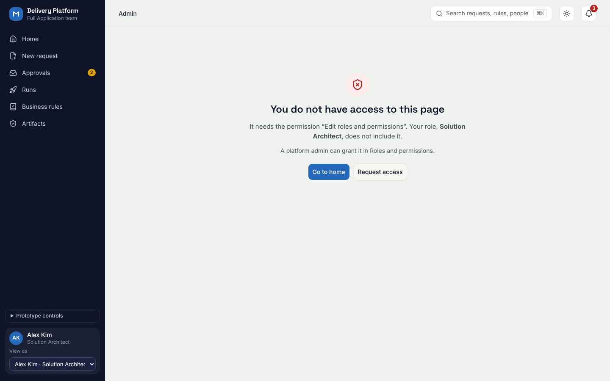

# Step 8 of 31: Access rules, tables, form dialogs and comments

Four small helper files: who may decide a gate, sortable tables with paging, the modal form, and comments/activity.

## What to tell Copilot

Open this file in the editor, then paste this into Copilot Chat (Agent or Edit mode):

```text
Using #file:08-shared-helpers.md, create 4 files exactly as given in the "Files" section: src/v3/gate.jsx, src/v3/table.jsx, src/v3/forms.jsx, src/v3/collab.jsx.
Copy the code character for character. Do not rename, reformat, shorten, "improve" or convert to TypeScript.
Do not leave placeholders such as "// rest of the code". When done, list the files you created with their line counts.
```

## What it should look like

Reference screenshots (1440 × 900):

- `../screens/23-no-access.png`
- `../screens/28-form-dialog.png`



## Files

Create these files with **exactly** this content.

### File: `src/v3/gate.jsx` (51 lines)

`````jsx
// Role-based access for decisions and admin pages.
import { Button } from '@/components/ui/button';
import { Card, Avatar, PEOPLE, Shell } from './ui';
import { useProto, ROLE_OF, PERMS } from './store';
import { Lock, ShieldX } from 'lucide-react';
import { useToast } from '@/components/friendly';

const LABEL = Object.fromEntries(PERMS.flatMap(([, l]) => l));

/* For a gated decision: who holds it, whether it is already decided, and whether the signed-in person may decide. */
export function useGate(id, perm) {
  const { runs, raw, me, can, myRole } = useProto();
  const r = raw[id];
  const decided = r.state !== 'wait';
  const notHolder = r.holder !== me;
  // A named backup approver gets the gate permission for that one work item.
  const noPerm = !can(perm) && !(r.holder === me && r.backupFor);
  return { run: runs[id], raw: r, decided, blocked: !decided && (notHolder || noPerm), notHolder, noPerm, perm, me, myRole };
}

export function NotYours({ g }) {
  const h = g.raw.holder;
  return (
    <Card className="p-5">
      <div className="flex items-center gap-2 text-[var(--v-ink-2)]"><Lock className="size-5" /><b className="text-[var(--v-ink)]">View only</b></div>
      <p className="mt-2 text-[14px] text-[var(--v-ink-2)]">
        {g.noPerm ? <>Your role, <b>{g.myRole}</b>, does not include “{LABEL[g.perm]}”.</> : <>This decision is assigned to someone else.</>}
      </p>
      <div className="mt-3 flex items-center gap-3 rounded-lg bg-[var(--v-sunken)] p-3"><Avatar p={h} size={30} /><div className="text-[13.5px]"><b className="font-medium">{PEOPLE[h]?.name}</b><div className="text-[var(--v-ink-3)]">{ROLE_OF[h] || PEOPLE[h]?.role} · decides this gate</div></div></div>
      <p className="mt-3 text-[13px] text-[var(--v-ink-3)]">You can read everything on this page and leave a comment. Try <b>View as</b> at the bottom of the menu to switch person.</p>
    </Card>
  );
}

/* Wrap an admin page: people without the permission see why, instead of the page. */
export function RequirePerm({ perm, active, crumbs, children }) {
  const { can, myRole } = useProto();
  const toast = useToast();
  if (can(perm)) return children;
  return (
    <Shell active={active} crumbs={crumbs}>
      <div className="mx-auto flex max-w-[560px] flex-col items-center gap-3 py-20 text-center">
        <span className="grid size-14 place-items-center rounded-full bg-[var(--v-red-soft)] text-[var(--v-red)]"><ShieldX className="size-7" /></span>
        <h1 className="font-display text-[24px] font-semibold">You do not have access to this page</h1>
        <p className="text-[15px] text-[var(--v-ink-2)]">It needs the permission “{LABEL[perm]}”. Your role, <b>{myRole}</b>, does not include it.</p>
        <p className="text-[14px] text-[var(--v-ink-3)]">A platform admin can grant it in Roles and permissions.</p>
        <div className="mt-2 flex gap-2"><Button asChild className="h-10 rounded-lg"><a href="#v3-home">Go to home</a></Button><Button variant="outline" className="h-10 rounded-lg" onClick={() => toast('Access request sent to Dana Whitfield.')}>Request access</Button></div>
      </div>
    </Shell>
  );
}
`````

### File: `src/v3/table.jsx` (41 lines)

`````jsx
// Shared table behaviour: sortable headers (with aria-sort), paging and a result count.
import { useMemo, useState, useEffect } from 'react';
import { ChevronUp, ChevronDown, ChevronsUpDown, ChevronLeft, ChevronRight } from 'lucide-react';

export function useTable(rows, { sort: initial = null, dir: initialDir = 'asc', pageSize = 10, getters = {} } = {}) {
  const [sort, setSort] = useState(initial);
  const [dir, setDir] = useState(initialDir);
  const [page, setPage] = useState(0);
  const sorted = useMemo(() => {
    if (!sort) return rows;
    const get = getters[sort] || (r => r[sort]);
    return [...rows].sort((a, b) => { const x = get(a), y = get(b); const c = typeof x === 'number' && typeof y === 'number' ? x - y : String(x).localeCompare(String(y)); return dir === 'asc' ? c : -c; });
  }, [rows, sort, dir, getters]);
  const pages = Math.max(1, Math.ceil(sorted.length / pageSize));
  useEffect(() => { if (page >= pages) setPage(0); }, [pages, page]);
  const view = sorted.slice(page * pageSize, page * pageSize + pageSize);
  const by = key => ({ active: sort === key, dir, onClick: () => { if (sort === key) setDir(d => (d === 'asc' ? 'desc' : 'asc')); else { setSort(key); setDir('asc'); } setPage(0); } });
  return { view, by, page, pages, setPage, total: sorted.length, from: sorted.length ? page * pageSize + 1 : 0, to: Math.min(sorted.length, (page + 1) * pageSize) };
}

export function SortTh({ label, s, className = '' }) {
  const Icon = s.active ? (s.dir === 'asc' ? ChevronUp : ChevronDown) : ChevronsUpDown;
  return (
    <th aria-sort={s.active ? (s.dir === 'asc' ? 'ascending' : 'descending') : 'none'} className={`font-medium ${className}`}>
      <button onClick={s.onClick} className={`-mx-1 inline-flex items-center gap-1 rounded px-1 py-0.5 hover:bg-[var(--v-surface)] hover:text-[var(--v-ink)] ${s.active ? 'text-[var(--v-ink)]' : ''}`}>{label}<Icon className="size-3.5 opacity-70" /></button>
    </th>
  );
}

export function Pager({ t, noun = 'items' }) {
  return (
    <div className="flex items-center gap-3 border-t border-[var(--v-line)] px-5 py-3 text-[13px] text-[var(--v-ink-3)]">
      <span className="tnum">{t.total ? `${t.from}–${t.to} of ${t.total} ${noun}` : `No ${noun}`}</span>
      <div className="ml-auto flex items-center gap-1">
        <button aria-label="Previous page" disabled={t.page === 0} onClick={() => t.setPage(t.page - 1)} className="grid size-8 place-items-center rounded-md border border-[var(--v-line)] bg-[var(--v-surface)] disabled:opacity-40"><ChevronLeft className="size-4" /></button>
        <span className="tnum px-2">Page {t.page + 1} of {t.pages}</span>
        <button aria-label="Next page" disabled={t.page >= t.pages - 1} onClick={() => t.setPage(t.page + 1)} className="grid size-8 place-items-center rounded-md border border-[var(--v-line)] bg-[var(--v-surface)] disabled:opacity-40"><ChevronRight className="size-4" /></button>
      </div>
    </div>
  );
}
`````

### File: `src/v3/forms.jsx` (34 lines)

`````jsx
// Small modal form used by admin and release actions, so every action opens a real form instead of a message.
// Focus moves into the dialog, Tab stays inside it, Esc closes it and focus returns to the button that opened it.
import { useEffect, useRef } from 'react';
import { Button } from '@/components/ui/button';
import { X } from 'lucide-react';

export function FormDialog({ title, sub, submitLabel, disabled, onSubmit, onClose, children, tone }) {
  const box = useRef(null); const back = useRef(document.activeElement);
  useEffect(() => { box.current?.querySelector('input,select,textarea')?.focus(); const b = back.current; return () => setTimeout(() => b?.focus?.(), 0); }, []);
  const keys = e => {
    if (e.key === 'Escape') { e.stopPropagation(); onClose(); }
    if (e.key === 'Tab') { const els = [...box.current.querySelectorAll('button:not([disabled]),input,select,textarea')]; const a = els[0], z = els[els.length - 1]; if (e.shiftKey && document.activeElement === a) { e.preventDefault(); z.focus(); } else if (!e.shiftKey && document.activeElement === z) { e.preventDefault(); a.focus(); } }
  };
  return (
    <div className="fixed inset-0 z-[60] grid place-items-center bg-[#101429]/45 p-6" onMouseDown={e => e.target === e.currentTarget && onClose()}>
      <form ref={box} role="dialog" aria-modal="true" aria-labelledby="fd-t" onKeyDown={keys} onSubmit={e => { e.preventDefault(); if (!disabled) onSubmit(); }} className="w-full max-w-[480px] overflow-hidden rounded-2xl border border-[var(--v-line)] bg-[var(--v-surface)] text-[var(--v-ink)] shadow-2xl">
        <header className="flex items-start gap-3 border-b border-[var(--v-line)] px-6 py-4">
          <div className="min-w-0 flex-1"><h2 id="fd-t" className="text-[17px] font-semibold">{title}</h2>{sub && <p className="mt-0.5 text-[13px] text-[var(--v-ink-3)]">{sub}</p>}</div>
          <button type="button" onClick={onClose} aria-label="Close" className="rounded-md p-1.5 hover:bg-[var(--v-sunken)]"><X className="size-4" /></button>
        </header>
        <div className="flex flex-col gap-4 px-6 py-5 text-[14px]">{children}</div>
        <footer className="flex justify-end gap-2 border-t border-[var(--v-line)] bg-[var(--v-sunken)] px-6 py-3">
          <Button type="button" variant="ghost" className="h-10 rounded-lg" onClick={onClose}>Cancel</Button>
          <Button type="submit" disabled={disabled} variant={tone === 'danger' ? 'destructive' : 'default'} className="h-10 rounded-lg px-5">{submitLabel}</Button>
        </footer>
      </form>
    </div>
  );
}

export const Field = ({ id, label, help, children }) => (
  <div><label htmlFor={id} className="block text-[13.5px] font-medium">{label}</label><div className="mt-1.5">{children}</div>{help && <p id={`${id}-help`} className="mt-1 text-[12.5px] text-[var(--v-ink-3)]">{help}</p>}</div>
);
export const inputCls = 'h-10 w-full rounded-lg border border-[var(--v-line-strong)] bg-[var(--v-surface)] px-3 text-[14px] outline-none focus:border-[var(--v-blue)] focus:ring-4 focus:ring-[var(--v-blue)]/15';
`````

### File: `src/v3/collab.jsx` (44 lines)

`````jsx
// Comments and activity for a work item. Comments are stored with the run and recorded in the audit log.
import { useState } from 'react';
import { Button } from '@/components/ui/button';
import { Card, CardHead, Avatar, PEOPLE } from './ui';
import { useProto } from './store';
import { useToast } from '@/components/friendly';

export const when = iso => { if (!iso) return ''; const d = new Date(iso); const mins = Math.round((Date.now() - d) / 60000); if (mins < 1) return 'just now'; if (mins < 60) return `${mins} min ago`; return d.toLocaleString('en-GB', { day: 'numeric', month: 'short', hour: '2-digit', minute: '2-digit', timeZone: 'UTC' }) + ' UTC'; };
const MENTION = /@(Priya|Alex|Sam|Dana|Jon|Lena|Tom|Mara)\b/g;

export function Comments({ id, title = 'Discussion' }) {
  const { comments, addComment } = useProto();
  const toast = useToast();
  const [text, setText] = useState('');
  const list = comments[id] || [];
  const post = () => { const t = text.trim(); if (!t) return; addComment(id, t); setText(''); const m = [...t.matchAll(MENTION)].map(x => x[1]); toast(m.length ? `Comment posted. ${m.join(', ')} ${m.length > 1 ? 'were' : 'was'} notified.` : 'Comment posted.'); };
  return (
    <Card>
      <CardHead title={title} sub={`${list.length} comment${list.length === 1 ? '' : 's'}`} />
      <ul className="flex flex-col gap-3 px-5">{list.map((c, i) => (
        <li key={i} className="flex gap-3"><Avatar p={c.who} size={28} /><div className="min-w-0 flex-1 rounded-xl rounded-tl-sm bg-[var(--v-sunken)] px-3 py-2 text-[14px]"><b className="font-medium">{PEOPLE[c.who]?.name}</b> <span className="text-[12px] text-[var(--v-ink-3)]">{when(c.at)}</span><p className="whitespace-pre-wrap">{c.text.split(MENTION).map((part, j) => j % 2 ? <span key={j} className="rounded bg-[var(--v-blue-soft)] px-1 font-medium text-[var(--v-blue)]">@{part}</span> : part)}</p></div></li>))}
      </ul>
      <form className="px-5 pt-3 pb-5" onSubmit={e => { e.preventDefault(); post(); }}>
        <label htmlFor={`c-${id}`} className="sr-only">Add a comment</label>
        <textarea id={`c-${id}`} rows={2} value={text} onChange={e => setText(e.target.value)} onKeyDown={e => { if (e.key === 'Enter' && (e.metaKey || e.ctrlKey)) post(); }} placeholder="Add a comment. Type @ and a name to notify someone." className="w-full rounded-lg border border-[var(--v-line)] p-2.5 text-[14px] outline-none focus:border-[var(--v-blue)] focus:ring-4 focus:ring-[var(--v-blue)]/15" />
        <div className="mt-2 flex items-center justify-between"><span className="text-[12px] text-[var(--v-ink-3)]">Ctrl + Enter to post</span><Button type="submit" size="sm" disabled={!text.trim()} className="rounded-lg">Post</Button></div>
      </form>
    </Card>
  );
}

export function Activity({ id }) {
  const { audit, NAME } = useProto();
  const rows = audit.filter(e => e.target.includes(id)).slice(0, 8);
  return (
    <Card>
      <CardHead title="Activity" sub="Everything that happened on this work item" right={<a href="#v3-audit" className="text-[13px] font-medium text-[var(--v-blue)]">Audit log</a>} />
      <ol className="flex flex-col gap-2.5 px-5 pb-5 text-[13.5px]">
        {rows.length ? rows.map((e, i) => <li key={i} className="grid grid-cols-[24px_1fr_auto] items-start gap-2.5">{NAME[e.who] ? <Avatar p={e.who} size={22} /> : <span className="size-[22px] rounded-full bg-[var(--v-sunken)]" />}<span><b className="font-medium">{NAME[e.who] || 'System'}</b> {e.action.charAt(0).toLowerCase() + e.action.slice(1)}</span><span className="text-[12px] text-[var(--v-ink-3)]">{when(e.at)}</span></li>)
          : <li className="text-[var(--v-ink-2)]">No activity recorded yet.</li>}
      </ol>
    </Card>
  );
}
`````

## Check before the next step

- [ ] `gate.jsx` exports `useGate`, `NotYours`, `RequirePerm`.
- [ ] `table.jsx` exports `useTable`, `SortTh`, `Pager`.
- [ ] `forms.jsx` exports `FormDialog`, `Field`, `inputCls`.
- [ ] `collab.jsx` exports `when`, `Comments`, `Activity`.

## Specification

This explains what the code above does, in words. If you later change the screen, keep to these rules.

### 4.11 Data table, SortTh, Pager

- Table in a `Card className="overflow-hidden"`: `w-full text-[13.5px]`, sr-only `<caption>`.
- Header row: `border-b bg-[--v-sunken] text-left text-[12.5px] text-[--v-ink-3]`, cells `font-medium`, first cell `py-2.5 pl-5`, last `pr-5`.
- Body rows: `border-b last:border-0 hover:bg-[--v-sunken]`; cells `py-3`–`py-3.5`; selected row `bg-[--v-blue-soft]`.
- Sub-line under a title: `font-mono text-[12px] text-[--v-ink-3]` ("WI-4821 · Full Application").
- `useTable(rows, { sort, dir, pageSize, getters })` → `{ view, by(key), page, pages, setPage, total, from, to }`; clicking a sorted header toggles asc/desc, a new header sorts asc and resets to page 1; numbers compare numerically, else `localeCompare`.
- `SortTh`: `<th aria-sort="ascending|descending|none">` containing a button `-mx-1 inline-flex items-center gap-1 rounded px-1 py-0.5 hover:bg-surface`; icon ChevronUp / ChevronDown / ChevronsUpDown 14px `opacity-70`.
- `Pager`: `border-t px-5 py-3 text-[13px] text-ink-3`; left "1–8 of 8 runs" (tnum) or "No runs"; right Prev/Next `size-8` bordered icon buttons (`aria-label="Previous page"`, disabled `opacity-40`) around "Page 1 of 1".
- Empty row: one cell `colSpan` all, `px-5 py-12 text-center text-ink-2`: "No runs match these filters. ‹Clear filters›".

### 4.14 FormDialog, Field

```
┌──────────────────────────────────────────────┐
│ Hold this release                        ✕   │ ← header border-b px-6 py-4, title 17px
│ Priya Nair and Mara Lopez are told why…      │   sub 13px ink-3
├──────────────────────────────────────────────┤
│ Why are you holding it?                      │ ← Field label 13.5px medium
│ ┌──────────────────────────────────────────┐ │
│ │ e.g. Pricing team asked to wait…         │ │
│ └──────────────────────────────────────────┘ │
│ At least 10 characters. This goes into…      │ ← help 12.5px ink-3, id="<id>-help"
├──────────────────────────────────────────────┤
│                        Cancel  [Hold release]│ ← footer bg-sunken px-6 py-3
└──────────────────────────────────────────────┘
```
- Scrim `fixed inset-0 z-[60] grid place-items-center bg-[#101429]/45 p-6`; clicking the scrim closes.
- Panel is a `<form role="dialog" aria-modal="true" aria-labelledby="fd-t">`, `w-full max-w-[480px] rounded-2xl border bg-surface shadow-2xl`. Body `flex flex-col gap-4 px-6 py-5 text-[14px]`.
- On open focus the first input; Tab and Shift+Tab cycle inside; Esc closes; on close focus returns to the opener. Enter submits only when not disabled.
- Footer: ghost "Cancel" + submit (`default`, or `destructive` when `tone="danger"`), both `h-10 rounded-lg`.

### 4.21 Comments and Activity

- **Comments** card ("Discussion", "n comment(s)"): each comment = Avatar 28 + bubble `rounded-xl rounded-tl-sm bg-sunken px-3 py-2 text-[14px]` with name, time (`when()`: "just now", "n min ago", or "11 Nov, 09:32 UTC"), text with @mentions highlighted (`rounded bg-blue-soft px-1 font-medium text-blue`). Composer: textarea 2 rows, placeholder "Add a comment. Type @ and a name to notify someone.", hint "Ctrl + Enter to post", [Post] disabled when empty. Mentions recognised: Priya, Alex, Sam, Dana, Jon, Lena, Tom, Mara. Toast: "Comment posted." or "Comment posted. Priya was notified." / "… were notified."
- **Activity** card ("Activity", "Everything that happened on this work item", right ‹Audit log›): up to 8 audit entries whose target contains the run ID, grid `24px 1fr auto`: avatar (or grey dot), "**Name** lower-cased action", time. Empty: "No activity recorded yet."

### 4.22 Gate helpers: NotYours and RequirePerm

- **NotYours** card (decision side panel when the viewer cannot decide): Lock icon + **View only**; text either "Your role, **X**, does not include “<permission label>”." or "This decision is assigned to someone else."; holder box (Avatar 30, name, "<role> · decides this gate"); footnote "You can read everything on this page and leave a comment. Try **View as** at the bottom of the menu to switch person."
- **RequirePerm** page (admin route without permission): centred `max-w-[560px] py-20`, 56px red-soft circle with ShieldX, H1 "You do not have access to this page" (24px display), "It needs the permission “<label>”. Your role, **X**, does not include it.", "A platform admin can grant it in Roles and permissions.", [Go to home] (Request access) → toast "Access request sent to Dana Whitfield."

### 7.7 Who may decide a gate (`useGate(id, perm)`)

- `decided` = run state is not `wait`.
- `blocked` = not decided and (I am not the holder **or** I lack the permission).
- **Named backup exception:** if I am the holder and the run is marked `backupFor`, I may decide without the role permission (Alex approving the Build for WI-4807).
- When blocked, the decision panel is replaced by NotYours (§4.22). The page itself stays readable.
