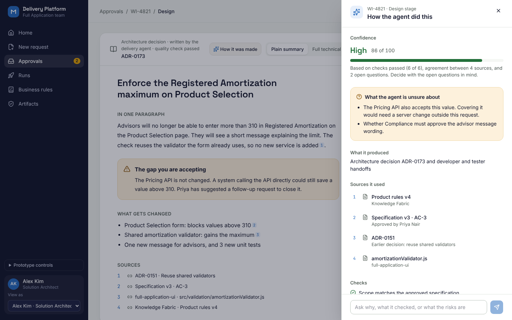

# Step 9 of 31: "How the agent did this" panel

The side sheet that shows confidence, doubts, sources, checks, steps, cost, and lets the reviewer ask the agent a question.

## What to tell Copilot

Open this file in the editor, then paste this into Copilot Chat (Agent or Edit mode):

```text
Using #file:09-agent-panel.md, create the file exactly as given in the "Files" section: src/v3/agentpanel.jsx.
Copy the code character for character. Do not rename, reformat, shorten, "improve" or convert to TypeScript.
Do not leave placeholders such as "// rest of the code". When done, list the files you created with their line counts.
```

## What it should look like

Reference screenshots (1440 × 900):

- `../screens/24-agent-panel.png`



## Files

Create this file with **exactly** this content.

### File: `src/v3/agentpanel.jsx` (82 lines)

`````jsx
// "How the agent did this": one transparency panel for every gate. Shows confidence and why, what the agent is
// unsure about, sources, checks, steps, model and cost, and lets the reviewer ask a question before deciding.
import { useEffect, useRef, useState } from 'react';
import { Button } from '@/components/ui/button';
import { Sparkles, X, CheckCircle2, XCircle, HelpCircle, FileText, Cpu, Clock, Coins, Wrench, Send } from 'lucide-react';

const STAGE_NAMES = ['Plan', 'Specify', 'Impact', 'Design', 'Build', 'Integrate', 'Validate', 'Release'];
const BASE = {
  0: { conf: 82, produced: 'A delivery plan: 1 objective and 2 stories', sources: [['Business request', 'As written by the requester'], ['Product rules v4', 'Knowledge Fabric'], ['Similar past request WI-4511', 'Released Mar 2026']], checks: [['Every story traces to the request', true], ['No scope beyond the request', true], ['Dependencies resolved', true]], unsure: ['Whether renewals are in scope; the request does not say.'], steps: [['Read the request and product rules', '1m 05s'], ['Drafted objective and stories', '2m 10s'], ['Checked traceability', '40s']], tokens: 3120, cost: 0.09, mins: '4 min' },
  1: { conf: 74, produced: 'A specification with 8 acceptance criteria', sources: [['Approved plan', 'Plan stage'], ['Statement layout guide', 'Knowledge Fabric'], ['Bank reconciliation interface', 'Integration catalogue']], checks: [['Each criterion is testable', true], ['Criteria match the plan', true], ['Open questions resolved', false]], unsure: ['The column order differs between two documents, so it asked you.', 'Whether closed accounts belong in the export.'], steps: [['Read plan and layout guide', '1m 30s'], ['Found 2 conflicting rules', '50s'], ['Prepared questions with a suggestion each', '1m 10s']], tokens: 4410, cost: 0.13, mins: '4 min' },
  2: { conf: 88, produced: 'An impact assessment: 4 components across 2 repositories', sources: [['Approved specification', 'Specify stage'], ['Repository map', 'Azure Repos'], ['Service dependency graph', 'Knowledge Fabric']], checks: [['Every acceptance criterion maps to a component', true], ['Callers of changed code found', true], ['Other applications checked', true]], unsure: ['Whether batch import shares the same validator.'], steps: [['Searched repositories for affected code', '2m 40s'], ['Traced callers and dependencies', '1m 50s'], ['Wrote the assessment', '1m 10s']], tokens: 5300, cost: 0.16, mins: '6 min' },
  5: { conf: 90, produced: 'Integration evidence: 3 pipeline runs on the merge commit', sources: [['Approved pull request', 'Azure Repos'], ['Pipeline definitions', 'Azure DevOps'], ['Contract test suite', 'Dependent services']], checks: [['Build and unit tests on the merge commit', true], ['Deployed to staging', true], ['Contract tests with dependent services', true]], unsure: ['Staging data is 2 days old, so one contract test ran against older fixtures.'], steps: [['Merged to the integration branch', '40s'], ['Ran 3 pipelines', '13m 00s'], ['Collected results and logs', '50s']], tokens: 1900, cost: 0.06, mins: '15 min' },
  3: { conf: 86, produced: 'Architecture decision ADR-0173 and developer and tester handoffs', sources: [['Product rules v4', 'Knowledge Fabric'], ['Specification v3 · AC-3', 'Approved by Priya Nair'], ['ADR-0151', 'Earlier decision: reuse shared validators'], ['amortizationValidator.js', 'full-application-ui']], checks: [['Scope matches the approved specification', true], ['Follows an approved pattern', true], ['Every decision cites a criterion', true], ['Facts checked against the sources', true], ['Developer and tester handoffs complete', true], ['AC-3 reference present (fixed by the agent)', true]], unsure: ['The Pricing API also accepts this value. Covering it would need a server change outside this request.', 'Whether Compliance must approve the advisor message wording.'], steps: [['Searched rules and earlier decisions', '3m 12s'], ['Checked the facts', '1m 24s'], ['Wrote the decision record', '4m 30s'], ['Found and fixed a missing AC-3 reference', '3m 06s'], ['Saved the evidence', '54s']], tokens: 6410, cost: 0.21, mins: '13 min 48 s', fixes: 1 },
  4: { conf: 91, produced: '4 changed files and 6 unit tests', sources: [['Approved design', 'Design stage'], ['Developer handoff', 'From the design'], ['Repository baseline', 'Build green before the change']], checks: [['6 of 6 unit tests pass', true], ['Only files named in the design changed', true], ['Lint and formatting', true], ['Screen reader announcement', true]], unsure: ['The banner copy is a draft until Compliance reviews it.'], steps: [['Mapped the design to files', '2m 20s'], ['Wrote the change', '6m 40s'], ['Wrote and ran unit tests', '4m 05s'], ['Opened pull request #214', '30s']], tokens: 9820, cost: 0.34, mins: '14 min' },
  6: { conf: 58, produced: 'A validation report', sources: [['Specification v2 · AC-1', '15-minute timeout'], ['Regression suite', '214 tests']], checks: [['212 of 214 regression tests pass', false], ['Acceptance criteria met', true]], unsure: ['Two tests still expect the old 20-minute timeout. The agent thinks the tests are out of date, not the code.'], steps: [['Ran regression tests', '9m 10s'], ['Retried twice', '14m 30s'], ['Stopped and asked for help', '10s']], tokens: 5200, cost: 0.18, mins: '24 min' },
  7: { conf: 93, produced: 'Release notes, rollback plan and deployment checklist', sources: [['Validation report', 'All criteria met'], ['UAT sign-off', 'Priya Nair'], ['Change ticket CHG0041872', 'ServiceNow']], checks: [['Validation and UAT complete', true], ['Window free of freezes', true], ['Rollback tested in staging', true]], unsure: ['Applications started before release keep the old fees; advisors may ask about this.'], steps: [['Collected evidence from earlier stages', '1m 10s'], ['Drafted release notes', '1m 40s'], ['Prepared rollback plan', '1m 05s']], tokens: 2950, cost: 0.08, mins: '4 min' },
};
const ANSWERS = [
  [/risk|gap|api|server/i, 'The main risk is the Pricing API. It accepts any value, so a system calling it directly could save more than 310. I left it out because the request named only the Product Selection page; I recommend a follow-up request for the API.'],
  [/source|evidence|where/i, 'Each statement in the document is numbered to its source. The maximum of 310 comes from Product rules v4 in the Knowledge Fabric; the reuse pattern comes from ADR-0151.'],
  [/confiden|sure|why/i, 'Confidence is based on how many checks passed, how well the sources agree, and whether I had to guess. One check did not pass (server-side impact), which is why it is not higher.'],
];
const answer = q => (ANSWERS.find(([re]) => re.test(q)) || [null, 'I have added your question to the discussion and flagged the stage owner. If it changes the decision, send the document back with your question as the note.'])[1];

export function AgentPanelButton({ stage, run, label = 'How the agent did this' }) {
  const [open, setOpen] = useState(false);
  const btn = useRef(null);
  return (<>
    <Button ref={btn} variant="outline" size="sm" className="h-9 rounded-lg" onClick={() => setOpen(true)} aria-haspopup="dialog"><Sparkles className="size-4 text-[var(--v-blue)]" />{label}</Button>
    {open && <AgentPanel stage={stage} run={run} onClose={() => { setOpen(false); setTimeout(() => btn.current?.focus(), 0); }} />}
  </>);
}

function AgentPanel({ stage, run, onClose }) {
  const d = BASE[stage] || BASE[3];
  const close = useRef(null);
  const [q, setQ] = useState(''); const [qa, setQa] = useState([]);
  useEffect(() => { close.current?.focus(); }, []);
  const tone = d.conf >= 80 ? ['High', 'var(--v-green)'] : d.conf >= 65 ? ['Medium', 'var(--v-amber)'] : ['Low', 'var(--v-red)'];
  const ask = () => { const t = q.trim(); if (!t) return; setQa(x => [...x, [t, answer(t)]]); setQ(''); };
  return (
    <div className="fixed inset-0 z-50 flex justify-end bg-[#101429]/35" onMouseDown={e => e.target === e.currentTarget && onClose()}>
      <aside role="dialog" aria-modal="true" aria-labelledby="ap-t" onKeyDown={e => e.key === 'Escape' && onClose()} className="flex h-full w-full max-w-[480px] flex-col overflow-hidden border-l border-[var(--v-line)] bg-[var(--v-surface)] text-[var(--v-ink)] shadow-2xl">
        <header className="flex items-start gap-3 border-b border-[var(--v-line)] px-6 py-4">
          <span className="grid size-9 shrink-0 place-items-center rounded-lg bg-[var(--v-blue-soft)] text-[var(--v-blue)]"><Sparkles className="size-5" /></span>
          <div className="min-w-0 flex-1"><div className="text-[12.5px] text-[var(--v-ink-3)]">{run} · {STAGE_NAMES[stage] || 'Design'} stage</div><h2 id="ap-t" className="text-[17px] font-semibold">How the agent did this</h2></div>
          <button ref={close} onClick={onClose} aria-label="Close" className="rounded-md p-1.5 hover:bg-[var(--v-sunken)]"><X className="size-4" /></button>
        </header>
        <div className="flex-1 space-y-6 overflow-y-auto px-6 py-5 text-[14px]">
          <section aria-labelledby="ap-c">
            <h3 id="ap-c" className="text-[13px] font-semibold text-[var(--v-ink-3)]">Confidence</h3>
            <div className="mt-2 flex items-center gap-3"><b className="font-display text-[22px]" style={{ color: tone[1] }}>{tone[0]}</b><span className="tnum text-[var(--v-ink-2)]">{d.conf} of 100</span></div>
            <div className="mt-2 h-2 rounded-full bg-[var(--v-sunken)]" role="img" aria-label={`Confidence ${d.conf} out of 100`}><div className="h-2 rounded-full" style={{ width: `${d.conf}%`, background: tone[1] }} /></div>
            <p className="mt-2 text-[13px] text-[var(--v-ink-2)]">Based on checks passed ({d.checks.filter(c => c[1]).length} of {d.checks.length}), agreement between {d.sources.length} sources, and {d.unsure.length} open question{d.unsure.length === 1 ? '' : 's'}. Decide with the open questions in mind.</p>
          </section>
          <section aria-labelledby="ap-u" className="rounded-xl border border-[var(--v-amber-line)] bg-[var(--v-amber-soft)] p-4">
            <h3 id="ap-u" className="flex items-center gap-2 font-semibold"><HelpCircle className="size-4 text-[var(--v-amber)]" />What the agent is unsure about</h3>
            <ul className="mt-2 list-disc space-y-1 pl-5">{d.unsure.map(u => <li key={u}>{u}</li>)}</ul>
          </section>
          <section aria-labelledby="ap-p"><h3 id="ap-p" className="text-[13px] font-semibold text-[var(--v-ink-3)]">What it produced</h3><p className="mt-1">{d.produced}</p></section>
          <section aria-labelledby="ap-s"><h3 id="ap-s" className="text-[13px] font-semibold text-[var(--v-ink-3)]">Sources it used</h3>
            <ol className="mt-2 flex flex-col gap-1.5">{d.sources.map(([a, b], i) => <li key={a}><a href="#v3-artifacts" className="flex items-start gap-2.5 rounded-lg px-2 py-1.5 hover:bg-[var(--v-sunken)]"><span className="mt-0.5 w-4 font-mono text-[12px] text-[var(--v-blue)]">{i + 1}</span><FileText className="mt-0.5 size-4 text-[var(--v-ink-3)]" /><span><b className="font-medium">{a}</b><span className="block text-[12.5px] text-[var(--v-ink-3)]">{b}</span></span></a></li>)}</ol></section>
          <section aria-labelledby="ap-k"><h3 id="ap-k" className="text-[13px] font-semibold text-[var(--v-ink-3)]">Checks</h3>
            <ul className="mt-2 flex flex-col gap-1.5">{d.checks.map(([c, okk]) => <li key={c} className="flex items-start gap-2">{okk ? <CheckCircle2 className="mt-0.5 size-4 shrink-0 text-[var(--v-green)]" /> : <XCircle className="mt-0.5 size-4 shrink-0 text-[var(--v-red)]" />}<span>{c}<span className="sr-only">{okk ? ': passed' : ': not passed'}</span></span></li>)}</ul></section>
          <section aria-labelledby="ap-st"><h3 id="ap-st" className="text-[13px] font-semibold text-[var(--v-ink-3)]">Steps</h3>
            <ol className="mt-2 flex flex-col gap-1.5">{d.steps.map(([s, t]) => <li key={s} className="flex justify-between gap-3"><span className="flex items-center gap-2">{/fix/i.test(s) && <Wrench className="size-3.5 text-[var(--v-amber)]" />}{s}</span><span className="tnum shrink-0 text-[var(--v-ink-3)]">{t}</span></li>)}</ol>
            {stage === 3 && run === 'WI-4821' && <a href="#v3-evidence" className="mt-2 inline-block text-[13px] font-medium text-[var(--v-blue)]">Open the full trace</a>}</section>
          <section aria-labelledby="ap-m" className="grid grid-cols-2 gap-2 text-[13px]">
            <h3 id="ap-m" className="sr-only">Model and cost</h3>
            {[[Cpu, 'Model', 'GPT-5.4'], [Clock, 'Time', d.mins], [Coins, 'Cost', `$${d.cost.toFixed(2)} · ${d.tokens.toLocaleString('en-US')} tokens`], [Wrench, 'Self-corrections', String(d.fixes || 0)]].map(([I, k, v]) => <div key={k} className="rounded-lg bg-[var(--v-sunken)] px-3 py-2"><div className="flex items-center gap-1.5 text-[var(--v-ink-3)]"><I className="size-3.5" />{k}</div><div className="mt-0.5 font-medium">{v}</div></div>)}
          </section>
          {qa.length > 0 && <section aria-label="Questions to the agent" aria-live="polite" className="flex flex-col gap-3">{qa.map(([a, b], i) => <div key={i} className="flex flex-col gap-1.5"><p className="self-end rounded-xl rounded-tr-sm bg-[var(--v-blue-soft)] px-3 py-2">{a}</p><p className="rounded-xl rounded-tl-sm bg-[var(--v-sunken)] px-3 py-2"><b className="font-medium">Agent:</b> {b}</p></div>)}</section>}
        </div>
        <form onSubmit={e => { e.preventDefault(); ask(); }} className="flex items-end gap-2 border-t border-[var(--v-line)] px-6 py-4">
          <label htmlFor="ap-q" className="sr-only">Ask the agent about this stage</label>
          <textarea id="ap-q" rows={1} value={q} onChange={e => setQ(e.target.value)} onKeyDown={e => { if (e.key === 'Enter' && !e.shiftKey) { e.preventDefault(); ask(); } }} placeholder="Ask why, what it checked, or what the risks are" className="min-h-10 flex-1 resize-none rounded-lg border border-[var(--v-line-strong)] bg-[var(--v-surface)] px-3 py-2 text-[14px] outline-none focus:border-[var(--v-blue)] focus:ring-4 focus:ring-[var(--v-blue)]/15" />
          <Button type="submit" disabled={!q.trim()} className="h-10 rounded-lg" aria-label="Ask"><Send className="size-4" /></Button>
        </form>
      </aside>
    </div>
  );
}
`````

## Check before the next step

- [ ] Exports `AgentPanelButton`.
- [ ] Content exists for all 8 stages (0 to 7).

## Specification

This explains what the code above does, in words. If you later change the screen, keep to these rules.

### 4.18 Agent panel ("How the agent did this")

Trigger `AgentPanelButton({ stage, run, label })`: outline `h-9 rounded-lg`, Sparkles icon in blue, default label "How the agent did this" (Approve uses "How it was made"). `aria-haspopup="dialog"`.

```
                                   ┌───────────────────────────────────────┐
                                   │ ✦  WI-4821 · Design stage          ✕ │
                                   │    How the agent did this             │
                                   ├───────────────────────────────────────┤
                                   │ Confidence                            │
                                   │ High   86 of 100                      │
                                   │ ███████████████████████░░░░            │
                                   │ Based on checks passed (6 of 6), …    │
                                   │ ┌ What the agent is unsure about ───┐ │ amber box
                                   │ │ • The Pricing API also accepts…   │ │
                                   │ └───────────────────────────────────┘ │
                                   │ What it produced                      │
                                   │ Sources it used  1 ▤ Product rules v4 │
                                   │ Checks  ✓ … / ✗ …                     │
                                   │ Steps   🔧 Found and fixed…   3m 06s  │
                                   │ ┌Model GPT-5.4┐┌Time 13 min 48 s┐     │
                                   │ ┌Cost $0.21 · 6,410 tokens┐┌Self-corrections 1┐
                                   │ (Q&A bubbles)                          │
                                   ├───────────────────────────────────────┤
                                   │ [Ask why, what it checked, or …] [➤]  │
                                   └───────────────────────────────────────┘
```
- Right-side sheet: scrim `fixed inset-0 z-50 flex justify-end bg-[#101429]/35`; panel `<aside role="dialog" aria-modal aria-labelledby="ap-t">` `h-full w-full max-w-[480px] border-l bg-surface shadow-2xl`. Focus starts on ✕; Esc and scrim close and return focus to the trigger.
- Confidence word and bar colour: ≥ 80 **High** green, ≥ 65 **Medium** amber, else **Low** red. Bar `h-2 rounded-full`, `role="img" aria-label="Confidence 86 out of 100"`.
- Explanation: "Based on checks passed (n of m), agreement between k sources, and u open question(s). Decide with the open questions in mind."
- Checks: CheckCircle2 green or XCircle red, plus sr-only ": passed" / ": not passed". Steps whose text contains "fix" get a Wrench icon in amber. For WI-4821 Design add ‹Open the full trace› → `#v3-evidence`.
- Metric tiles `grid grid-cols-2 gap-2`, each `rounded-lg bg-sunken px-3 py-2` with icon (Cpu, Clock, Coins, Wrench).
- Ask box: textarea 1 row, Enter sends, Shift+Enter newline; send button icon-only `aria-label="Ask"`, disabled when empty. Answers appear as chat bubbles (question right, blue-soft; answer left, sunken, prefixed **Agent:**) in an `aria-live="polite"` section. Canned answers by keyword: risk/gap/api/server, source/evidence/where, confiden/sure/why; otherwise "I have added your question to the discussion and flagged the stage owner…".
- Per-stage content is in §9.6.

### 9.6 Agent panel content per stage

| Stage | Confidence | Produced | Unsure about | Time · cost · tokens |
|---|---|---|---|---|
| 0 Plan | 82 | A delivery plan: 1 objective and 2 stories | Whether renewals are in scope; the request does not say. | 4 min · $0.09 · 3,120 |
| 1 Specify | 74 | A specification with 8 acceptance criteria | The column order differs between two documents, so it asked you. / Whether closed accounts belong in the export. | 4 min · $0.13 · 4,410 |
| 2 Impact | 88 | An impact assessment: 4 components across 2 repositories | Whether batch import shares the same validator. | 6 min · $0.16 · 5,300 |
| 3 Design | 86 | Architecture decision ADR-0173 and developer and tester handoffs | The Pricing API also accepts this value… / Whether Compliance must approve the advisor message wording. | 13 min 48 s · $0.21 · 6,410 · 1 self-correction |
| 4 Build | 91 | 4 changed files and 6 unit tests | The banner copy is a draft until Compliance reviews it. | 14 min · $0.34 · 9,820 |
| 5 Integrate | 90 | Integration evidence: 3 pipeline runs on the merge commit | Staging data is 2 days old, so one contract test ran against older fixtures. | 15 min · $0.06 · 1,900 |
| 6 Validate | 58 (Low) | A validation report | Two tests still expect the old 20-minute timeout… | 24 min · $0.18 · 5,200 |
| 7 Release | 93 | Release notes, rollback plan and deployment checklist | Applications started before release keep the old fees… | 4 min · $0.08 · 2,950 |

Each stage also lists 2–4 sources, 2–6 checks (pass/fail) and 3–5 timed steps (full text in `agentpanel.jsx BASE`). Model for every stage: GPT-5.4.
