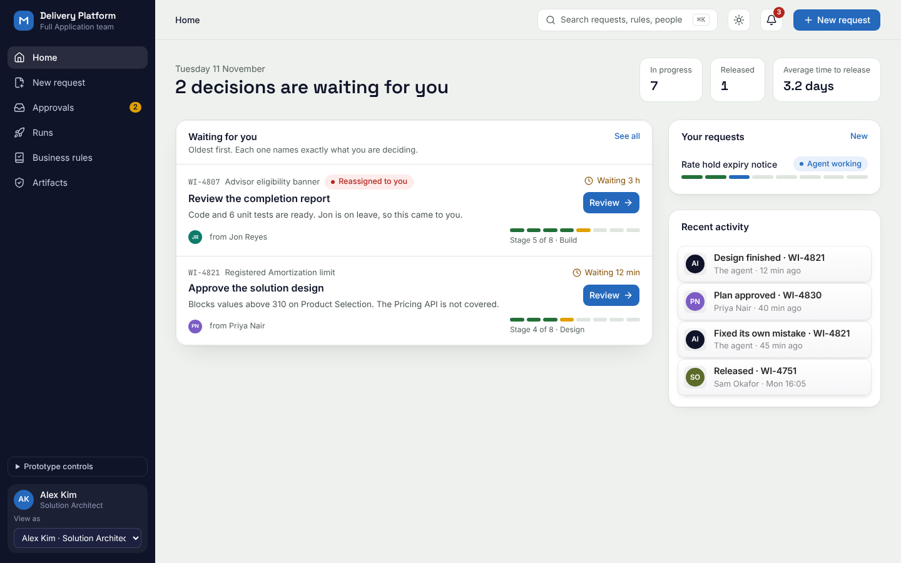

# Step 11 of 31: Screen 1: Home

What is waiting for the signed-in person, their requests and recent activity.

## What to tell Copilot

Open this file in the editor, then paste this into Copilot Chat (Agent or Edit mode):

```text
Using #file:11-screen-home.md, create the file exactly as given in the "Files" section: src/v3/Home.jsx.
Copy the code character for character. Do not rename, reformat, shorten, "improve" or convert to TypeScript.
Do not leave placeholders such as "// rest of the code". When done, list the files you created with their line counts.
```

## What it should look like

Reference screenshots (1440 × 900):

- `../screens/01-home.png`
- `../screens/29-home-dark.png`



## Files

Create this file with **exactly** this content.

### File: `src/v3/Home.jsx` (79 lines)

`````jsx
import { Button } from '@/components/ui/button';
import SplitText from '@/components/SplitText';
import AnimatedList from '@/components/AnimatedList';
import SpotlightCard from '@/components/SpotlightCard';
import { Shell, Card, CardHead, Pill, Avatar, Stepper, PEOPLE } from './ui';
import { useProto, runHref } from './store';
import { useTheme } from './theme';
import { Clock, ArrowRight, Plus, PartyPopper } from 'lucide-react';

export default function V3Home() {
  const { mine, list, feed, me, can, attention, myRole, kpi } = useProto();
  const isAdmin = can('squads.manage');
  const { resolved } = useTheme();
  const myRequests = list.filter(r => r.by === me).slice(0, 4);
  const inProgress = list.filter(r => r.state !== 'done').length;
  const heading = mine.length ? `${mine.length} ${mine.length === 1 ? 'decision is' : 'decisions are'} waiting for you` : 'You are all caught up';
  return (
    <Shell active="home" crumbs={['Home']} actions={<Button asChild className="h-9 rounded-lg px-4"><a href="#v3-new"><Plus className="size-4" />New request</a></Button>}>
      <div className="mx-auto flex max-w-[1180px] flex-col gap-7">
        <div className="flex flex-wrap items-end gap-6">
          <div className="min-w-0 flex-1">
            <p className="text-[14px] text-[var(--v-ink-3)]">Tuesday 11 November</p>
            <SplitText key={heading} text={heading} tag="h1" splitType="words" effect="fade" delay={45} duration={0.5} textAlign="left" trigger="load" className="font-display text-[30px] font-semibold leading-tight" />
          </div>
          <div className="flex gap-3">
            {[['In progress', kpi.inProgress, 'Work items that are not yet released', '#v3-runs'], ['Released', kpi.released, 'Work items released or scheduled for release', '#v3-runs'], ['Average time to release', '3.2 days', 'From request to release, last 30 days', '#v3-admin']].map(([l, v, tip, href]) => (
              <a key={l} href={href} title={tip} className="rounded-xl border border-[var(--v-line)] bg-[var(--v-surface)] px-4 py-2.5 hover:border-[var(--v-line-strong)]"><span className="block text-[12.5px] text-[var(--v-ink-3)]">{l}</span><span className="tnum block font-display text-[20px] font-semibold">{v}</span></a>))}
          </div>
        </div>

        <div className="grid grid-cols-[minmax(0,1fr)_340px] items-start gap-6">
          <SpotlightCard theme={resolved} spotlightColor={resolved === 'dark' ? 'rgba(122,167,255,0.14)' : 'rgba(36,105,188,0.18)'} intensity={0.12} spotlightSize={420} borderGlow={0.35} flare={false} className="!rounded-2xl !border !border-[var(--v-line)] !bg-[var(--v-surface)] !p-0 shadow-[0_1px_2px_rgba(16,20,41,.04),0_8px_24px_-12px_rgba(16,20,41,.10)]">
            <CardHead title="Waiting for you" sub="Oldest first. Each one names exactly what you are deciding." right={mine.length > 0 && <a href="#v3-approvals" className="text-[13px] font-medium text-[var(--v-blue)]">See all</a>} />
            {mine.length ? (
              <ul className="divide-y divide-[var(--v-line)] border-t border-[var(--v-line)]">
                {mine.map(w => (
                  <li key={w.id} className="group grid grid-cols-[minmax(0,1fr)_auto] gap-x-6 gap-y-3 px-5 py-4 hover:bg-[var(--v-sunken)]">
                    <div className="min-w-0">
                      <div className="flex flex-wrap items-center gap-2"><a href={runHref(w.id)} className="font-mono text-[12px] text-[var(--v-ink-3)] hover:underline">{w.id}</a><span className="text-[13px] text-[var(--v-ink-3)]">{w.t}</span>{w.reassigned && <Pill tone="bad">Reassigned to you</Pill>}</div>
                      <a href={w.screen || runHref(w.id)} className="mt-0.5 block text-[16px] font-semibold hover:text-[var(--v-blue)]">{w.ask}</a>
                      <p className="mt-1 max-w-[62ch] text-[13.5px] text-[var(--v-ink-2)]">{w.why}</p>
                    </div>
                    <div className="flex flex-col items-end gap-2">
                      <span className="flex items-center gap-1.5 text-[13px] text-[var(--v-amber)]"><Clock className="size-3.5" />Waiting {w.wait}</span>
                      <Button asChild className="h-9 rounded-lg"><a href={w.screen || runHref(w.id)}>Review<ArrowRight className="size-4" /></a></Button>
                    </div>
                    <div className="col-span-2 flex items-center gap-3"><Avatar p={w.by} size={22} /><span className="text-[12.5px] text-[var(--v-ink-3)]">from {PEOPLE[w.by].name}</span><div className="ml-auto w-52"><Stepper s={w.s} compact label /></div></div>
                  </li>))}
              </ul>
            ) : (
              <div className="flex flex-col items-center gap-2 border-t border-[var(--v-line)] px-5 py-12 text-center">
                <PartyPopper className="size-8 text-[var(--v-green)]" />
                <b className="text-[16px]">Nothing is waiting for you</b>
                <p className="max-w-[44ch] text-[14px] text-[var(--v-ink-2)]">The agent is carrying on with the work you approved. You will be notified when the next decision needs you.</p>
                <Button asChild variant="outline" className="mt-2 h-9 rounded-lg"><a href="#v3-runs">See all runs</a></Button>
              </div>
            )}
          </SpotlightCard>

          <div className="flex flex-col gap-6">
            {isAdmin && <Card className="overflow-hidden"><div className={`px-5 py-4 ${attention.length ? 'bg-[var(--v-red-soft)]' : 'bg-[var(--v-green-soft)]'}`}><div className="text-[12.5px] font-medium text-[var(--v-ink-2)]">{myRole}</div><b className="text-[16px]">{attention.length ? `${attention.length} problems need an admin` : 'No problems need an admin'}</b><p className="mt-1 text-[13.5px] text-[var(--v-ink-2)]">Approvers on leave, stuck agents, freezes and incomplete squads.</p><Button asChild size="sm" className="mt-3 rounded-lg"><a href="#v3-admin">Open governance</a></Button></div></Card>}
            <Card>
              <CardHead title="Your requests" right={<a href="#v3-new" className="text-[13px] font-medium text-[var(--v-blue)]">New</a>} />
              <ul className="flex flex-col gap-1 px-3 pb-4">
                {!myRequests.length && <li className="px-2 py-2 text-[13.5px] text-[var(--v-ink-2)]">You have not started any requests. <a href="#v3-new" className="font-medium text-[var(--v-blue)]">Start one</a></li>}
                {myRequests.map(r => <li key={r.id}><a href={runHref(r.id)} className="flex flex-col gap-1.5 rounded-lg px-2 py-2 hover:bg-[var(--v-sunken)]"><div className="flex items-center justify-between gap-2"><span className="truncate font-medium">{r.t}</span><Pill tone={r.state}>{r.state === 'done' ? 'Released' : r.state === 'bad' ? 'Needs attention' : r.state === 'work' ? 'Agent working' : 'Waiting'}</Pill></div><Stepper s={r.s} compact /></a></li>)}
              </ul>
            </Card>
            <Card>
              <CardHead title="Recent activity" />
              <div className="px-2 pb-3"><AnimatedList key={feed.length} ariaLabel="Recent activity" onItemSelect={item => { const id = /WI-\d+/.exec(item.title)?.[0]; if (id) location.hash = `v3-run-${id.toLowerCase()}`; }} theme={resolved} frame={false} showGradients={false} displayScrollbar={false} selectOnHover={false} enableArrowNavigation={false} animateOnce width="100%" maxHeight={400} gap={2} radius={10} accentColor="#2469bc"
                items={feed.slice(0, 5).map(f => ({ icon: <Avatar p={f.p} size={30} />, title: f.title, description: `${f.who} · ${f.t}` }))} /></div>
            </Card>
          </div>
        </div>
      </div>
    </Shell>
  );
}
`````

## Check

Home cannot be opened yet: the router arrives in the next step, and the check for Home is there.

## Specification

This explains what the code above does, in words. If you later change the screen, keep to these rules.

### 6.1 Home (`#v3-home`)

**Purpose.** Answer "what needs me?" in one look. **Top-bar action:** [+ New request] (`h-9 px-4`, → `#v3-new`).

```
Tuesday 11 November                                   ┌In progress┐┌Released┐┌Average time to release┐
1 decision is waiting for you                         │    7      ││   1    ││       3.2 days        │
                                                      └───────────┘└────────┘└───────────────────────┘
┌ Waiting for you ─────────────────────── ‹See all› ┐  ┌ Solution Architect ──────────────┐ (admins only,
│ Oldest first. Each one names exactly what you…     │  │ 4 problems need an admin          │  red-soft or
├────────────────────────────────────────────────────┤  │ Approvers on leave, stuck agents… │  green-soft)
│ WI-4807 Advisor eligibility banner ●Reassigned to you │ [Open governance]                │
│ Review the completion report           ⏱ Waiting 3 h │ └──────────────────────────────────┘
│ Code and 6 unit tests are ready. Jon…    [Review →]│  ┌ Your requests ────────── ‹New› ┐
│ PN from Priya Nair            ▮▮▮▮▮▯▯▯ Stage 5 of 8 │  │ Rate hold expiry notice ●Agent… │
├────────────────────────────────────────────────────┤  │ ▮▮▮▯▯▯▯▯                         │
│ WI-4821 Registered Amortization limit              │  └─────────────────────────────────┘
│ Approve the solution design            ⏱ Waiting 12 min┌ Recent activity ────────────────┐
│ …                                        [Review →]│  │ AI Design finished · WI-4821     │
└────────────────────────────────────────────────────┘  │    The agent · 12 min ago        │
                     minmax(0,1fr)                       └─────────────── 340px ───────────┘
```

- Header: date line 14px ink-3 ("Tuesday 11 November"), animated H1 30px. H1 text: "n decision(s) is/are waiting for you" or "You are all caught up".
- KPI chips: **In progress** (runs not done; tooltip "Work items that are not yet released"; → Runs), **Released** (done runs; → Runs), **Average time to release** "3.2 days" ("From request to release, last 30 days"; → Governance).
- **Waiting for you** (SpotlightCard): sub "Oldest first. Each one names exactly what you are deciding."; right ‹See all› (only if any). Each row: mono run ID link + title 13px + optional red Pill "Reassigned to you"; the **ask** as a 16px semibold link to the gate screen; the **why** 13.5px (max 62ch); right column "⏱ Waiting <time>" amber + [Review →]; bottom line Avatar 22 "from <requester>" + compact labelled stepper `w-52`. Sorted by waiting time, oldest first.
- Empty state: PartyPopper green 32px, "Nothing is waiting for you", "The agent is carrying on with the work you approved. You will be notified when the next decision needs you.", (See all runs).
- Admin card (only with `squads.manage`): role label, "**n problems need an admin**" (red-soft) or "No problems need an admin" (green-soft), "Approvers on leave, stuck agents, freezes and incomplete squads.", [Open governance].
- **Your requests**: up to 4 runs requested by me; each row title + Pill (Released / Needs attention / Agent working / Waiting) + compact stepper. Empty: "You have not started any requests. ‹Start one›".
- **Recent activity**: the 5 newest feed items, Avatar 30 + title + "who · time"; selecting an item that contains a WI number opens that run.
