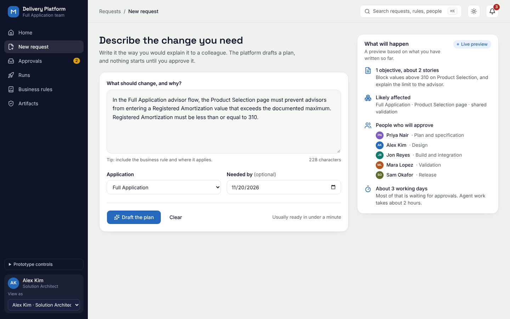

# Step 13 of 31: Screen 2: New request

Describe a change in plain words and preview what will happen.

## What to tell Copilot

Open this file in the editor, then paste this into Copilot Chat (Agent or Edit mode):

```text
Using #file:13-screen-new-request.md, create the file exactly as given in the "Files" section: src/v3/NewRequest.jsx.
Copy the code character for character. Do not rename, reformat, shorten, "improve" or convert to TypeScript.
Do not leave placeholders such as "// rest of the code". When done, list the files you created with their line counts.
Then add the route for this screen in src/App.jsx as described under "Wire it into the router".
```

## What it should look like

Reference screenshots (1440 × 900):

- `../screens/02-new-request.png`



## Files

Create this file with **exactly** this content.

### File: `src/v3/NewRequest.jsx` (51 lines)

`````jsx
import { useState } from 'react';
import { Button } from '@/components/ui/button';
import { Shell, Card, CardHead, Avatar, Pill } from './ui';
import { Sparkles, FileText, Users, Timer, Boxes } from 'lucide-react';
import { useToast } from '@/components/friendly';
import { useProto, runHref } from './store';

const EXAMPLE = 'In the Full Application advisor flow, the Product Selection page must prevent advisors from entering a Registered Amortization value that exceeds the documented maximum. Registered Amortization must be less than or equal to 310.';
export default function V3New() {
  const toast = useToast();
  const { createRequest, nextId } = useProto();
  const [text, setText] = useState(EXAMPLE);
  const [app, setApp] = useState('Full Application');
  const ok = text.trim().length > 40;
  return (
    <Shell active="new" crumbs={['Requests', 'New request']}>
      <div className="mx-auto grid max-w-[1180px] grid-cols-[minmax(0,1fr)_400px] items-start gap-6">
        <div className="flex flex-col gap-5">
          <div><h1 className="font-display text-[28px] font-semibold">Describe the change you need</h1><p className="mt-1 max-w-[60ch] text-[15px] text-[var(--v-ink-2)]">Write it the way you would explain it to a colleague. The platform drafts a plan, and nothing starts until you approve it.</p></div>
          <Card className="p-5">
            <label htmlFor="req" className="text-[14px] font-semibold">What should change, and why?</label>
            <textarea id="req" value={text} onChange={e => setText(e.target.value)} rows={6} className="mt-2 w-full resize-y rounded-xl border border-[var(--v-line)] bg-[var(--v-sunken)] p-4 text-[15px] leading-relaxed outline-none focus:border-[var(--v-blue)] focus:bg-[var(--v-surface)] focus:ring-4 focus:ring-[var(--v-blue)]/15" />
            <div className="mt-1 flex justify-between text-[12.5px] text-[var(--v-ink-3)]"><span>Tip: include the business rule and where it applies.</span><span className="tnum">{text.length} characters</span></div>
            <div className="mt-5 grid grid-cols-2 gap-4">
              <label className="flex flex-col gap-1.5 text-[14px] font-semibold" htmlFor="app">Application
                <select id="app" value={app} onChange={e => setApp(e.target.value)} className="h-10 rounded-lg border border-[var(--v-line)] bg-[var(--v-surface)] px-3 font-normal"><option>Full Application</option><option>Advisor Portal</option><option>Client Services</option></select></label>
              <label className="flex flex-col gap-1.5 text-[14px] font-semibold" htmlFor="by"><span>Needed by <span className="font-normal text-[var(--v-ink-3)]">(optional)</span></span>
                <input id="by" type="date" defaultValue="2026-11-20" className="h-10 rounded-lg border border-[var(--v-line)] bg-[var(--v-surface)] px-3 font-normal" /></label>
            </div>
            <div className="mt-6 flex items-center gap-3 border-t border-[var(--v-line)] pt-5">
              <Button disabled={!ok} onClick={() => { const id = 'WI-' + nextId; createRequest(id, text, app); toast(`${id} started. The agent is drafting the plan.`); location.hash = runHref(id).slice(1); }} className="h-10 rounded-lg px-5"><Sparkles className="size-4" />Draft the plan</Button>
              <Button variant="ghost" className="h-10 rounded-lg" onClick={() => setText('')}>Clear</Button>
              <span className="ml-auto text-[13px] text-[var(--v-ink-3)]">Usually ready in under a minute</span>
            </div>
          </Card>
        </div>

        <Card className="sticky top-24">
          <CardHead title="What will happen" sub="A preview based on what you have written so far." right={<Pill tone="work">Live preview</Pill>} />
          <ol className="flex flex-col gap-4 px-5 pb-5">
            <li className="flex gap-3"><FileText className="mt-0.5 size-5 shrink-0 text-[var(--v-blue)]" /><div><b className="font-medium">1 objective, about 2 stories</b><p className="text-[13.5px] text-[var(--v-ink-2)]">Block values above 310 on Product Selection, and explain the limit to the advisor.</p></div></li>
            <li className="flex gap-3"><Boxes className="mt-0.5 size-5 shrink-0 text-[var(--v-blue)]" /><div><b className="font-medium">Likely affected</b><p className="text-[13.5px] text-[var(--v-ink-2)]">{app} · Product Selection page · shared validation</p></div></li>
            <li className="flex gap-3"><Users className="mt-0.5 size-5 shrink-0 text-[var(--v-blue)]" /><div><b className="font-medium">People who will approve</b>
              <div className="mt-2 flex flex-col gap-1.5">{[['priya','Plan and specification'],['alex','Design'],['jon','Build and integration'],['mara','Validation'],['sam','Release']].map(([p, w]) => <div key={p} className="flex items-center gap-2 text-[13.5px]"><Avatar p={p} size={22} /><span className="font-medium">{p === 'priya' ? 'Priya Nair' : p === 'alex' ? 'Alex Kim' : p === 'jon' ? 'Jon Reyes' : p === 'mara' ? 'Mara Lopez' : 'Sam Okafor'}</span><span className="text-[var(--v-ink-3)]">· {w}</span></div>)}</div></div></li>
            <li className="flex gap-3"><Timer className="mt-0.5 size-5 shrink-0 text-[var(--v-blue)]" /><div><b className="font-medium">About 3 working days</b><p className="text-[13.5px] text-[var(--v-ink-2)]">Most of that is waiting for approvals. Agent work takes about 2 hours.</p></div></li>
          </ol>
        </Card>
      </div>
    </Shell>
  );
}
`````

## Wire it into the router

If you are using the temporary router from step 12, add these two lines to `src/App.jsx` (the final router in step 31 already has them):

```jsx
import V3New from '@/v3/NewRequest';   // with the other imports
  'v3-new': V3New,                 // inside ROUTES
```

## Check before the next step

- [ ] Open `#v3-new` as Alex Kim. It matches `../screens/02-new-request.png`.
- [ ] Every button and link on the screen does what the specification below says.
- [ ] Switch the theme to dark: nothing is unreadable and no white boxes remain.
- [ ] No errors in the browser console.

## Specification

This explains what the code above does, in words. If you later change the screen, keep to these rules.

### 6.2 New request (`#v3-new`)

**Purpose.** Describe a change in plain words and preview what will happen before starting.

```
Describe the change you need                                  ┌ What will happen ──── ●Live preview ┐
Write it the way you would explain it to a colleague…          │ A preview based on what you have…  │
┌──────────────────────────────────────────────────────────┐   │ ▤ 1 objective, about 2 stories     │
│ What should change, and why?                             │   │   Block values above 310 on…       │
│ ┌──────────────────────────────────────────────────────┐ │   │ ⧉ Likely affected                  │
│ │ In the Full Application advisor flow, the Product… │ │   │   Full Application · Product Sel…  │
│ └──────────────────────────────────────────────────────┘ │   │ 👥 People who will approve          │
│ Tip: include the business rule…          231 characters   │   │   PN Priya Nair · Plan and spec…    │
│ Application [Full Application ▾]  Needed by (optional) [📅]│   │   AK Alex Kim · Design …            │
│ ───────────────────────────────────────────────────────  │   │ ⏱ About 3 working days             │
│ [✦ Draft the plan]  Clear        Usually ready in under a minute │ Most of that is waiting…         │
└──────────────────────────────────────────────────────────┘   └──────────────── 400px, sticky ─────┘
```

- H1 "Describe the change you need"; lede "Write it the way you would explain it to a colleague. The platform drafts a plan, and nothing starts until you approve it."
- Textarea label "What should change, and why?", 6 rows, `rounded-xl bg-sunken p-4 text-[15px]`, becomes surface on focus. Pre-filled with: "In the Full Application advisor flow, the Product Selection page must prevent advisors from entering a Registered Amortization value that exceeds the documented maximum. Registered Amortization must be less than or equal to 310."
- Helper row: "Tip: include the business rule and where it applies." · "<n> characters" (tnum).
- Two fields: **Application** select (Full Application, Advisor Portal, Client Services); **Needed by** *(optional)* date, default 2026-11-20.
- Footer: [✦ Draft the plan] disabled until the text is longer than 40 characters; ghost "Clear" empties the text; "Usually ready in under a minute".
- Preview card (sticky `top-24`, Pill "Live preview"): 1 objective about 2 stories; Likely affected = "<app> · Product Selection page · shared validation"; People who will approve: Priya Nair · Plan and specification, Alex Kim · Design, Jon Reyes · Build and integration, Mara Lopez · Validation, Sam Okafor · Release; "About 3 working days" + "Most of that is waiting for approvals. Agent work takes about 2 hours."
- **Draft the plan** → `createRequest(WI-<nextId>, text, app)`, toast "WI-4841 started. The agent is drafting the plan.", navigate to the new run. Title is derived from the first sentence, dropping a leading "In/On/For/Within … ," clause, capitalised, cut at a word to 56 characters with "…".
