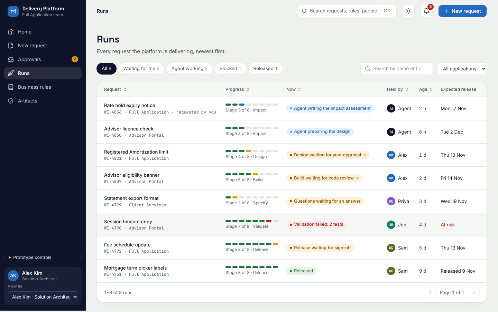

# Step 14 of 31: Screen 3: Runs and Approvals

Every work item in one filterable, sortable list. The same file also renders Approvals.

## What to tell Copilot

Open this file in the editor, then paste this into Copilot Chat (Agent or Edit mode):

```text
Using #file:14-screen-runs-approvals.md, create the file exactly as given in the "Files" section: src/v3/Runs.jsx.
Copy the code character for character. Do not rename, reformat, shorten, "improve" or convert to TypeScript.
Do not leave placeholders such as "// rest of the code". When done, list the files you created with their line counts.
Then add the route for this screen in src/App.jsx as described under "Wire it into the router".
```

## What it should look like

Reference screenshots (1440 × 900):

- `../screens/03-runs.png`
- `../screens/04-approvals.png`



## Files

Create this file with **exactly** this content.

### File: `src/v3/Runs.jsx` (56 lines)

`````jsx
// Runs: every work item in one filterable list.
import { useMemo, useState } from 'react';
import { Button } from '@/components/ui/button';
import { Shell, Card, Pill, Avatar, Stepper, PEOPLE } from './ui';
import { useProto, runHref } from './store';
import { useTable, SortTh, Pager } from './table';
const AGE = { 'just now': 0, '2 h': 2, '6 h': 6, '1 d': 24, '2 d': 48, '3 d': 72, '4 d': 96, '5 d': 120, '9 d': 216 };
const GET = { t: r => r.t, age: r => AGE[r.age] ?? 0, holder: r => r.holder, now: r => r.now, progress: r => r.s.replace(/[^d]/g, '').length };

import { Plus, Search } from 'lucide-react';


const FILTERS = [['all', 'All'], ['you', 'Waiting for me'], ['work', 'Agent working'], ['bad', 'Blocked'], ['done', 'Released']];

export default function V3Runs({ approvals }) {
  const [f, setF] = useState(approvals ? 'you' : 'all');
  const [app, setApp] = useState('All applications');
  const [q, setQ] = useState('');
  const { list: RUNS, me } = useProto();
  const rows = useMemo(() => RUNS.filter(r => (f === 'all' || r.state === f) && (app === 'All applications' || r.app === app) && (`${r.id} ${r.t}`.toLowerCase().includes(q.toLowerCase()))), [f, app, q, RUNS]);
  const tb = useTable(rows, { sort: approvals ? 'age' : null, dir: 'desc', getters: GET, pageSize: 8 });
  const count = k => k === 'all' ? RUNS.length : RUNS.filter(r => r.state === k).length;
  return (
    <Shell active={approvals ? 'approvals' : 'run'} crumbs={[approvals ? 'Approvals' : 'Runs']} actions={<Button asChild className="h-9 rounded-lg px-4"><a href="#v3-new"><Plus className="size-4" />New request</a></Button>}>
      <div className="mx-auto flex max-w-[1240px] flex-col gap-5">
        <div><h1 className="font-display text-[28px] font-semibold">{approvals ? 'Approvals' : 'Runs'}</h1><p className="mt-1 text-[15px] text-[var(--v-ink-2)]">{approvals ? 'Decisions waiting for you, oldest first. Switch the filter to see everything else.' : 'Every request the platform is delivering, newest first.'}</p></div>
        <div className="flex flex-wrap items-center gap-3">
          <div role="tablist" aria-label="Filter by status" className="flex flex-wrap gap-1.5">{FILTERS.map(([k, l]) => <button key={k} role="tab" aria-selected={f === k} onClick={() => setF(k)} className={`h-8 rounded-full px-3.5 text-[13.5px] ring-1 ${f === k ? 'bg-[var(--v-inv)] text-[var(--v-inv-fg)] ring-[var(--v-inv)]' : 'bg-[var(--v-surface)] text-[var(--v-ink-2)] ring-[var(--v-line)] hover:ring-[var(--v-line-strong)]'}`}>{l} <span className="tnum opacity-70">{count(k)}</span></button>)}</div>
          <div className="flex-1" />
          <label className="flex h-9 items-center gap-2 rounded-lg border border-[var(--v-line)] bg-[var(--v-surface)] px-3 text-[13.5px]" htmlFor="rq"><Search className="size-4 text-[var(--v-ink-3)]" /><span className="sr-only">Search runs</span><input id="rq" value={q} onChange={e => setQ(e.target.value)} placeholder="Search by name or ID" className="w-40 bg-transparent outline-none" /></label>
          <label htmlFor="rapp" className="sr-only">Application</label>
          <select id="rapp" value={app} onChange={e => setApp(e.target.value)} className="h-9 rounded-lg border border-[var(--v-line)] bg-[var(--v-surface)] px-3 text-[13.5px]"><option>All applications</option><option>Full Application</option><option>Advisor Portal</option><option>Client Services</option></select>
        </div>
        <Card className="overflow-hidden">
          <table className="w-full text-[13.5px]">
            <caption className="sr-only">Runs</caption>
            <thead><tr className="border-b border-[var(--v-line)] bg-[var(--v-sunken)] text-left text-[12.5px] text-[var(--v-ink-3)]"><SortTh label="Request" s={tb.by('t')} className="py-2.5 pl-5" /><SortTh label="Progress" s={tb.by('progress')} className="w-44 pr-6" /><SortTh label="Now" s={tb.by('now')} className="pr-4" /><SortTh label="Held by" s={tb.by('holder')} className="pr-4" /><SortTh label="Age" s={tb.by('age')} className="pr-4" /><th className="pr-5 font-medium">Expected release</th></tr></thead>
            <tbody>
              {tb.view.map(r => (
                <tr key={r.id} className="border-b border-[var(--v-line)] last:border-0 hover:bg-[var(--v-sunken)]">
                  <td className="py-3.5 pl-5"><a href={runHref(r.id)} className="font-medium hover:text-[var(--v-blue)]">{r.t}</a><div className="font-mono text-[12px] text-[var(--v-ink-3)]">{r.id} · {r.app}{r.by === me && ' · requested by you'}</div></td>
                  <td className="pr-6"><Stepper s={r.s} compact label /></td>
                  <td className="pr-4">{r.state === 'you' ? <a href={r.screen || runHref(r.id)} className="inline-flex"><Pill tone="you">{r.now} →</Pill></a> : <Pill tone={r.state}>{r.now}</Pill>}</td>
                  <td className="pr-4"><span className="flex items-center gap-2"><Avatar p={r.holder} size={24} />{r.holder === 'agent' ? 'Agent' : PEOPLE[r.holder].name.split(' ')[0]}</span></td>
                  <td className="tnum pr-4 text-[var(--v-ink-2)]">{r.age}</td>
                  <td className={`pr-5 ${r.eta === 'At risk' ? 'font-medium text-[var(--v-red)]' : ''}`}>{r.eta}</td>
                </tr>))}
              {!rows.length && <tr><td colSpan={6} className="px-5 py-12 text-center text-[var(--v-ink-2)]">No runs match these filters. <button onClick={() => { setF('all'); setApp('All applications'); setQ(''); }} className="font-medium text-[var(--v-blue)] underline">Clear filters</button></td></tr>}
            </tbody>
          </table>
          <Pager t={tb} noun="runs" />
        </Card>
      </div>
    </Shell>
  );
}
`````

## Wire it into the router

If you are using the temporary router from step 12, add these two lines to `src/App.jsx` (the final router in step 31 already has them):

```jsx
import V3Runs from '@/v3/Runs';   // with the other imports
  'v3-runs': V3Runs,                 // inside ROUTES
  'v3-approvals': () => <V3Runs approvals />,   // inside ROUTES
```

## Check before the next step

- [ ] Open `#v3-runs` as Alex Kim. It matches `../screens/03-runs.png`.
- [ ] Every button and link on the screen does what the specification below says.
- [ ] Switch the theme to dark: nothing is unreadable and no white boxes remain.
- [ ] No errors in the browser console.

## Specification

This explains what the code above does, in words. If you later change the screen, keep to these rules.

### 6.3 Runs and Approvals (`#v3-runs`, `#v3-approvals`)

```
Runs                                                                                [+ New request]
Every request the platform is delivering, newest first.
(All 8) (Waiting for me 2) (Agent working 2) (Blocked 1) (Released 1)      [⌕ Search by name or ID] [All applications ▾]
┌───────────────────────────────────────────────────────────────────────────────────────────────┐
│ Request ⇅               │ Progress ⇅          │ Now ⇅                         │ Held by ⇅ │ Age ⇅ │ Expected release │
│ Rate hold expiry notice │ ▮▮▮▯▯▯▯▯            │ ●Agent writing the impact…    │ AI Agent  │ 2 h   │ Mon 17 Nov       │
│ WI-4836 · Full Application · requested by you   Stage 3 of 8 · Impact                                              │
│ …                                                                                                                  │
├───────────────────────────────────────────────────────────────────────────────────────────────┤
│ 1–8 of 8 runs                                                         ‹ Page 1 of 1 ›           │
└───────────────────────────────────────────────────────────────────────────────────────────────┘
```

- H1 "Runs" / "Approvals". Lede: "Every request the platform is delivering, newest first." / "Decisions waiting for you, oldest first. Switch the filter to see everything else."
- Filter chips with counts: All · Waiting for me · Agent working · Blocked · Released (Approvals starts on "Waiting for me" and sorts by Age descending).
- Search (by name or ID, `w-40`) and Application select (All applications + 3 apps).
- Columns: **Request** (title link + mono "ID · app" + " · requested by you"), **Progress** (`w-44`, compact labelled stepper), **Now** (Pill; if it is my turn, an amber Pill "… →" linking to the gate screen), **Held by** (Avatar 24 + first name or "Agent"), **Age** (tnum), **Expected release** (red medium when "At risk"). Sortable: Request, Progress (count of done stages), Now, Held by, Age (hours). Page size 8.
- Empty: "No runs match these filters. ‹Clear filters›" (resets filter, app and search).
