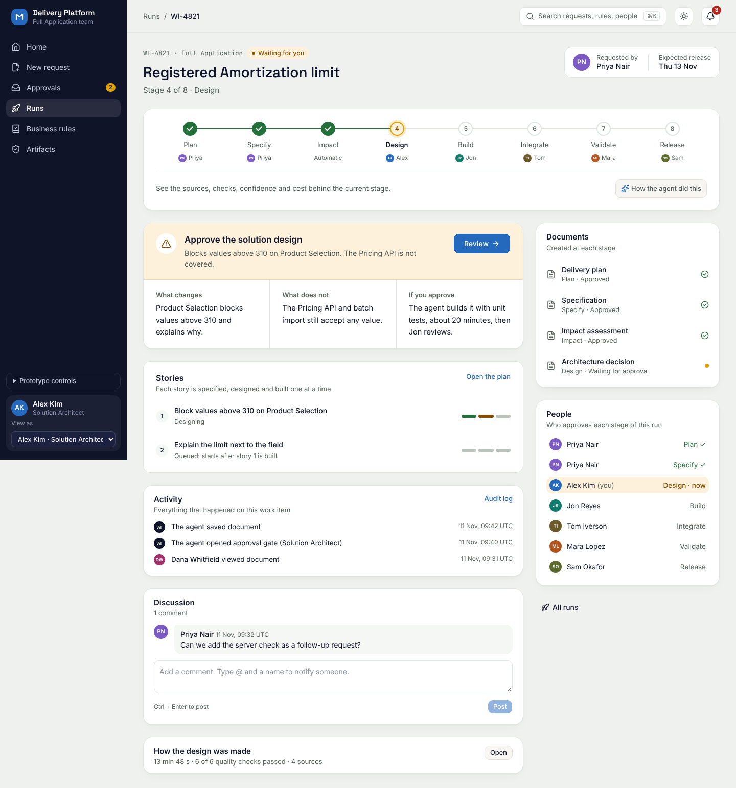

# Step 15 of 31: Screen 4: Run overview

Where one work item is, who holds it, what happens next, and all its documents.

## What to tell Copilot

Open this file in the editor, then paste this into Copilot Chat (Agent or Edit mode):

```text
Using #file:15-screen-run-overview.md, create the file exactly as given in the "Files" section: src/v3/Run.jsx.
Copy the code character for character. Do not rename, reformat, shorten, "improve" or convert to TypeScript.
Do not leave placeholders such as "// rest of the code". When done, list the files you created with their line counts.
Then add the route for this screen in src/App.jsx as described under "Wire it into the router".
```

## What it should look like

Reference screenshots (1440 × 900):

- `../screens/05-run-overview.png`
- `../screens/21-run-failed.png`
- `../screens/22-run-release-wait.png`



## Files

Create this file with **exactly** this content.

### File: `src/v3/Run.jsx` (143 lines)

`````jsx
// Run overview for any work item: where it is, who holds it, and what happens next.
import { useEffect, useState } from 'react';
import { FormDialog, Field } from './forms';
import { Button } from '@/components/ui/button';
import { Shell, Card, CardHead, Pill, Avatar, Stepper, PEOPLE, STAGES } from './ui';
import { AgentPanelButton } from './agentpanel';
import { useProto } from './store';
import { useToast } from '@/components/friendly';
import { Comments, Activity } from './collab';
import { useDoc, StoriesCard, DevAgentCard, KINDS, storiesFor } from './docs';
import { FileText, ArrowRight, AlertTriangle, CheckCircle2, Loader2, Clock, Rocket, RotateCcw } from 'lucide-react';

const DOC = ['Delivery plan', 'Specification', 'Impact assessment', 'Architecture decision', 'Completion report', 'Integration evidence', 'Validation report', 'Release record'];

function StatusCard({ r }) {
  const toast = useToast();
  const { approvePlan, requestPlanChanges, can, undo, me, policy, retryRun, assignEngineer, cancelSchedule, approveStage, sendBackStage } = useProto();
  const [back, setBack] = useState(false); const [backWhy, setBackWhy] = useState('');
  const stage = r.s.length - 1;
  const LATE = { 5: ['gate.integrate', 'Approve integration', 'Integration approved. Validation is running.', 'approve integrations'], 6: ['gate.validate', 'Approve validation', 'Validation approved. The release is with Sam Okafor.', 'approve validation'], 7: ['gate.release', 'Schedule for the next window', 'Release scheduled for Thu 13 Nov, 18:00.', 'release'] }[stage];
  const { openDoc } = useDoc();
  const selfPlan = !r.screen && r.s.length === 1 && policy.planSoD && r.by === me;
  const holder = PEOPLE[r.holder]?.name || 'the agent';
  if (r.state === 'you') return (
    <Card className="overflow-hidden">
      <div className="flex items-start gap-4 border-b border-[var(--v-amber-line)] bg-[var(--v-amber-soft)] px-6 py-5">
        <span className="grid size-10 shrink-0 place-items-center rounded-full bg-[var(--v-surface)] text-[var(--v-amber)]"><AlertTriangle className="size-5" /></span>
        <div className="min-w-0 flex-1"><h2 className="text-[17px] font-semibold">{r.ask}</h2><p className="mt-0.5 text-[14px] text-[var(--v-ink-2)]">{r.why}</p></div>
        {r.screen ? <Button asChild className="h-10 shrink-0 rounded-lg px-5"><a href={r.screen}>Review<ArrowRight className="size-4" /></a></Button>
          : LATE ? (can(LATE[0]) ? <div className="flex shrink-0 gap-2"><Button className="h-10 rounded-lg px-5" onClick={() => { const t = approveStage(r.id); toast(LATE[2], () => undo(t)); }}>{LATE[1]}</Button>{stage < 7 && <Button variant="outline" className="h-10 rounded-lg" onClick={() => setBack(true)}>Send back</Button>}</div> : <span className="shrink-0 text-[13px] text-[var(--v-ink-3)]">Your role cannot {LATE[3]}</span>)
          : selfPlan ? <span className="max-w-[220px] shrink-0 text-[13px] text-[var(--v-ink-2)]">You requested this, so another Product Owner must approve the plan.</span>
          : can('gate.plan') ? <div className="flex shrink-0 gap-2"><Button className="h-10 rounded-lg px-5" onClick={() => { const t = approvePlan(r.id); toast('Plan approved. The agent is writing the specification.', () => undo(t)); }}>Approve plan</Button><Button variant="outline" className="h-10 rounded-lg" onClick={() => { const t = requestPlanChanges(r.id); toast('Plan sent back to the agent.', () => undo(t)); }}>Send back</Button></div>
          : <span className="shrink-0 text-[13px] text-[var(--v-ink-3)]">Your role cannot approve plans</span>}
      </div>
      {!r.screen && stage === 5 && <table className="w-full text-[14px]"><caption className="sr-only">Integration pipelines</caption><thead><tr className="border-b border-[var(--v-line)] bg-[var(--v-sunken)] text-left text-[12.5px] text-[var(--v-ink-3)]"><th className="px-6 py-2 font-medium">Pipeline (Azure DevOps)</th><th className="font-medium">Result</th><th className="pr-6 font-medium">Duration</th></tr></thead><tbody>{[['Build and unit tests on the merge commit', '6 min'], ['Deploy to staging', '4 min'], ['Contract tests with dependent services', '3 min']].map(([n, d]) => <tr key={n} className="border-b border-[var(--v-line)] last:border-0"><td className="px-6 py-2.5">{n}</td><td><span className="inline-flex items-center gap-1.5 text-[var(--v-green)]"><CheckCircle2 className="size-4" />Passed</span></td><td className="tnum pr-6 text-[var(--v-ink-2)]">{d}</td></tr>)}</tbody></table>}
      {!r.screen && stage === 6 && <div className="grid grid-cols-3 divide-x divide-[var(--v-line)] text-[14px]">{[['Acceptance criteria', 'All met, each linked to its test'], ['Regression tests', '214 of 214 pass'], ['User acceptance', 'Signed off by the Product Owner']].map(([h, t]) => <div key={h} className="px-6 py-5"><h3 className="text-[13px] font-semibold text-[var(--v-ink-3)]">{h}</h3><p className="mt-1 flex items-start gap-1.5"><CheckCircle2 className="mt-0.5 size-4 shrink-0 text-[var(--v-green)]" />{t}</p></div>)}</div>}
      {back && <FormDialog title={`Send back the ${stage === 5 ? 'integration' : 'validation'}`} sub="The agent gets your note, fixes the problem and submits again." submitLabel="Send back" disabled={backWhy.trim().length < 10} onClose={() => setBack(false)} onSubmit={() => { const t = sendBackStage(r.id, backWhy.trim()); setBack(false); setBackWhy(''); toast('Sent back to the agent with your note.', () => undo(t)); }}>
        <Field id="back-why" label="What needs to change?" help="At least 10 characters. This goes into the audit log."><textarea id="back-why" rows={3} value={backWhy} onChange={e => setBackWhy(e.target.value)} aria-describedby="back-why-help" className="w-full rounded-lg border border-[var(--v-line-strong)] bg-[var(--v-surface)] p-3 text-[14px] outline-none focus:border-[var(--v-blue)]" /></Field>
      </FormDialog>}
      {!r.screen && stage === 0 && <div className="grid grid-cols-3 divide-x divide-[var(--v-line)] text-[14px]">
        <div className="px-6 py-5"><h3 className="text-[13px] font-semibold text-[var(--v-ink-3)]">Objective</h3><p className="mt-1 leading-relaxed">{r.t.replace(/…$/, '')}.</p></div>
        <div className="px-6 py-5"><h3 className="text-[13px] font-semibold text-[var(--v-ink-3)]">Stories</h3><ol className="mt-1 list-decimal pl-4 leading-relaxed">{storiesFor(r).map(s => <li key={s.n}><button onClick={() => openDoc({ run: r.id, kind: 'story', story: s.n })} className="text-left text-[var(--v-blue)] hover:underline">{s.title}</button></li>)}</ol><button onClick={() => openDoc({ run: r.id, kind: 'plan' })} className="mt-2 text-[13px] font-medium text-[var(--v-blue)] hover:underline">Open the full plan</button></div>
        <div className="px-6 py-5"><h3 className="text-[13px] font-semibold text-[var(--v-ink-3)]">Agent assumptions</h3><ul className="mt-1 list-disc pl-4 leading-relaxed"><li>Only {r.app} is affected</li><li>No API change in this request</li></ul></div>
      </div>}
      {r.id === 'WI-4821' && <div className="grid grid-cols-3 divide-x divide-[var(--v-line)]">
        {[['What changes', 'Product Selection blocks values above 310 and explains why.'], ['What does not', 'The Pricing API and batch import still accept any value.'], ['If you approve', 'The agent builds it with unit tests, about 20 minutes, then Jon reviews.']].map(([h, t]) => <div key={h} className="px-6 py-5"><h3 className="text-[13px] font-semibold text-[var(--v-ink-3)]">{h}</h3><p className="mt-1 text-[14.5px] leading-relaxed">{t}</p></div>)}
      </div>}
    </Card>);
  if (r.state === 'bad' && r.s.includes('f')) return (
    <Card className="overflow-hidden" role="alert">
      <div className="flex items-start gap-4 border-b border-[var(--v-red-line)] bg-[var(--v-red-soft)] px-6 py-5">
        <span className="grid size-10 shrink-0 place-items-center rounded-full bg-[var(--v-surface)] text-[var(--v-red)]"><AlertTriangle className="size-5" /></span>
        <div className="min-w-0 flex-1"><h2 className="text-[17px] font-semibold">Validation failed: 2 of 214 tests</h2><p className="mt-0.5 text-[14px] text-[var(--v-ink-2)]">The agent tried 3 times and stopped. The tests still expect the old 20-minute timeout; the spec now says 15.</p></div>
      </div>
      <ul className="divide-y divide-[var(--v-line)] font-mono text-[13px]">{[['session.spec.js › warns at 18 min', 'expected 18, got 13'], ['logout.spec.js › auto logout', 'expected 20, got 15']].map(([a, b]) => <li key={a} className="flex justify-between gap-4 px-6 py-2.5"><span>{a}</span><span className="text-[var(--v-red)]">{b}</span></li>)}</ul>
      <div className="flex flex-wrap items-center gap-2 border-t border-[var(--v-line)] px-6 py-4">
        <span className="mr-auto text-[13px] text-[var(--v-ink-3)]">Agent attempts: 3 of 3 · last run 40 min ago · CI #5521</span>
        {can('runs.pause') || r.by === me ? <Button className="h-9 rounded-lg" onClick={() => { retryRun(r.id); toast('Re-running validation with updated tests.'); }}>Update the tests and re-run</Button> : null}
        {can('squads.manage') && <Button variant="outline" className="h-9 rounded-lg" onClick={() => { const t = assignEngineer(r.id); toast('Lena Brooks is now investigating.', () => undo(t)); }}>Assign an engineer</Button>}
        {!can('runs.pause') && r.by !== me && !can('squads.manage') && <span className="text-[13px] text-[var(--v-ink-2)]">Jon Reyes and the platform admin have been notified.</span>}
      </div>
    </Card>);
  if (r.scheduled) return (
    <Card className="flex flex-wrap items-start gap-4 px-6 py-5">
      <span className="grid size-10 shrink-0 place-items-center rounded-full bg-[var(--v-blue-soft)] text-[var(--v-blue)]"><Clock className="size-5" /></span>
      <div className="min-w-0 flex-1"><h2 className="text-[17px] font-semibold">Release scheduled: {r.scheduled}</h2><p className="mt-0.5 text-[14px] text-[var(--v-ink-2)]">Not live yet. The deployment starts in the window, then health checks run and the record is completed. Until then the release can be cancelled.</p></div>
      {can('gate.release') && <Button variant="outline" className="h-10 shrink-0 rounded-lg" onClick={() => { const t = cancelSchedule(r.id); toast('Scheduled release cancelled. It is back with the Release Manager.', () => undo(t)); }}>Cancel schedule</Button>}
    </Card>);
  const cfg = {
    work: r.s.length === 5 && r.s[4] === 'a'
      ? [Loader2, 'bg-[var(--v-blue-soft)] text-[var(--v-blue)]', r.dev === 'working' ? 'The Developer Agent is building in VS Code' : 'Ready for the Developer Agent in VS Code', r.now + (r.dev === 'working' ? '. The completion report comes back here automatically.' : '. A developer copies the prompt below into the Agent in VS Code.'), null]
      : [Loader2, 'bg-[var(--v-blue-soft)] text-[var(--v-blue)]', 'The agent is working', r.now + '. You will be notified when a person is needed.', null],
    wait: [Clock, 'bg-[var(--v-amber-soft)] text-[var(--v-amber)]', `Waiting for ${holder}`, r.now + '.', ['Send a reminder', () => toast(`Reminder sent to ${holder}.`)]],
    bad: [AlertTriangle, 'bg-[var(--v-red-soft)] text-[var(--v-red)]', 'Needs attention', r.now + '. The run is paused until someone decides what to do.', null],
    done: [CheckCircle2, 'bg-[var(--v-green-soft)] text-[var(--v-green)]', r.now, 'Every stage is complete and the evidence is saved.', null],
  }[r.state];
  const [I, c, h, t, act] = cfg;
  return (
    <Card className="flex items-start gap-4 px-6 py-5">
      <span className={`grid size-10 shrink-0 place-items-center rounded-full ${c}`}><I className={`size-5 ${r.state === 'work' ? 'animate-spin [animation-duration:2.5s]' : ''}`} /></span>
      <div className="min-w-0 flex-1"><h2 className="text-[17px] font-semibold">{h}</h2><p className="mt-0.5 text-[14px] text-[var(--v-ink-2)]">{t}</p>{r.decidedAt && <p className="mt-2 text-[13px] text-[var(--v-green)]">Your decision was recorded {r.decidedAt}.</p>}</div>
      {act && <Button variant="outline" className="h-10 shrink-0 rounded-lg" onClick={act[1]}>{act[0]}</Button>}
    </Card>);
}

export default function V3Run({ id = 'WI-4821' }) {
  const { runs, finishPlan, togglePause, can, approver, me, finishRetry } = useProto();
  const { openDoc } = useDoc();
  const toast = useToast();
  const r = runs[id];
  useEffect(() => { if (r?.retrying) { const t = setTimeout(() => finishRetry(id), 3500); return () => clearTimeout(t); } }, [r?.retrying, id, finishRetry]);
  useEffect(() => { if (r?.fresh && r.s === 'a') { const t = setTimeout(() => finishPlan(id), 4000); return () => clearTimeout(t); } }, [r?.fresh, r?.s, id, finishPlan]);
  if (!r) return (
    <Shell active="run" crumbs={['Runs', id]}><div className="mx-auto max-w-[600px] py-20 text-center"><h1 className="font-display text-[24px] font-semibold">We could not find {id}</h1><p className="mt-2 text-[var(--v-ink-2)]">It may have been reset with the demo data.</p><Button asChild className="mt-5 h-10 rounded-lg"><a href="#v3-runs">Back to all runs</a></Button></div></Shell>);
  const cur = Math.max(r.s.length, 1);
  return (
    <Shell active="run" crumbs={['Runs', r.id]} actions={can('runs.pause') && <Button variant="outline" className="h-9 rounded-lg" onClick={() => { togglePause(r.id); toast(r.paused ? `${r.id} resumed.` : `${r.id} paused. Nothing will move until you resume it.`); }}>{r.paused ? 'Resume run' : 'Pause run'}</Button>}>
      <div className="mx-auto flex max-w-[1180px] flex-col gap-6">
        <div className="flex flex-wrap items-start gap-6">
          <div className="min-w-0 flex-1">
            <div className="flex items-center gap-2"><span className="font-mono text-[12.5px] text-[var(--v-ink-3)]">{r.id} · {r.app}</span><Pill tone={r.state}>{r.state === 'you' ? 'Waiting for you' : r.state === 'work' ? 'Agent working' : r.state === 'wait' ? 'Waiting for a person' : r.state === 'bad' ? 'Needs attention' : 'Complete'}</Pill></div>
            <h1 className="mt-1 font-display text-[28px] font-semibold">{r.t}</h1>
            <p className="mt-1 text-[15px] text-[var(--v-ink-2)]">Stage {cur} of 8 · {STAGES[cur - 1][0]}</p>
          </div>
          <div className="flex items-center gap-3 rounded-xl border border-[var(--v-line)] bg-[var(--v-surface)] px-4 py-3"><Avatar p={r.by} size={34} /><div className="leading-tight"><div className="text-[12.5px] text-[var(--v-ink-3)]">Requested by</div><div className="font-medium">{PEOPLE[r.by].name}</div></div><div className="mx-2 h-8 w-px bg-[var(--v-line)]" /><div className="leading-tight"><div className="text-[12.5px] text-[var(--v-ink-3)]">Expected release</div><div className="font-medium">{r.eta}</div></div></div>
        </div>

        <Card className="px-6 py-6"><Stepper s={r.s} />{(() => { const at = [...r.s].findIndex(c => c !== 'd'); const st = at < 0 ? r.s.length - 1 : at; return <div className="mt-4 flex items-center justify-between gap-3 border-t border-[var(--v-line)] pt-4 text-[13.5px] text-[var(--v-ink-2)]"><span>See the sources, checks, confidence and cost behind the current stage.</span><AgentPanelButton stage={st} run={r.id} /></div>; })()}</Card>

        <div className="grid grid-cols-[minmax(0,1fr)_360px] items-start gap-6">
          <div className="flex flex-col gap-6">
            {r.paused && <Card className="flex items-center gap-3 border-[var(--v-amber-line)] bg-[var(--v-amber-soft)] px-6 py-4 text-[14px]"><Clock className="size-5 text-[var(--v-amber)]" /><span className="flex-1"><b>Paused by you.</b> The agent and approvers cannot move this run until you resume it.</span><Button className="h-9 rounded-lg" onClick={() => togglePause(r.id)}>Resume run</Button></Card>}
            <StatusCard r={r} />
            {r.state === 'done' && <Card className="px-6 py-5"><div className="flex flex-wrap items-center gap-4"><div className="min-w-0 flex-1"><h2 className="text-[16px] font-semibold">In production</h2><p className="mt-0.5 text-[14px] text-[var(--v-ink-2)]">Health checks normal since release · error rate 0.02% · no linked incidents. The tested rollback plan is attached to the release record.</p></div>{can('gate.release') ? <Button variant="outline" className="h-10 rounded-lg" onClick={() => toast(`Rollback of ${r.id} prepared. It needs a second Release Manager to confirm before it runs.`)}><RotateCcw className="size-4" />Roll back</Button> : <span className="text-[13px] text-[var(--v-ink-3)]">Release Managers can roll back this change.</span>}</div></Card>}
            {r.answers && <Card className="px-6 py-5"><h2 className="text-[16px] font-semibold">Answers to the agent’s questions</h2><dl className="mt-2 flex flex-col gap-2 text-[14px]">{r.answers.map(([q, a]) => <div key={q}><dt className="text-[var(--v-ink-3)]">{q}</dt><dd className="font-medium">{a}</dd></div>)}</dl></Card>}
            {r.sentBack && r.state === 'work' && <Card className="border-[var(--v-amber-line)] bg-[var(--v-amber-soft)] px-6 py-4 text-[14px]"><b className="font-semibold">Sent back:</b> {r.sentBack}</Card>}
            {r.hold && <Card className="border-[var(--v-amber-line)] bg-[var(--v-amber-soft)] px-6 py-4 text-[14px]"><b className="font-semibold">Release held:</b> {r.hold}</Card>}
            <StoriesCard r={r} />
            <DevAgentCard r={r} />
            <Activity id={r.id} />
            <Comments id={r.id} />
            {r.id === 'WI-4821' && <Card><CardHead title="How the design was made" sub="13 min 48 s · 6 of 6 quality checks passed · 4 sources" right={<Button asChild variant="outline" size="sm" className="rounded-lg"><a href="#v3-evidence">Open</a></Button>} /></Card>}
          </div>
          <div className="flex flex-col gap-6">
            <Card>
              <CardHead title="Documents" sub="Created at each stage" />
              <ul className="flex flex-col px-3 pb-3">
                {DOC.slice(0, r.s.replace(/[^dw]/g, '').length).map((t, i) => { const ok = r.s[i] === 'd'; return <li key={t}><button onClick={() => openDoc({ run: r.id, kind: KINDS[i] })} className="flex w-full items-center gap-3 rounded-lg px-2 py-2.5 text-left hover:bg-[var(--v-sunken)]"><FileText className="size-[18px] shrink-0 text-[var(--v-ink-3)]" /><div className="min-w-0 flex-1"><div className="truncate font-medium">{t}</div><div className="text-[12.5px] text-[var(--v-ink-3)]">{STAGES[i][0]} · {ok ? 'Approved' : 'Waiting for approval'}</div></div>{ok ? <CheckCircle2 className="size-4 text-[var(--v-green)]" /> : <span className="size-2 rounded-full bg-[#e0a000]" />}</button></li>; })}
                {r.s[3] === 'd' && <li><button onClick={() => openDoc({ run: r.id, kind: 'assignment' })} className="flex w-full items-center gap-3 rounded-lg px-2 py-2.5 text-left hover:bg-[var(--v-sunken)]"><FileText className="size-[18px] shrink-0 text-[var(--v-ink-3)]" /><div className="min-w-0 flex-1"><div className="truncate font-medium">Developer assignment</div><div className="text-[12.5px] text-[var(--v-ink-3)]">Build · prompt for the Agent in VS Code</div></div></button></li>}
                {!r.s.replace(/[^dw]/g, '').length && <li className="px-2 py-3 text-[13.5px] text-[var(--v-ink-2)]">The first document appears when the plan is drafted.</li>}
              </ul>
            </Card>
            <Card>
              <CardHead title="People" sub="Who approves each stage of this run" right={can('squads.manage') && <a href={`#v3-squad-${r.id.toLowerCase()}`} className="text-[13px] font-medium text-[var(--v-blue)]">Manage</a>} />
              <ul className="flex flex-col gap-2 px-5 pb-5 text-[13.5px]">{STAGES.map(([st], i) => { const p = approver(r, i); if (!p) return null; const now = r.s[i] === 'w' || (r.s[i] === 'f'); const done = r.s[i] === 'd'; return <li key={st} className={`flex items-center gap-2.5 rounded-lg px-1.5 py-1 ${now ? 'bg-[var(--v-amber-soft)]' : ''}`}><Avatar p={p} size={24} /><span className="flex-1">{PEOPLE[p].name}{p === me && <span className="text-[var(--v-ink-3)]"> (you)</span>}</span><span className={done ? 'text-[var(--v-green)]' : now ? 'font-medium text-[var(--v-amber)]' : 'text-[var(--v-ink-3)]'}>{st}{done ? ' ✓' : now ? ' · now' : ''}</span></li>; })}</ul>
            </Card>
            <Button asChild variant="ghost" className="h-9 justify-start rounded-lg"><a href="#v3-runs"><Rocket className="size-4" />All runs</a></Button>
          </div>
        </div>
      </div>
    </Shell>
  );
}
`````

## Wire it into the router

If you are using the temporary router from step 12, add these two lines to `src/App.jsx` (the final router in step 31 already has them):

```jsx
import V3Run from '@/v3/Run';   // with the other imports
  'v3-run': V3Run,                 // inside ROUTES
```

## Check before the next step

- [ ] Open `#v3-run-wi-4821` as Alex Kim. It matches `../screens/05-run-overview.png`.
- [ ] Every button and link on the screen does what the specification below says.
- [ ] Switch the theme to dark: nothing is unreadable and no white boxes remain.
- [ ] No errors in the browser console.

## Specification

This explains what the code above does, in words. If you later change the screen, keep to these rules.

### 6.4 Run overview (`#v3-run-<id>`)

**Purpose.** Where a work item is, who holds it, what happens next, and every document. **Top-bar action** (if `runs.pause`): (Pause run) / (Resume run).

```
WI-4821 · Full Application ●Waiting for you                    ┌PN Requested by │ Expected release┐
Registered Amortization limit                                  │   Priya Nair   │ Thu 13 Nov      │
Stage 4 of 8 · Design                                          └─────────────────────────────────┘
┌──────────────────────────────────────────────────────────────────────────────────────────────┐
│  ✓──────✓──────✓──────④──────⑤──────⑥──────⑦──────⑧   (full stepper, §4.7)                    │
│  See the sources, checks, confidence and cost behind the current stage.  (✦ How the agent did this) │
└──────────────────────────────────────────────────────────────────────────────────────────────┘
┌ StatusCard (varies, see below) ───────────────────────────┐ ┌ Documents ───────────────────┐
│ ⚠ Approve the solution design                [Review →]   │ │ Created at each stage         │
│   Blocks values above 310 on Product Selection…           │ │ ▤ Delivery plan  Plan·Approved ✓│
│ What changes │ What does not │ If you approve             │ │ ▤ Specification …          ✓ │
└───────────────────────────────────────────────────────────┘ │ ▤ Architecture decision  ● │
┌ Stories ─────────────────────────────── ‹Open the plan› ┐   │ ▤ Developer assignment       │
│ ① Block values above 310…  Designing        ▮▮▯        │   └──────────────────────────────┘
│ ② Explain the limit…  Queued: starts after story 1 …    │   ┌ People ────────── ‹Manage› ┐
└─────────────────────────────────────────────────────────┘   │ PN Priya Nair        Plan ✓ │
┌ Build · Developer Agent in VS Code   [⧉ Copy Developer prompt] (from stage 5) │ AK Alex Kim (you) Design · now │ amber row
┌ Activity ─────────────────────────────── ‹Audit log› ┐      │ …                            │
┌ Discussion ──────────────────────────────────────────┐      └──────────────────────────────┘
┌ How the design was made  13 min 48 s · 6 of 6…   (Open) ┐   (🚀 All runs)
                      minmax(0,1fr)                                  360px
```

**Header**: mono "ID · app" + Pill (Waiting for you / Agent working / Waiting for a person / Needs attention / Complete); H1 title; "Stage n of 8 · <stage>"; right box Avatar 34 "Requested by <name>" | "Expected release <eta>".

**Stepper card**: full stepper, then a divider row "See the sources, checks, confidence and cost behind the current stage." + Agent panel button for the first stage that is not done.

**Left column, in order**:
1. Paused banner (amber, if paused): "**Paused by you.** The agent and approvers cannot move this run until you resume it." [Resume run].
2. **StatusCard** — one of:

| Condition | Shows |
|---|---|
| It is my decision (`state = you`) | Amber strip: AlertTriangle, ask (17px), why. Right side: [Review →] to the gate screen if the run has one; for Integrate (5)/Validate (6)/Release (7) gates without a screen: [Approve integration]/[Approve validation]/[Schedule for the next window] + (Send back) (not on Release), or "Your role cannot approve integrations/approve validation/release"; for a plan (stage 0): [Approve plan] (Send back), or "You requested this, so another Product Owner must approve the plan." when separation of duties applies, or "Your role cannot approve plans". |
| … and stage 5 | Table "Pipeline (Azure DevOps) · Result · Duration": Build and unit tests on the merge commit ✓Passed 6 min; Deploy to staging ✓Passed 4 min; Contract tests with dependent services ✓Passed 3 min |
| … and stage 6 | Three columns: Acceptance criteria "All met, each linked to its test"; Regression tests "214 of 214 pass"; User acceptance "Signed off by the Product Owner" |
| … and stage 0 | Three columns: Objective (title), Stories (numbered links to each story + ‹Open the full plan›), Agent assumptions ("Only <app> is affected", "No API change in this request") |
| … and WI-4821 | Three columns: What changes "Product Selection blocks values above 310 and explains why." · What does not "The Pricing API and batch import still accept any value." · If you approve "The agent builds it with unit tests, about 20 minutes, then Jon reviews." |
| Failed (`bad` with an `f` stage) | Red card `role="alert"`: "Validation failed: 2 of 214 tests", "The agent tried 3 times and stopped. The tests still expect the old 20-minute timeout; the spec now says 15."; mono list "session.spec.js › warns at 18 min — expected 18, got 13", "logout.spec.js › auto logout — expected 20, got 15"; footer "Agent attempts: 3 of 3 · last run 40 min ago · CI #5521" + [Update the tests and re-run] (if `runs.pause` or requester) + (Assign an engineer) (if `squads.manage`) or "Jon Reyes and the platform admin have been notified." |
| Release scheduled | Blue clock: "Release scheduled: <when>", "Not live yet. The deployment starts in the window, then health checks run and the record is completed. Until then the release can be cancelled." + (Cancel schedule) if `gate.release` |
| Agent working at Build (stage 5, `a`) | Spinner: "Ready for the Developer Agent in VS Code" or "The Developer Agent is building in VS Code" + now + ". A developer copies the prompt below into the Agent in VS Code." / ". The completion report comes back here automatically." |
| Agent working (other) | Spinner blue: "The agent is working", "<now>. You will be notified when a person is needed." |
| Waiting for someone else | Amber clock: "Waiting for <holder>", "<now>." + (Send a reminder) → toast "Reminder sent to <name>." |
| Needs attention (other) | Red: "Needs attention", "<now>. The run is paused until someone decides what to do." |
| Done | Green: "Released", "Every stage is complete and the evidence is saved." |
| After any decision | Green line "Your decision was recorded just now." |

3. **In production** (done runs): "Health checks normal since release · error rate 0.02% · no linked incidents. The tested rollback plan is attached to the release record." + (↺ Roll back) for `gate.release` → toast "Rollback of <id> prepared. It needs a second Release Manager to confirm before it runs." or "Release Managers can roll back this change."
4. **Answers to the agent’s questions** (if answered): question in ink-3, answer medium.
5. **Sent back:** <note> (amber, while the agent reworks). **Release held:** <reason> (amber).
6. **Stories** card (from the plan onward).
7. **Build · Developer Agent in VS Code** card (from stage 5): Laptop tile; "The agent runs standalone on the developer’s machine. The platform prepares its assignment and tracks the result."; [⧉ Copy Developer prompt] until working; five tracked steps with a vertical line: (1) ‹Developer assignment ready› "Handoff and prompt prepared from the approved design" ✓ → opens the assignment; (2) Developer Agent started in VS Code: "Copy the prompt and paste it into the Agent in VS Code" → after copying "Waiting for the agent to connect…" (spinner) → "Connected · last heartbeat just now" (✓) or "Started by Lena Brooks" when built; (3) Branch and Azure Boards task #<88000+n> with the branch name `feature/wi-4821-registered-amortization-li…`; (4) Pull request #<200+n> in Azure Repos: "Opens when the agent finishes" / "Opened · checks green"; (5) ‹Completion report received› "Comes back to the platform automatically" / "4 files changed · 6 of 6 tests pass". Copy → toast "Developer prompt copied. Paste it into the Agent in VS Code." and after 2.5 s the step shows connected.
8. **Activity** and **Discussion** (§4.21).
9. WI-4821 only: card "How the design was made", sub "13 min 48 s · 6 of 6 quality checks passed · 4 sources", (Open) → `#v3-evidence`.

**Right column (360px)**:
- **Documents** "Created at each stage": one row per stage reached that is done or waiting (Delivery plan, Specification, Impact assessment, Architecture decision, Completion report, Integration evidence, Validation report, Release record) with "<stage> · Approved" ✓ or "<stage> · Waiting for approval" ● (`#e0a000`). After Design is approved add "Developer assignment" ("Build · prompt for the Agent in VS Code"). Empty: "The first document appears when the plan is drafted." Rows open the document viewer.
- **People** "Who approves each stage of this run" (+ ‹Manage› → squad, for `squads.manage`): one row per stage with an approver: Avatar 24, name (+ " (you)"), stage label; done → green "Plan ✓"; current → amber row "Design · now".
- Ghost link (🚀 All runs).

**Timers on this page**: a fresh run in stage `a` becomes a plan waiting for approval after **4 s** (`finishPlan`); a retrying run finishes validation after **3.5 s** (`finishRetry`).
