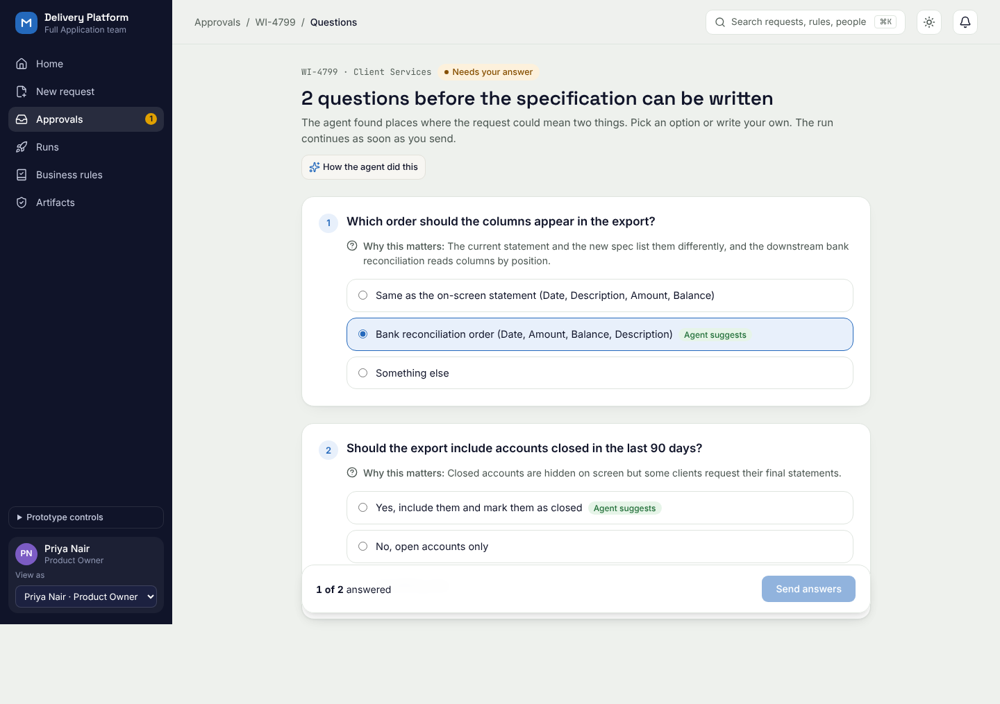

# Step 17 of 31: Screen 6: Answer questions

The agent asks; the requester picks an option for each question.

## What to tell Copilot

Open this file in the editor, then paste this into Copilot Chat (Agent or Edit mode):

```text
Using #file:17-screen-clarify.md, create the file exactly as given in the "Files" section: src/v3/Clarify.jsx.
Copy the code character for character. Do not rename, reformat, shorten, "improve" or convert to TypeScript.
Do not leave placeholders such as "// rest of the code". When done, list the files you created with their line counts.
Then add the route for this screen in src/App.jsx as described under "Wire it into the router".
```

## What it should look like

Reference screenshots (1440 × 900):

- `../screens/07-clarify.png`



## Files

Create this file with **exactly** this content.

### File: `src/v3/Clarify.jsx` (52 lines)

`````jsx
import { useState } from 'react';
import { Button } from '@/components/ui/button';
import { Shell, Card, Pill } from './ui';
import { useToast } from '@/components/friendly';
import { HelpCircle, CheckCircle2 } from 'lucide-react';
import { AgentPanelButton } from './agentpanel';
import { useProto } from './store';
import { useGate, NotYours } from './gate';

const QS = [
  { id: 'q1', q: 'Which order should the columns appear in the export?', why: 'The current statement and the new spec list them differently, and the downstream bank reconciliation reads columns by position.', opts: ['Same as the on-screen statement (Date, Description, Amount, Balance)', 'Bank reconciliation order (Date, Amount, Balance, Description)'], rec: 1 },
  { id: 'q2', q: 'Should the export include accounts closed in the last 90 days?', why: 'Closed accounts are hidden on screen but some clients request their final statements.', opts: ['Yes, include them and mark them as closed', 'No, open accounts only'], rec: 0 },
];
export default function V3Clarify() {
  const toast = useToast();
  const [a, setA] = useState({ q1: 1 });
  const done = QS.every(q => a[q.id] !== undefined);
  const { runs, answerQuestions, undo } = useProto();
  const g = useGate('WI-4799', 'gate.plan');
  const sent = g.decided;
  return (
    <Shell active="approvals" crumbs={['Approvals', 'WI-4799', 'Questions']}>
      <div className="mx-auto flex max-w-[820px] flex-col gap-6">
        <div><div className="flex items-center gap-2"><span className="font-mono text-[12.5px] text-[var(--v-ink-3)]">WI-4799 · Client Services</span><Pill tone="you">Needs your answer</Pill></div>
          <h1 className="mt-1 font-display text-[28px] font-semibold">2 questions before the specification can be written</h1>
          <p className="mt-1 text-[15px] text-[var(--v-ink-2)]">The agent found places where the request could mean two things. Pick an option or write your own. The run continues as soon as you send.</p>
          <div className="mt-3"><AgentPanelButton stage={1} run="WI-4799" /></div></div>
        {QS.map((q, qi) => (
          <Card key={q.id} className="p-6">
            <fieldset>
              <legend className="flex items-start gap-3"><span className="grid size-7 shrink-0 place-items-center rounded-full bg-[var(--v-blue-soft)] text-[13px] font-semibold text-[var(--v-blue)]">{qi + 1}</span><span className="text-[17px] font-semibold leading-snug">{q.q}</span></legend>
              <p className="mt-2 ml-10 flex gap-2 text-[14px] text-[var(--v-ink-2)]"><HelpCircle className="mt-0.5 size-4 shrink-0" /><span><b className="font-medium">Why this matters:</b> {q.why}</span></p>
              <div className="mt-4 ml-10 flex flex-col gap-2">
                {[...q.opts, 'Something else'].map((o, i) => (
                  <label key={o} className={`flex cursor-pointer items-start gap-3 rounded-xl border px-4 py-3 text-[14.5px] transition-colors ${a[q.id] === i ? 'border-[var(--v-blue)] bg-[var(--v-blue-soft)]' : 'border-[var(--v-line)] hover:border-[var(--v-line-strong)]'}`}>
                    <input type="radio" name={q.id} checked={a[q.id] === i} onChange={() => setA({ ...a, [q.id]: i })} className="mt-1 accent-[var(--v-blue)]" />
                    <span className="flex-1">{o}{i === q.rec && <span className="ml-2 rounded-full bg-[var(--v-green-soft)] px-2 py-0.5 text-[12px] font-medium text-[var(--v-green)]">Agent suggests</span>}</span>
                  </label>))}
                {a[q.id] === q.opts.length && <textarea aria-label="Your answer" rows={2} placeholder="Type your answer" className="rounded-xl border border-[var(--v-line)] p-3 text-[14.5px] outline-none focus:border-[var(--v-blue)]" />}
              </div>
            </fieldset>
          </Card>))}
        {g.blocked && <NotYours g={g} />}
        {sent && <div className="flex items-center gap-3 rounded-2xl border border-[var(--v-line)] bg-[var(--v-green-soft)] px-5 py-3.5 text-[14px]"><CheckCircle2 className="size-5 text-[var(--v-green)]" />Your answers were sent. The agent is writing the specification.<a href="#v3-run-wi-4799" className="ml-auto font-medium text-[var(--v-blue)]">Open the run</a></div>}
        {!sent && !g.blocked && <div className="sticky bottom-4 flex items-center gap-4 rounded-2xl border border-[var(--v-line)] bg-white/95 px-5 py-3.5 shadow-lg backdrop-blur">
          <span className="text-[14px]"><b className="tnum">{Object.keys(a).length} of {QS.length}</b> answered</span>
          <Button disabled={!done} onClick={() => { const t = answerQuestions(QS.map(q => [q.q, a[q.id] === q.opts.length ? 'Own answer' : q.opts[a[q.id]]])); toast('Answers sent. The agent is writing the specification.', () => undo(t)); location.hash = 'v3-run-wi-4799'; }} className="ml-auto h-10 rounded-lg px-5">Send answers</Button>
        </div>}
      </div>
    </Shell>
  );
}
`````

## Wire it into the router

If you are using the temporary router from step 12, add these two lines to `src/App.jsx` (the final router in step 31 already has them):

```jsx
import V3Clarify from '@/v3/Clarify';   // with the other imports
  'v3-clarify': V3Clarify,                 // inside ROUTES
```

## Check before the next step

- [ ] Open `#v3-clarify` with **View as → Priya Nair**. It matches `../screens/07-clarify.png`.
- [ ] Every button and link on the screen does what the specification below says.
- [ ] Switch the theme to dark: nothing is unreadable and no white boxes remain.
- [ ] No errors in the browser console.

## Specification

This explains what the code above does, in words. If you later change the screen, keep to these rules.

### 6.6 Answer questions (`#v3-clarify`, WI-4799)

```
WI-4799 · Client Services ●Needs your answer
2 questions before the specification can be written
The agent found places where the request could mean two things…   (✦ How the agent did this)
┌──────────────────────────────────────────────────────────────────┐
│ ① Which order should the columns appear in the export?            │
│   ⓘ Why this matters: The current statement and the new spec…    │
│   ○ Same as the on-screen statement (Date, Description, Amount…) │
│   ◉ Bank reconciliation order (Date, Amount, Balance…) ●Agent suggests │ selected = blue border + blue-soft
│   ○ Something else                                               │
└──────────────────────────────────────────────────────────────────┘
┌ ② Should the export include accounts closed in the last 90 days? ┐
└──────────────────────────────────────────────────────────────────┘
┌ sticky bottom bar: 1 of 2 answered                 [Send answers] ┐
```

- Width 820. Header: mono "WI-4799 · Client Services" + Pill "Needs your answer"; H1 "2 questions before the specification can be written"; lede "The agent found places where the request could mean two things. Pick an option or write your own. The run continues as soon as you send."; Agent panel (stage 1).
- Each question is a `<fieldset>` in a Card `p-6`: legend = 28px blue-soft number + 17px question; "Why this matters:" line with HelpCircle; options as radio cards (`rounded-xl border px-4 py-3 text-[14.5px]`, selected `border-blue bg-blue-soft`), the suggested option has a green chip "Agent suggests"; last option "Something else" reveals a textarea "Type your answer".
- Q1 "Which order should the columns appear in the export?" — why: "The current statement and the new spec list them differently, and the downstream bank reconciliation reads columns by position." Options: "Same as the on-screen statement (Date, Description, Amount, Balance)"; "Bank reconciliation order (Date, Amount, Balance, Description)" (suggested, pre-selected).
- Q2 "Should the export include accounts closed in the last 90 days?" — why: "Closed accounts are hidden on screen but some clients request their final statements." Options: "Yes, include them and mark them as closed" (suggested); "No, open accounts only".
- Sticky bottom bar `sticky bottom-4 rounded-2xl border bg-white/95 shadow-lg backdrop-blur`: "**n of 2** answered" + [Send answers] (disabled until all answered) → `answerQuestions`, toast "Answers sent. The agent is writing the specification." + Undo, go to the run.
- After sending: green banner "Your answers were sent. The agent is writing the specification. ‹Open the run›". Not mine: NotYours.
