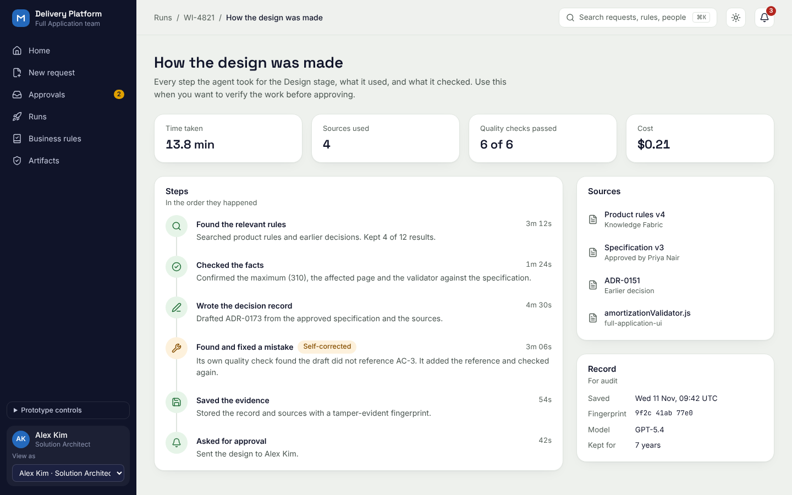

# Step 18 of 31: Screen 7: How the design was made

The full trace of the agent's steps, sources and record for one stage.

## What to tell Copilot

Open this file in the editor, then paste this into Copilot Chat (Agent or Edit mode):

```text
Using #file:18-screen-evidence.md, create the file exactly as given in the "Files" section: src/v3/Evidence.jsx.
Copy the code character for character. Do not rename, reformat, shorten, "improve" or convert to TypeScript.
Do not leave placeholders such as "// rest of the code". When done, list the files you created with their line counts.
Then add the route for this screen in src/App.jsx as described under "Wire it into the router".
```

## What it should look like

Reference screenshots (1440 × 900):

- `../screens/08-evidence.png`



## Files

Create this file with **exactly** this content.

### File: `src/v3/Evidence.jsx` (38 lines)

`````jsx
import { Shell, Card, CardHead, Pill } from './ui';
import { Search, CheckCircle2, PenLine, Wrench, Save, Bell, FileText } from 'lucide-react';

const STEPS = [
  [Search,'Found the relevant rules','Searched product rules and earlier decisions. Kept 4 of 12 results.','3m 12s','done'],
  [CheckCircle2,'Checked the facts','Confirmed the maximum (310), the affected page and the validator against the specification.','1m 24s','done'],
  [PenLine,'Wrote the decision record','Drafted ADR-0173 from the approved specification and the sources.','4m 30s','done'],
  [Wrench,'Found and fixed a mistake','Its own quality check found the draft did not reference AC-3. It added the reference and checked again.','3m 06s','fix'],
  [Save,'Saved the evidence','Stored the record and sources with a tamper-evident fingerprint.','54s','done'],
  [Bell,'Asked for approval','Sent the design to Alex Kim.','42s','done'],
];
export default function V3Evidence() {
  return (
    <Shell active="evidence" crumbs={['Runs', 'WI-4821', 'How the design was made']}>
      <div className="mx-auto flex max-w-[1180px] flex-col gap-6">
        <div><h1 className="font-display text-[28px] font-semibold">How the design was made</h1><p className="mt-1 max-w-[70ch] text-[15px] text-[var(--v-ink-2)]">Every step the agent took for the Design stage, what it used, and what it checked. Use this when you want to verify the work before approving.</p></div>
        <div className="grid grid-cols-4 gap-4">{[['Time taken',13.8,1,'',' min'],['Sources used',4,0,'',''],['Quality checks passed',6,0,'',' of 6'],['Cost',0.21,2,'$','']].map(([l, v, d, pre, suf]) => <Card key={l} className="px-5 py-4"><div className="text-[13px] text-[var(--v-ink-3)]">{l}</div><div className="tnum mt-0.5 font-display text-[22px] font-semibold">{pre}{v.toFixed(d)}{suf}</div></Card>)}</div>
        <div className="grid grid-cols-[minmax(0,1fr)_360px] items-start gap-6">
          <Card>
            <CardHead title="Steps" sub="In the order they happened" />
            <ol className="relative flex flex-col px-5 pb-5">
              {STEPS.map(([I, t, d, time, k], i) => (
                <li key={t} className="relative flex gap-4 pb-6 last:pb-0">
                  {i < STEPS.length - 1 && <span aria-hidden="true" className="absolute top-10 bottom-0 left-[19px] w-0.5 bg-[var(--v-line)]" />}
                  <span className={`relative z-10 grid size-10 shrink-0 place-items-center rounded-full ${k === 'fix' ? 'bg-[var(--v-amber-soft)] text-[var(--v-amber)]' : 'bg-[var(--v-green-soft)] text-[var(--v-green)]'}`}><I className="size-[18px]" /></span>
                  <div className="min-w-0 flex-1 pt-1.5"><div className="flex items-center gap-2"><b className="font-semibold">{t}</b>{k === 'fix' && <Pill tone="wait" dot={false}>Self-corrected</Pill>}<span className="tnum ml-auto text-[13px] text-[var(--v-ink-3)]">{time}</span></div><p className="mt-0.5 text-[14px] text-[var(--v-ink-2)]">{d}</p></div>
                </li>))}
            </ol>
          </Card>
          <div className="flex flex-col gap-6">
            <Card><CardHead title="Sources" /><ul className="flex flex-col gap-1 px-3 pb-3">{[['Product rules v4','Knowledge Fabric'],['Specification v3','Approved by Priya Nair'],['ADR-0151','Earlier decision'],['amortizationValidator.js','full-application-ui']].map(([a, b]) => <li key={a}><a href="#v3-artifacts" className="flex items-center gap-3 rounded-lg px-2 py-2 hover:bg-[var(--v-sunken)]"><FileText className="size-[18px] text-[var(--v-ink-3)]" /><div><div className="font-medium">{a}</div><div className="text-[12.5px] text-[var(--v-ink-3)]">{b}</div></div></a></li>)}</ul></Card>
            <Card><CardHead title="Record" sub="For audit" /><dl className="grid grid-cols-[auto_1fr] gap-x-4 gap-y-2 px-5 pb-5 text-[13.5px]"><dt className="text-[var(--v-ink-3)]">Saved</dt><dd>Wed 11 Nov, 09:42 UTC</dd><dt className="text-[var(--v-ink-3)]">Fingerprint</dt><dd className="font-mono text-[12.5px]">9f2c 41ab 77e0</dd><dt className="text-[var(--v-ink-3)]">Model</dt><dd>GPT-5.4</dd><dt className="text-[var(--v-ink-3)]">Kept for</dt><dd>7 years</dd></dl></Card>
          </div>
        </div>
      </div>
    </Shell>
  );
}
`````

## Wire it into the router

If you are using the temporary router from step 12, add these two lines to `src/App.jsx` (the final router in step 31 already has them):

```jsx
import V3Evidence from '@/v3/Evidence';   // with the other imports
  'v3-evidence': V3Evidence,                 // inside ROUTES
```

## Check before the next step

- [ ] Open `#v3-evidence` as Alex Kim. It matches `../screens/08-evidence.png`.
- [ ] Every button and link on the screen does what the specification below says.
- [ ] Switch the theme to dark: nothing is unreadable and no white boxes remain.
- [ ] No errors in the browser console.

## Specification

This explains what the code above does, in words. If you later change the screen, keep to these rules.

### 6.7 How the design was made (`#v3-evidence`)

- H1 "How the design was made"; lede "Every step the agent took for the Design stage, what it used, and what it checked. Use this when you want to verify the work before approving."
- Four KPI tiles: Time taken **13.8 min** · Sources used **4** · Quality checks passed **6 of 6** · Cost **$0.21**.
- Grid `1fr / 360px`. **Steps** "In the order they happened" (timeline §4.25): Found the relevant rules (3m 12s) "Searched product rules and earlier decisions. Kept 4 of 12 results." · Checked the facts (1m 24s) "Confirmed the maximum (310), the affected page and the validator against the specification." · Wrote the decision record (4m 30s) "Drafted ADR-0173 from the approved specification and the sources." · **Found and fixed a mistake** (3m 06s, amber, Pill "Self-corrected") "Its own quality check found the draft did not reference AC-3. It added the reference and checked again." · Saved the evidence (54s) "Stored the record and sources with a tamper-evident fingerprint." · Asked for approval (42s) "Sent the design to Alex Kim."
- **Sources** (links to Artifacts): Product rules v4 — Knowledge Fabric; Specification v3 — Approved by Priya Nair; ADR-0151 — Earlier decision; amortizationValidator.js — full-application-ui.
- **Record** "For audit": Saved Wed 11 Nov, 09:42 UTC · Fingerprint `9f2c 41ab 77e0` · Model GPT-5.4 · Kept for 7 years.
