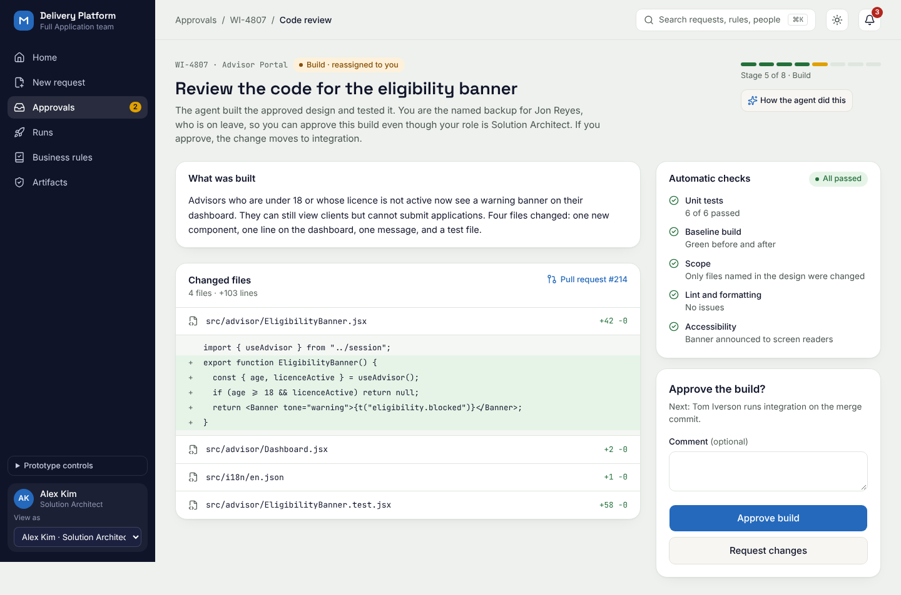

# Step 19 of 31: Screen 8: Code review (Build gate)

What was built, the changed files, the automatic checks, and the decision.

## What to tell Copilot

Open this file in the editor, then paste this into Copilot Chat (Agent or Edit mode):

```text
Using #file:19-screen-code-review.md, create the file exactly as given in the "Files" section: src/v3/Review.jsx.
Copy the code character for character. Do not rename, reformat, shorten, "improve" or convert to TypeScript.
Do not leave placeholders such as "// rest of the code". When done, list the files you created with their line counts.
Then add the route for this screen in src/App.jsx as described under "Wire it into the router".
```

## What it should look like

Reference screenshots (1440 × 900):

- `../screens/09-code-review.png`



## Files

Create this file with **exactly** this content.

### File: `src/v3/Review.jsx` (84 lines)

`````jsx
// Build gate: review the developer completion report and the code change before integration.
import { useState } from 'react';
import { Button } from '@/components/ui/button';
import { Shell, Card, CardHead, Pill, Stepper } from './ui';
import { useToast } from '@/components/friendly';
import { CheckCircle2, FileCode2, GitPullRequest } from 'lucide-react';
import { AgentPanelButton } from './agentpanel';
import { useProto } from './store';
import { useGate, NotYours } from './gate';

const FILES = [
  ['src/advisor/EligibilityBanner.jsx', '+42 −0', [
    ['ctx', 'import { useAdvisor } from "../session";'],
    ['add', 'export function EligibilityBanner() {'],
    ['add', '  const { age, licenceActive } = useAdvisor();'],
    ['add', '  if (age >= 18 && licenceActive) return null;'],
    ['add', '  return <Banner tone="warning">{t("eligibility.blocked")}</Banner>;'],
    ['add', '}'],
  ]],
  ['src/advisor/Dashboard.jsx', '+2 −0', [['ctx', '<Header />'], ['add', '<EligibilityBanner />'], ['ctx', '<ClientList />']]],
  ['src/i18n/en.json', '+1 −0', [['add', '"eligibility.blocked": "You can view clients but cannot submit applications until your licence is active."']]],
  ['src/advisor/EligibilityBanner.test.jsx', '+58 −0', null],
];
const CHECKS = [['Unit tests', '6 of 6 passed'], ['Baseline build', 'Green before and after'], ['Scope', 'Only files named in the design were changed'], ['Lint and formatting', 'No issues'], ['Accessibility', 'Banner announced to screen readers']];

export default function V3Review() {
  const toast = useToast();
  const { runs, approveBuild, requestBuildChanges, undo } = useProto();
  const g = useGate('WI-4807', 'gate.build');
  const run = g.run;
  const decided = g.decided;
  const go = () => { location.hash = 'v3-run-wi-4807'; };
  const [open, setOpen] = useState(0);
  return (
    <Shell active="approvals" crumbs={['Approvals', 'WI-4807', 'Code review']}>
      <div className="mx-auto flex max-w-[1240px] flex-col gap-6">
        <div className="flex flex-wrap items-start gap-6">
          <div className="min-w-0 flex-1">
            <div className="flex items-center gap-2"><span className="font-mono text-[12.5px] text-[var(--v-ink-3)]">WI-4807 · Advisor Portal</span><Pill tone="you">Build · reassigned to you</Pill></div>
            <h1 className="mt-1 font-display text-[28px] font-semibold">Review the code for the eligibility banner</h1>
            <p className="mt-1 max-w-[72ch] text-[15px] text-[var(--v-ink-2)]">The agent built the approved design and tested it. You are the named backup for Jon Reyes, who is on leave, so you can approve this build even though your role is Solution Architect. If you approve, the change moves to integration.</p>
          </div>
          <div className="w-56 pt-2"><Stepper s="ddddw" compact /><div className="mt-1.5 text-[12.5px] text-[var(--v-ink-3)]">Stage 5 of 8 · Build</div><div className="mt-3"><AgentPanelButton stage={4} run="WI-4807" /></div></div>
        </div>

        <div className="grid grid-cols-[minmax(0,1fr)_360px] items-start gap-6">
          <div className="flex flex-col gap-6">
            <Card>
              <CardHead title="What was built" />
              <p className="px-5 pb-4 text-[14.5px] leading-relaxed">Advisors who are under 18 or whose licence is not active now see a warning banner on their dashboard. They can still view clients but cannot submit applications. Four files changed: one new component, one line on the dashboard, one message, and a test file.</p>
            </Card>
            <Card className="overflow-hidden">
              <CardHead title="Changed files" sub="4 files · +103 lines" right={<a href="#v3-review" className="flex items-center gap-1.5 text-[13px] font-medium text-[var(--v-blue)]"><GitPullRequest className="size-4" />Pull request #214</a>} />
              <ul className="border-t border-[var(--v-line)]">
                {FILES.map(([f, n, lines], i) => (
                  <li key={f} className="border-b border-[var(--v-line)] last:border-0">
                    <button onClick={() => setOpen(open === i ? -1 : i)} aria-expanded={open === i} className="flex w-full items-center gap-3 px-5 py-3 text-left hover:bg-[var(--v-sunken)]"><FileCode2 className="size-4 text-[var(--v-ink-3)]" /><span className="font-mono text-[13px]">{f}</span><span className="ml-auto font-mono text-[12.5px] text-[var(--v-green)]">{n}</span></button>
                    {open === i && (lines ? <pre className="overflow-x-auto border-t border-[var(--v-line)] bg-[var(--v-sunken)] py-2 font-mono text-[12.5px] leading-6">{lines.map(([k, l], j) => <div key={j} className={`px-5 ${k === 'add' ? 'bg-[var(--v-green-soft)]' : ''}`}><span className="mr-3 inline-block w-3 select-none text-[var(--v-ink-3)]">{k === 'add' ? '+' : ' '}</span>{l}</div>)}</pre>
                      : <p className="border-t border-[var(--v-line)] px-5 py-3 text-[13px] text-[var(--v-ink-2)]">6 tests covering under 18, inactive licence, both conditions and the eligible case.</p>)}
                  </li>))}
              </ul>
            </Card>
          </div>

          <aside className="flex flex-col gap-4">
            <Card>
              <CardHead title="Automatic checks" right={<Pill tone="done">All passed</Pill>} />
              <ul className="flex flex-col gap-2.5 px-5 pb-5">{CHECKS.map(([a, b]) => <li key={a} className="flex items-start gap-2.5 text-[13.5px]"><CheckCircle2 className="mt-0.5 size-4 shrink-0 text-[var(--v-green)]" /><span><b className="font-medium">{a}</b><span className="block text-[var(--v-ink-2)]">{b}</span></span></li>)}</ul>
            </Card>
            {g.blocked && <NotYours g={g} />}
          {decided && <Card className="p-5"><div className="flex items-center gap-2 text-[var(--v-green)]"><CheckCircle2 className="size-5" /><b>Decision recorded</b></div><p className="mt-2 text-[14px] text-[var(--v-ink-2)]">You have decided on this build. Current status: {run.now}.</p><div className="mt-4 flex flex-col gap-2"><Button asChild className="h-10 rounded-lg"><a href="#v3-run-wi-4807">Open the run</a></Button><Button asChild variant="outline" className="h-10 rounded-lg"><a href="#v3-home">Back to home</a></Button></div></Card>}
            {!decided && !g.blocked && <Card className="p-5">
              <h2 className="text-[17px] font-semibold">Approve the build?</h2>
              <p className="mt-1 text-[13.5px] text-[var(--v-ink-2)]">Next: Tom Iverson runs integration on the merge commit.</p>
              <label htmlFor="rnote" className="mt-4 block text-[13.5px] font-medium">Comment <span className="font-normal text-[var(--v-ink-3)]">(optional)</span></label>
              <textarea id="rnote" rows={2} className="mt-1.5 w-full rounded-lg border border-[var(--v-line)] p-2.5 text-[14px] outline-none focus:border-[var(--v-blue)] focus:ring-4 focus:ring-[var(--v-blue)]/15" />
              <div className="mt-4 flex flex-col gap-2"><Button onClick={() => { const t = approveBuild(); toast('Build approved. Integration has started.', () => undo(t)); go(); }} className="h-11 rounded-lg text-[15px]">Approve build</Button><Button variant="outline" onClick={() => { const t = requestBuildChanges(); toast('Sent back to the agent with your comment.', () => undo(t)); go(); }} className="h-11 rounded-lg text-[15px]">Request changes</Button></div>
            </Card>}
          </aside>
        </div>
      </div>
    </Shell>
  );
}
`````

## Wire it into the router

If you are using the temporary router from step 12, add these two lines to `src/App.jsx` (the final router in step 31 already has them):

```jsx
import V3Review from '@/v3/Review';   // with the other imports
  'v3-review': V3Review,                 // inside ROUTES
```

## Check before the next step

- [ ] Open `#v3-review` as Alex Kim. It matches `../screens/09-code-review.png`.
- [ ] Every button and link on the screen does what the specification below says.
- [ ] Switch the theme to dark: nothing is unreadable and no white boxes remain.
- [ ] No errors in the browser console.

## Specification

This explains what the code above does, in words. If you later change the screen, keep to these rules.

### 6.8 Code review, Build gate (`#v3-review`, WI-4807)

```
WI-4807 · Advisor Portal ●Build · reassigned to you                         ▮▮▮▮▮▯▯▯
Review the code for the eligibility banner                                  Stage 5 of 8 · Build
The agent built the approved design and tested it. You are the named…       (✦ How the agent did this)
┌ What was built ─────────────────────────────────────────┐  ┌ Automatic checks ── ●All passed ┐
│ Advisors who are under 18 or whose licence is not…      │  │ ✓ Unit tests  6 of 6 passed     │
└─────────────────────────────────────────────────────────┘  │ ✓ Baseline build  Green before… │
┌ Changed files  4 files · +103 lines   ‹⑂ Pull request #214› │ ✓ Scope  Only files named…     │
│ ▸ src/advisor/EligibilityBanner.jsx            +42 −0  │  │ ✓ Lint and formatting  No issues│
│   + export function EligibilityBanner() { …            │  │ ✓ Accessibility  Banner announced│
│ ▸ src/advisor/Dashboard.jsx                     +2 −0  │  └─────────────────────────────────┘
│ ▸ src/i18n/en.json                              +1 −0  │  ┌ Approve the build? ─────────────┐
│ ▸ src/advisor/EligibilityBanner.test.jsx       +58 −0  │  │ Next: Tom Iverson runs integration│
└─────────────────────────────────────────────────────────┘  │ Comment (optional) [          ] │
                                                              │ [Approve build] (Request changes)│
```

- Header: Pill "Build · reassigned to you"; H1 "Review the code for the eligibility banner"; lede "The agent built the approved design and tested it. You are the named backup for Jon Reyes, who is on leave, so you can approve this build even though your role is Solution Architect. If you approve, the change moves to integration."; right `w-56`: compact stepper `ddddw`, "Stage 5 of 8 · Build", Agent panel (stage 4).
- **What was built**: "Advisors who are under 18 or whose licence is not active now see a warning banner on their dashboard. They can still view clients but cannot submit applications. Four files changed: one new component, one line on the dashboard, one message, and a test file."
- **Changed files** (first file open by default; one open at a time, `aria-expanded`). Diffs: EligibilityBanner.jsx (context import line, then 5 added lines of the component); Dashboard.jsx (`<Header />`, + `<EligibilityBanner />`, `<ClientList />`); en.json (+ `"eligibility.blocked": "You can view clients but cannot submit applications until your licence is active."`); the test file shows text "6 tests covering under 18, inactive licence, both conditions and the eligible case."
- **Automatic checks** (Pill "All passed"): Unit tests "6 of 6 passed"; Baseline build "Green before and after"; Scope "Only files named in the design were changed"; Lint and formatting "No issues"; Accessibility "Banner announced to screen readers".
- Decision: "Approve the build?", "Next: Tom Iverson runs integration on the merge commit.", Comment (optional), [Approve build] → toast "Build approved. Integration has started." + Undo; (Request changes) → "Sent back to the agent with your comment." + Undo; both go to the run. Decided and NotYours states as in §6.5.
