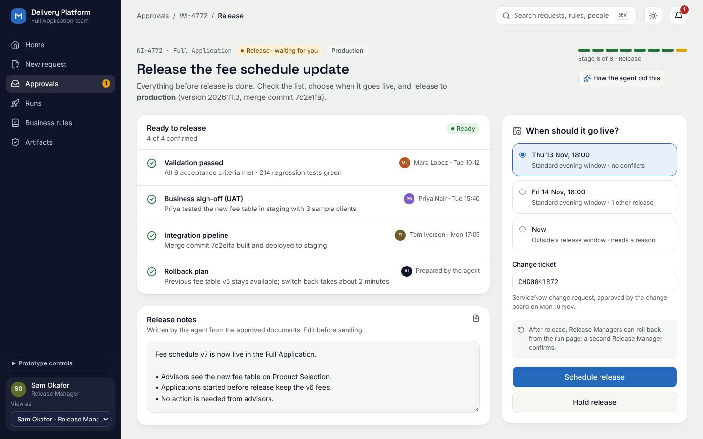

# Step 20 of 31: Screen 9: Release

Readiness list, release notes, release window, change ticket, hold and confirm.

## What to tell Copilot

Open this file in the editor, then paste this into Copilot Chat (Agent or Edit mode):

```text
Using #file:20-screen-release.md, create the file exactly as given in the "Files" section: src/v3/Release.jsx.
Copy the code character for character. Do not rename, reformat, shorten, "improve" or convert to TypeScript.
Do not leave placeholders such as "// rest of the code". When done, list the files you created with their line counts.
Then add the route for this screen in src/App.jsx as described under "Wire it into the router".
```

## What it should look like

Reference screenshots (1440 × 900):

- `../screens/10-release.png`
- `../screens/28-form-dialog.png`



## Files

Create this file with **exactly** this content.

### File: `src/v3/Release.jsx` (101 lines)

`````jsx
// Release gate: the release manager confirms everything is ready, picks a window and releases.
import { useEffect, useRef, useState } from 'react';
import { Button } from '@/components/ui/button';
import { Shell, Card, CardHead, Pill, Avatar, Stepper } from './ui';
import { useToast } from '@/components/friendly';
import { CheckCircle2, CalendarClock, RotateCcw, FileText } from 'lucide-react';
import { AgentPanelButton } from './agentpanel';
import { FormDialog, Field } from './forms';
import { useProto } from './store';
import { useGate, NotYours } from './gate';

const READY = [
  ['Validation passed', 'All 8 acceptance criteria met · 214 regression tests green', 'mara', 'Mara Lopez · Tue 10:12'],
  ['Business sign-off (UAT)', 'Priya tested the new fee table in staging with 3 sample clients', 'priya', 'Priya Nair · Tue 15:40'],
  ['Integration pipeline', 'Merge commit 7c2e1fa built and deployed to staging', 'tom', 'Tom Iverson · Mon 17:05'],
  ['Rollback plan', 'Previous fee table v6 stays available; switch back takes about 2 minutes', 'agent', 'Prepared by the agent'],
];
function ConfirmRelease({ why, ticket, onCancel, onConfirm }) {
  const cancel = useRef(null);
  useEffect(() => { cancel.current?.focus(); }, []);
  return (
    <div className="fixed inset-0 z-50 grid place-items-center bg-[#101429]/45 p-6" onMouseDown={e => e.target === e.currentTarget && onCancel()}>
      <div role="alertdialog" aria-modal="true" aria-labelledby="rc-t" aria-describedby="rc-d" onKeyDown={e => e.key === 'Escape' && onCancel()} className="w-full max-w-[480px] rounded-2xl bg-[var(--v-surface)] p-6 shadow-2xl">
        <h2 id="rc-t" className="font-display text-[20px] font-semibold">Release to production now?</h2>
        <p id="rc-d" className="mt-1 text-[14px] text-[var(--v-ink-2)]">This goes live immediately, outside a release window. It cannot be undone from here; use the rollback plan if something goes wrong.</p>
        <dl className="mt-4 grid grid-cols-[120px_1fr] gap-y-1.5 rounded-xl bg-[var(--v-sunken)] p-4 text-[13.5px]">
          <dt className="text-[var(--v-ink-3)]">Environment</dt><dd className="font-medium">Production</dd>
          <dt className="text-[var(--v-ink-3)]">Version</dt><dd>2026.11.3 · commit <span className="font-mono">7c2e1fa</span></dd>
          <dt className="text-[var(--v-ink-3)]">Change ticket</dt><dd className="font-mono">{ticket}</dd>
          <dt className="text-[var(--v-ink-3)]">Reason</dt><dd>{why}</dd>
          <dt className="text-[var(--v-ink-3)]">Rollback</dt><dd>Switch back to fee table v6, about 2 minutes</dd>
        </dl>
        <div className="mt-5 flex justify-end gap-2"><Button ref={cancel} variant="outline" className="h-10 rounded-lg" onClick={onCancel}>Cancel</Button><Button className="h-10 rounded-lg bg-[var(--v-red)] hover:bg-[#93201a]" onClick={onConfirm}>Release to production</Button></div>
      </div>
    </div>
  );
}

const WINDOWS = [['Thu 13 Nov, 18:00', 'Standard evening window · no conflicts'], ['Fri 14 Nov, 18:00', 'Standard evening window · 1 other release'], ['Now', 'Outside a release window · needs a reason']];

export default function V3Release() {
  const toast = useToast();
  const { runs, scheduleRelease, holdRelease, undo } = useProto();
  const [hold, setHold] = useState(false); const [holdWhy, setHoldWhy] = useState('');
  const g = useGate('WI-4772', 'gate.release');
  const run = g.run;
  const decided = g.decided;
  const go = () => { location.hash = 'v3-run-wi-4772'; };
  const [w, setW] = useState(0);
  const [why, setWhy] = useState('');
  const [ticket, setTicket] = useState('CHG0041872');
  const [confirm, setConfirm] = useState(false);
  const canAct = !decided && !g.blocked;
  const needWhy = w === 2 && why.trim().length < 10;
  const doRelease = () => { const t = scheduleRelease(WINDOWS[w][0]); setConfirm(false); if (w === 2) toast('Released to production. The team has been notified.'); else toast(`Release scheduled for ${WINDOWS[w][0]}. You can cancel it until then.`, () => undo(t)); go(); };
  return (
    <Shell active="approvals" crumbs={['Approvals', 'WI-4772', 'Release']}>
      <div className="mx-auto flex max-w-[1180px] flex-col gap-6">
        <div className="flex flex-wrap items-start gap-6">
          <div className="min-w-0 flex-1">
            <div className="flex items-center gap-2"><span className="font-mono text-[12.5px] text-[var(--v-ink-3)]">WI-4772 · Full Application</span><Pill tone={canAct ? 'you' : decided ? 'done' : 'wait'}>{canAct ? 'Release · waiting for you' : decided ? run.now : 'Release · waiting for Sam Okafor'}</Pill><Pill tone="mute" dot={false}>Production</Pill></div>
            <h1 className="mt-1 font-display text-[28px] font-semibold">Release the fee schedule update</h1>
            <p className="mt-1 max-w-[70ch] text-[15px] text-[var(--v-ink-2)]">Everything before release is done. Check the list, choose when it goes live, and release to <b>production</b> (version 2026.11.3, merge commit 7c2e1fa).</p>
          </div>
          <div className="w-56 pt-2"><Stepper s="dddddddw" compact /><div className="mt-1.5 text-[12.5px] text-[var(--v-ink-3)]">Stage 8 of 8 · Release</div><div className="mt-3"><AgentPanelButton stage={7} run="WI-4772" /></div></div>
        </div>
        <div className="grid grid-cols-[minmax(0,1fr)_380px] items-start gap-6">
          <div className="flex flex-col gap-6">
            <Card>
              <CardHead title="Ready to release" sub="4 of 4 confirmed" right={<Pill tone="done">Ready</Pill>} />
              <ul className="divide-y divide-[var(--v-line)] border-t border-[var(--v-line)]">{READY.map(([t, d, p, by]) => <li key={t} className="flex items-start gap-4 px-5 py-4"><CheckCircle2 className="mt-0.5 size-5 shrink-0 text-[var(--v-green)]" /><div className="min-w-0 flex-1"><b className="font-semibold">{t}</b><p className="text-[13.5px] text-[var(--v-ink-2)]">{d}</p></div><span className="flex shrink-0 items-center gap-2 text-[12.5px] text-[var(--v-ink-3)]"><Avatar p={p} size={22} />{by}</span></li>)}</ul>
            </Card>
            <Card>
              <CardHead title="Release notes" sub="Written by the agent from the approved documents. Edit before sending." right={<FileText className="size-4 text-[var(--v-ink-3)]" />} />
              <label htmlFor="notes" className="sr-only">Release notes</label>
              <textarea id="notes" rows={5} readOnly={!canAct} aria-readonly={!canAct} defaultValue={'Fee schedule v7 is now live in the Full Application.\n\n• Advisors see the new fee table on Product Selection.\n• Applications started before release keep the v6 fees.\n• No action is needed from advisors.'} className="mx-5 mb-5 w-[calc(100%-40px)] rounded-xl border border-[var(--v-line)] bg-[var(--v-sunken)] p-4 text-[14px] leading-relaxed outline-none focus:border-[var(--v-blue)] focus:bg-[var(--v-surface)]" />
            </Card>
          </div>
          <aside className="flex flex-col gap-4">
            {g.blocked && <NotYours g={g} />}
          {decided && <Card className="p-5"><div className="flex items-center gap-2 text-[var(--v-green)]"><CheckCircle2 className="size-5" /><b>Decision recorded</b></div><p className="mt-2 text-[14px] text-[var(--v-ink-2)]">The release decision is recorded. Current status: {run.now}.</p><div className="mt-4 flex flex-col gap-2"><Button asChild className="h-10 rounded-lg"><a href="#v3-run-wi-4772">Open the run</a></Button><Button asChild variant="outline" className="h-10 rounded-lg"><a href="#v3-home">Back to home</a></Button></div></Card>}
            {!decided && !g.blocked && <Card className="p-5">
              <h2 className="flex items-center gap-2 text-[17px] font-semibold"><CalendarClock className="size-5 text-[var(--v-ink-3)]" />When should it go live?</h2>
              <fieldset className="mt-3 flex flex-col gap-2"><legend className="sr-only">Release window</legend>
                {WINDOWS.map(([t, d], i) => <label key={t} className={`flex cursor-pointer items-start gap-3 rounded-xl border px-3.5 py-3 ${w === i ? 'border-[var(--v-blue)] bg-[var(--v-blue-soft)]' : 'border-[var(--v-line)]'}`}><input type="radio" name="win" checked={w === i} onChange={() => setW(i)} className="mt-1 accent-[var(--v-blue)]" /><span><b className="block font-medium">{t}</b><span className="text-[12.5px] text-[var(--v-ink-2)]">{d}</span></span></label>)}
              </fieldset>
              {w === 2 && <><label htmlFor="why" className="mt-3 block text-[13.5px] font-medium">Reason for releasing outside a window</label><input id="why" className="mt-1.5 h-10 w-full rounded-lg border border-[var(--v-line)] px-3 text-[14px]" value={why} onChange={e => setWhy(e.target.value)} aria-invalid={needWhy} aria-describedby="why-help" placeholder="e.g. regulatory deadline" /><p id="why-help" className={`mt-1 text-[12.5px] ${needWhy ? 'text-[var(--v-red)]' : 'text-[var(--v-ink-3)]'}`}>Required. At least 10 characters, recorded in the audit log.</p></>}
              <label htmlFor="chg" className="mt-4 block text-[13.5px] font-medium">Change ticket</label><input id="chg" value={ticket} onChange={e => setTicket(e.target.value)} className="mt-1.5 h-10 w-full rounded-lg border border-[var(--v-line)] px-3 font-mono text-[13.5px]" /><p className="mt-1 text-[12.5px] text-[var(--v-ink-3)]">ServiceNow change request, approved by the change board on Mon 10 Nov.</p>
              <div className="mt-4 flex items-start gap-2 rounded-lg bg-[var(--v-sunken)] p-3 text-[12.5px] text-[var(--v-ink-2)]"><RotateCcw className="mt-0.5 size-3.5 shrink-0" />After release, Release Managers can roll back from the run page; a second Release Manager confirms.</div>
              <div className="mt-4 flex flex-col gap-2"><Button disabled={needWhy || !ticket.trim()} onClick={() => w === 2 ? setConfirm(true) : doRelease()} className="h-11 rounded-lg text-[15px]">{w === 2 ? 'Release now' : 'Schedule release'}</Button><Button variant="outline" onClick={() => setHold(true)} className="h-11 rounded-lg text-[15px]">Hold release</Button></div>
            </Card>}
          </aside>
        </div>
      </div>
      {hold && <FormDialog title="Hold this release" sub="Priya Nair and Mara Lopez are told why, and the run waits until you release it." submitLabel="Hold release" disabled={holdWhy.trim().length < 10} onClose={() => setHold(false)} onSubmit={() => { const t = holdRelease(holdWhy.trim()); setHold(false); toast('Release held. Priya and Mara have been told why.', () => undo(t)); go(); }}>
        <Field id="hold-why" label="Why are you holding it?" help="At least 10 characters. This goes into the audit log."><textarea id="hold-why" rows={3} value={holdWhy} onChange={e => setHoldWhy(e.target.value)} aria-describedby="hold-why-help" className="w-full rounded-lg border border-[var(--v-line-strong)] bg-[var(--v-surface)] p-3 text-[14px] outline-none focus:border-[var(--v-blue)]" placeholder="e.g. Pricing team asked to wait for the rate change" /></Field>
      </FormDialog>}
      {confirm && <ConfirmRelease why={why} ticket={ticket} onCancel={() => setConfirm(false)} onConfirm={doRelease} />}
    </Shell>
  );
}
`````

## Wire it into the router

If you are using the temporary router from step 12, add these two lines to `src/App.jsx` (the final router in step 31 already has them):

```jsx
import V3Release from '@/v3/Release';   // with the other imports
  'v3-release': V3Release,                 // inside ROUTES
```

## Check before the next step

- [ ] Open `#v3-release` with **View as → Sam Okafor**. It matches `../screens/10-release.png`.
- [ ] Every button and link on the screen does what the specification below says.
- [ ] Switch the theme to dark: nothing is unreadable and no white boxes remain.
- [ ] No errors in the browser console.

## Specification

This explains what the code above does, in words. If you later change the screen, keep to these rules.

### 6.9 Release gate (`#v3-release`, WI-4772)

```
WI-4772 · Full Application ●Release · waiting for you  ●Production            ▮▮▮▮▮▮▮▮
Release the fee schedule update                                                Stage 8 of 8 · Release
Everything before release is done. Check the list, choose when it goes live…   (✦ How the agent did this)
┌ Ready to release  4 of 4 confirmed ──────────── ●Ready ┐  ┌ 📅 When should it go live? ────────┐
│ ✓ Validation passed   All 8 acceptance… ML Mara Lopez · Tue 10:12 │ ◉ Thu 13 Nov, 18:00          │
│ ✓ Business sign-off (UAT) …            PN Priya Nair · Tue 15:40 │   Standard evening window…   │
│ ✓ Integration pipeline …               TI Tom Iverson · Mon 17:05│ ○ Fri 14 Nov, 18:00          │
│ ✓ Rollback plan …                      AI Prepared by the agent  │ ○ Now  Outside a release…    │
└────────────────────────────────────────────────────────┘  │ Change ticket [CHG0041872]        │
┌ Release notes  Written by the agent… Edit before sending ┐ │ ServiceNow change request…       │
│ [Fee schedule v7 is now live in the Full Application…]  │  │ ↺ After release, Release Managers…│
└────────────────────────────────────────────────────────┘  │ [Schedule release] (Hold release) │
```

- Pills: "Release · waiting for you" (you) / "Release · waiting for Sam Okafor" / run status when decided; plus mute "Production". H1 "Release the fee schedule update". Lede "Everything before release is done. Check the list, choose when it goes live, and release to **production** (version 2026.11.3, merge commit 7c2e1fa)."
- **Ready to release** (4 of 4 confirmed, Pill "Ready"): Validation passed — "All 8 acceptance criteria met · 214 regression tests green" — Mara Lopez · Tue 10:12; Business sign-off (UAT) — "Priya tested the new fee table in staging with 3 sample clients" — Priya Nair · Tue 15:40; Integration pipeline — "Merge commit 7c2e1fa built and deployed to staging" — Tom Iverson · Mon 17:05; Rollback plan — "Previous fee table v6 stays available; switch back takes about 2 minutes" — Prepared by the agent.
- **Release notes** (editable only for the deciding person, otherwise `readOnly`): "Fee schedule v7 is now live in the Full Application.\n\n• Advisors see the new fee table on Product Selection.\n• Applications started before release keep the v6 fees.\n• No action is needed from advisors."
- **When should it go live?** radio cards: Thu 13 Nov, 18:00 — "Standard evening window · no conflicts" (default); Fri 14 Nov, 18:00 — "Standard evening window · 1 other release"; Now — "Outside a release window · needs a reason". Choosing **Now** shows "Reason for releasing outside a window" (input, placeholder "e.g. regulatory deadline", help "Required. At least 10 characters, recorded in the audit log.", red + `aria-invalid` while too short).
- **Change ticket** (mono, default CHG0041872), help "ServiceNow change request, approved by the change board on Mon 10 Nov."
- Note box: "After release, Release Managers can roll back from the run page; a second Release Manager confirms."
- [Schedule release] / [Release now] (disabled if the reason is missing or the ticket is empty) and (Hold release).
- Schedule → `scheduleRelease(window)`, toast "Release scheduled for Thu 13 Nov, 18:00. You can cancel it until then." + Undo. Release now → confirm dialog "Release to production now?" ("This goes live immediately, outside a release window. It cannot be undone from here; use the rollback plan if something goes wrong."; facts Environment Production · Version 2026.11.3 · commit 7c2e1fa · Change ticket · Reason · Rollback "Switch back to fee table v6, about 2 minutes"; (Cancel) focused, red [Release to production]) → toast "Released to production. The team has been notified." (no Undo).
- Hold → FormDialog "Hold this release" / "Priya Nair and Mara Lopez are told why, and the run waits until you release it." / field "Why are you holding it?" (≥ 10 chars, placeholder "e.g. Pricing team asked to wait for the rate change") / [Hold release] → toast "Release held. Priya and Mara have been told why." + Undo.
