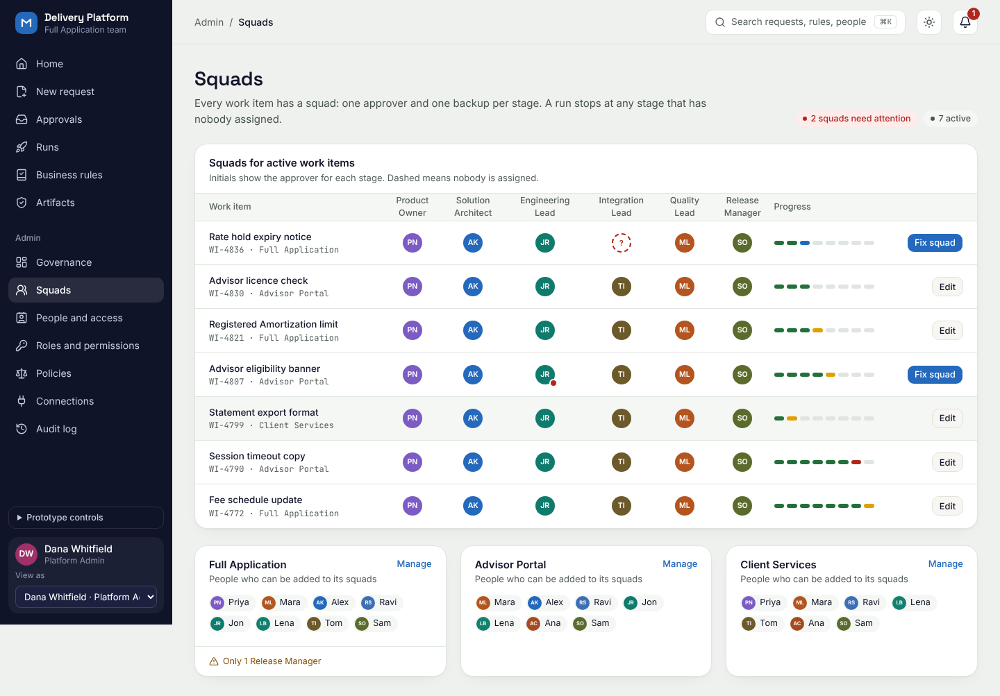

# Step 24 of 31: Screen 13: Squads (admin)

Who approves each stage of every work item.

## What to tell Copilot

Open this file in the editor, then paste this into Copilot Chat (Agent or Edit mode):

```text
Using #file:24-screen-squads.md, create the file exactly as given in the "Files" section: src/v3/Squads.jsx.
Copy the code character for character. Do not rename, reformat, shorten, "improve" or convert to TypeScript.
Do not leave placeholders such as "// rest of the code". When done, list the files you created with their line counts.
Then add the route for this screen in src/App.jsx as described under "Wire it into the router".
```

## What it should look like

Reference screenshots (1440 × 900):

- `../screens/14-squads.png`



## Files

Create this file with **exactly** this content.

### File: `src/v3/Squads.jsx` (51 lines)

`````jsx
// Admin · Squads: who approves each stage of every work item, and the people available per application.
import { Button } from '@/components/ui/button';
import { Shell, Card, CardHead, Pill, Avatar, PEOPLE, Stepper } from './ui';
import { useProto } from './store';
import { AlertTriangle } from 'lucide-react';

const ROLES = [['PO', 'Product Owner', 'priya'], ['SA', 'Solution Architect', 'alex'], ['EL', 'Engineering Lead', 'jon'], ['IL', 'Integration Lead', 'tom'], ['QL', 'Quality Lead', 'mara'], ['RM', 'Release Manager', 'sam']];
const POOLS = [['Full Application', ['priya', 'mara', 'alex', 'ravi', 'jon', 'lena', 'tom', 'mara', 'sam']], ['Advisor Portal', ['mara', 'alex', 'ravi', 'jon', 'lena', 'ana', 'sam']], ['Client Services', ['priya', 'mara', 'ravi', 'lena', 'tom', 'ana', 'sam']]];
export const squadHref = id => `#v3-squad-${id.toLowerCase()}`;

export default function V3Squads() {
  const { list, attention } = useProto();
  const active = list.filter(r => r.state !== 'done');
  const gaps = active.filter(r => r.squadGap || (r.id === 'WI-4807' && attention.includes('leave')));
  return (
    <Shell active="squads" crumbs={['Admin', 'Squads']}>
      <div className="mx-auto flex max-w-[1240px] flex-col gap-6">
        <div className="flex flex-wrap items-end gap-4"><div className="min-w-0 flex-1"><h1 className="font-display text-[28px] font-semibold">Squads</h1><p className="mt-1 max-w-[80ch] text-[15px] text-[var(--v-ink-2)]">Every work item has a squad: one approver and one backup per stage. A run stops at any stage that has nobody assigned.</p></div>
          <div className="flex gap-2">{gaps.length ? <Pill tone="bad">{gaps.length} squad{gaps.length > 1 ? 's' : ''} need attention</Pill> : <Pill tone="done">All squads complete</Pill>}<Pill tone="mute">{active.length} active</Pill></div></div>
        <Card className="overflow-hidden">
          <CardHead title="Squads for active work items" sub="Initials show the approver for each stage. Dashed means nobody is assigned." />
          <div className="overflow-x-auto">
            <table className="w-full min-w-[980px] text-[13.5px]"><caption className="sr-only">Squads by work item</caption>
              <thead><tr className="border-y border-[var(--v-line)] bg-[var(--v-sunken)] text-left text-[12.5px] text-[var(--v-ink-3)]"><th className="py-2.5 pl-5 font-medium">Work item</th>{ROLES.map(([k, l]) => <th key={k} title={l} className="px-2 text-center font-medium">{l.split(' ')[0]}<br />{l.split(' ')[1]}</th>)}<th className="w-40 pr-4 font-medium">Progress</th><th className="pr-5"><span className="sr-only">Actions</span></th></tr></thead>
              <tbody>{active.map(r => {
                const leave = r.id === 'WI-4807' && attention.includes('leave');
                return (
                  <tr key={r.id} className="border-b border-[var(--v-line)] last:border-0 hover:bg-[var(--v-sunken)]">
                    <td className="py-3 pl-5"><b className="font-medium">{r.t}</b><div className="font-mono text-[12px] text-[var(--v-ink-3)]">{r.id} · {r.app}</div></td>
                    {ROLES.map(([k, l, p]) => {
                      const missing = r.squadGap && k === 'IL'; const away = leave && k === 'EL';
                      const who = r.id === 'WI-4807' && k === 'EL' && !leave ? 'lena' : p;
                      return <td key={k} className="px-2 text-center">{missing ? <span title={`${l}: nobody assigned`} className="mx-auto grid size-7 place-items-center rounded-full border-2 border-dashed border-[var(--v-red)] text-[11px] font-semibold text-[var(--v-red)]">?<span className="sr-only">{l} not assigned</span></span> : <span className="relative mx-auto inline-block"><Avatar p={who} size={28} />{away && <span title="On leave" className="absolute -right-1 -bottom-1 size-3 rounded-full border-2 border-white bg-[var(--v-red)]"><span className="sr-only">{PEOPLE[who].name} is on leave</span></span>}</span>}</td>;
                    })}
                    <td className="pr-4"><Stepper s={r.s} compact /></td>
                    <td className="pr-5 text-right"><Button asChild size="sm" variant={r.squadGap || leave ? 'default' : 'outline'} className="rounded-lg"><a href={squadHref(r.id)}>{r.squadGap || leave ? 'Fix squad' : 'Edit'}</a></Button></td>
                  </tr>); })}</tbody>
            </table>
          </div>
        </Card>
        <div className="grid grid-cols-3 gap-5">
          {POOLS.map(([app, ppl]) => (
            <Card key={app}><CardHead title={app} sub="People who can be added to its squads" right={<a href="#v3-people" className="text-[13px] font-medium text-[var(--v-blue)]">Manage</a>} />
              <div className="flex flex-wrap gap-1.5 px-5 pb-5">{[...new Set(ppl)].map(p => <span key={p} className="flex items-center gap-1.5 rounded-full bg-[var(--v-sunken)] py-0.5 pr-2.5 pl-0.5 text-[12.5px]"><Avatar p={p} size={20} />{PEOPLE[p].name.split(' ')[0]}</span>)}</div>
              {app === 'Full Application' && <p className="flex items-center gap-1.5 border-t border-[var(--v-line)] px-5 py-3 text-[12.5px] text-[var(--v-amber)]"><AlertTriangle className="size-3.5" />Only 1 Release Manager</p>}
            </Card>))}
        </div>
      </div>
    </Shell>
  );
}
`````

## Wire it into the router

If you are using the temporary router from step 12, add these two lines to `src/App.jsx` (the final router in step 31 already has them):

```jsx
import V3Squads from '@/v3/Squads';   // with the other imports
  'v3-squads': V3Squads,                 // inside ROUTES
```

## Check before the next step

- [ ] Open `#v3-squads` with **View as → Dana Whitfield**. It matches `../screens/14-squads.png`.
- [ ] Every button and link on the screen does what the specification below says.
- [ ] Switch the theme to dark: nothing is unreadable and no white boxes remain.
- [ ] No errors in the browser console.

## Specification

This explains what the code above does, in words. If you later change the screen, keep to these rules.

### 6.13 Squads (`#v3-squads`)

- H1 "Squads"; lede "Every work item has a squad: one approver and one backup per stage. A run stops at any stage that has nobody assigned."; Pills "n squad(s) need attention" (bad) or "All squads complete" (done) + "n active".
- Table (min width 980) "Squads for active work items" / "Initials show the approver for each stage. Dashed means nobody is assigned.": Work item · Product Owner · Solution Architect · Engineering Lead · Integration Lead · Quality Lead · Release Manager (two-line headers) · Progress · action. Cells: Avatar 28; missing = dashed red circle "?" (sr-only "<role> not assigned"); on leave = red 12px dot on the avatar. Action [Fix squad] (primary, when a gap or leave) or (Edit).
- Three pool cards (Full Application, Advisor Portal, Client Services) "People who can be added to its squads" + ‹Manage› → People; avatar chips; Full Application footer "⚠ Only 1 Release Manager" (amber).
