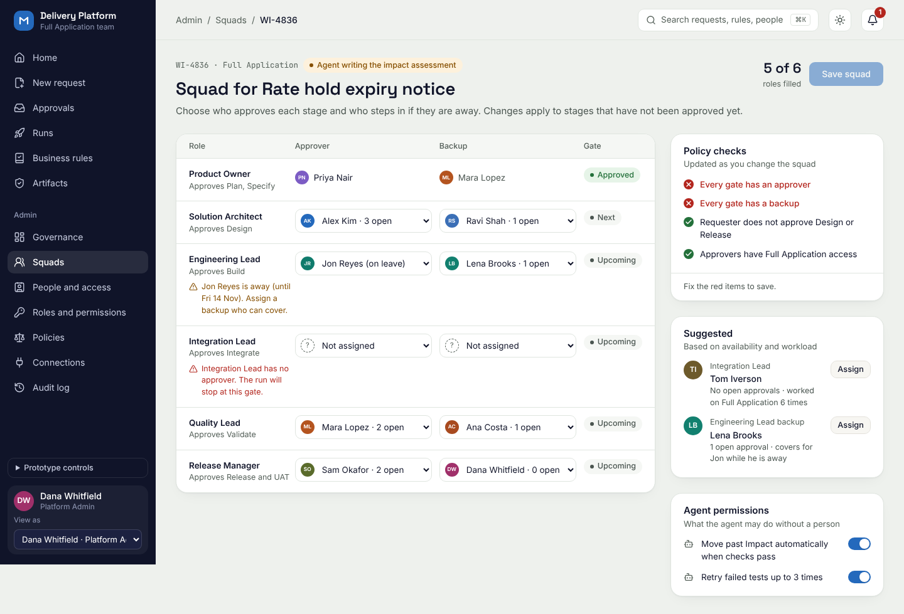

# Step 25 of 31: Screen 14: Squad for one work item (admin)

Assign an approver and a backup to every gate, with live policy checks.

## What to tell Copilot

Open this file in the editor, then paste this into Copilot Chat (Agent or Edit mode):

```text
Using #file:25-screen-squad-editor.md, create the file exactly as given in the "Files" section: src/v3/Squad.jsx.
Copy the code character for character. Do not rename, reformat, shorten, "improve" or convert to TypeScript.
Do not leave placeholders such as "// rest of the code". When done, list the files you created with their line counts.
Then add the route for this screen in src/App.jsx as described under "Wire it into the router".
```

## What it should look like

Reference screenshots (1440 × 900):

- `../screens/15-squad-detail.png`



## Files

Create this file with **exactly** this content.

### File: `src/v3/Squad.jsx` (131 lines)

`````jsx
// Super admin · Squad for a work item: assign an approver and a backup to every gate, with live policy checks.
import { useMemo, useState } from 'react';
import { Button } from '@/components/ui/button';
import { Shell, Card, CardHead, Pill, Avatar, PEOPLE } from './ui';
import { useToast } from '@/components/friendly';
import { useProto } from './store';
import { Check, X, AlertTriangle, Bot } from 'lucide-react';

const REQUESTER = 'priya';
// role, stages it approves, eligible people, status of its gate
const ROLES = [
  ['Product Owner', 'Plan, Specify', ['priya', 'mara'], 'Approved'],
  ['Solution Architect', 'Design', ['alex', 'ravi'], 'Waiting now'],
  ['Engineering Lead', 'Build', ['jon', 'lena'], 'Next'],
  ['Integration Lead', 'Integrate', ['tom', 'lena'], 'Upcoming'],
  ['Quality Lead', 'Validate', ['mara', 'ana'], 'Upcoming'],
  ['Release Manager', 'Release and UAT', ['sam', 'dana'], 'Upcoming'],
];
const LOAD = { priya: 4, alex: 3, ravi: 1, jon: 2, lena: 1, tom: 0, mara: 2, ana: 1, sam: 2, dana: 0 };
const LEAVE = { jon: 'On leave until Fri 14 Nov' };
const START = { 'Product Owner': ['priya', 'mara'], 'Solution Architect': ['alex', 'ravi'], 'Engineering Lead': ['jon', ''], 'Integration Lead': ['', ''], 'Quality Lead': ['mara', 'ana'], 'Release Manager': ['sam', 'dana'] };

function PersonSelect({ id, value, options, onChange, label }) {
  return (
    <label className="flex flex-col gap-1" htmlFor={id}>
      <span className="sr-only">{label}</span>
      <div className="flex items-center gap-2 rounded-lg border border-[var(--v-line)] bg-[var(--v-surface)] pl-2 focus-within:border-[var(--v-blue)] focus-within:ring-4 focus-within:ring-[var(--v-blue)]/15">
        {value ? <Avatar p={value} size={22} /> : <span className="grid size-[22px] place-items-center rounded-full border border-dashed border-[var(--v-ink-3)] text-[11px] text-[var(--v-ink-3)]">?</span>}
        <select id={id} value={value} onChange={e => onChange(e.target.value)} className="h-9 min-w-0 flex-1 bg-transparent pr-2 text-[13.5px] outline-none">
          <option value="">Not assigned</option>
          {options.map(p => <option key={p} value={p}>{PEOPLE[p].name}{LEAVE[p] ? ' (on leave)' : ` · ${LOAD[p]} open`}</option>)}
        </select>
      </div>
    </label>
  );
}

const STAGE_OF = { 'Product Owner': [0, 1], 'Solution Architect': [3], 'Engineering Lead': [4], 'Integration Lead': [5], 'Quality Lead': [6], 'Release Manager': [7] };
const gateFor = (s, role) => { const idx = STAGE_OF[role]; if (idx.every(i => s[i] === 'd')) return 'Approved'; if (idx.some(i => s[i] === 'w')) return 'Waiting now'; const cur = s.length; return idx[0] === cur ? 'Next' : 'Upcoming'; };
export default function V3Squad({ id = 'WI-4836' }) {
  const toast = useToast();
  const { resolve, undo, runs, attention } = useProto();
  const run = runs[id] || runs['WI-4836'];
  const [sq, setSq] = useState(() => { const s = structuredClone(START); if (!run.squadGap) s['Integration Lead'] = ['tom', 'lena']; if (run.id === 'WI-4807' && !attention.includes('leave')) s['Engineering Lead'] = ['lena', 'jon']; if (run.id !== 'WI-4807') s['Engineering Lead'] = [s['Engineering Lead'][0], s['Engineering Lead'][1] || 'lena']; return s; });
  const [autonomy, setAutonomy] = useState({ impact: true, retry: true });
  const set = (role, i, v) => setSq(s => ({ ...s, [role]: i === 0 ? [v, s[role][1]] : [s[role][0], v] }));

  const issues = useMemo(() => {
    const out = [];
    ROLES.forEach(([r]) => {
      const [a, b] = sq[r];
      if (!a) out.push([r, `${r} has no approver. The run will stop at this gate.`, 'bad']);
      else if (LEAVE[a]) out.push([r, `${PEOPLE[a].name} is away (${LEAVE[a].replace('On leave ', '')}). Assign a backup who can cover.`, 'warn']);
      if (!b) out.push([r, `${r} has no backup approver.`, 'warn']);
      if (a && a === b) out.push([r, `${r}: approver and backup are the same person.`, 'bad']);
    });
    if (sq['Solution Architect'][0] === REQUESTER || sq['Release Manager'][0] === REQUESTER) out.push(['sod', 'The requester cannot approve Design or Release.', 'bad']);
    return out;
  }, [sq]);
  const filled = ROLES.filter(([r]) => sq[r][0]).length;
  const policies = [
    ['Every gate has an approver', ROLES.every(([r]) => sq[r][0])],
    ['Every gate has a backup', ROLES.every(([r]) => sq[r][1])],
    ['Requester does not approve Design or Release', sq['Solution Architect'][0] !== REQUESTER && sq['Release Manager'][0] !== REQUESTER],
    ['Approvers have Full Application access', true],
  ];
  const blocking = issues.some(i => i[2] === 'bad');

  return (
    <Shell active="squads" crumbs={['Admin', 'Squads', run.id]}>
      <div className="mx-auto flex max-w-[1240px] flex-col gap-6">
        <div className="flex flex-wrap items-start gap-6">
          <div className="min-w-0 flex-1">
            <div className="flex items-center gap-2"><span className="font-mono text-[12.5px] text-[var(--v-ink-3)]">{run.id} · {run.app}</span><Pill tone={run.state === 'done' ? 'done' : 'wait'}>{run.now}</Pill></div>
            <h1 className="mt-1 font-display text-[28px] font-semibold">Squad for {run.t}</h1>
            <p className="mt-1 text-[15px] text-[var(--v-ink-2)]">Choose who approves each stage and who steps in if they are away. Changes apply to stages that have not been approved yet.</p>
          </div>
          <div className="flex items-center gap-3">
            <div className="text-right"><div className="tnum font-display text-[22px] font-semibold">{filled} of {ROLES.length}</div><div className="text-[12.5px] text-[var(--v-ink-3)]">roles filled</div></div>
            <Button disabled={blocking} onClick={() => { const t = run.squadGap ? resolve('squad') : run.id === 'WI-4807' && attention.includes('leave') ? resolve('leave') : null; toast('Squad saved. New approvers have been notified.', t ? () => undo(t) : undefined); location.hash = 'v3-squads'; }} className="h-10 rounded-lg px-5">Save squad</Button>
          </div>
        </div>

        <div className="grid grid-cols-[minmax(0,1fr)_340px] items-start gap-6">
          <Card className="overflow-hidden">
            <table className="w-full text-[13.5px]">
              <caption className="sr-only">Approval roles for {run.id}</caption>
              <thead><tr className="border-b border-[var(--v-line)] bg-[var(--v-sunken)] text-left text-[12.5px] text-[var(--v-ink-3)]"><th className="py-2.5 pl-5 font-medium">Role</th><th className="font-medium">Approver</th><th className="font-medium">Backup</th><th className="pr-5 font-medium">Gate</th></tr></thead>
              <tbody>{ROLES.map(([r, st, opts], i) => { const gate = gateFor(run.s, r);
                const locked = gate === 'Approved';
                const rowIssue = issues.find(x => x[0] === r);
                return (
                  <tr key={r} className="border-b border-[var(--v-line)] align-top last:border-0">
                    <td className="py-3.5 pl-5"><b className="font-semibold">{r}</b><div className="text-[12.5px] text-[var(--v-ink-3)]">Approves {st}</div>
                      {rowIssue && <div className={`mt-1.5 flex items-start gap-1.5 text-[12.5px] ${rowIssue[2] === 'bad' ? 'text-[var(--v-red)]' : 'text-[var(--v-amber)]'}`}><AlertTriangle className="mt-0.5 size-3.5 shrink-0" />{rowIssue[1]}</div>}</td>
                    <td className="py-3 pr-3 w-[230px]">{locked ? <span className="flex h-9 items-center gap-2"><Avatar p={sq[r][0]} size={22} />{PEOPLE[sq[r][0]].name}</span> : <PersonSelect id={`a${i}`} label={`${r} approver`} value={sq[r][0]} options={opts} onChange={v => set(r, 0, v)} />}</td>
                    <td className="py-3 pr-3 w-[230px]">{locked ? <span className="flex h-9 items-center gap-2 text-[var(--v-ink-2)]"><Avatar p={sq[r][1]} size={22} />{PEOPLE[sq[r][1]].name}</span> : <PersonSelect id={`b${i}`} label={`${r} backup`} value={sq[r][1]} options={[...opts, 'dana'].filter((p, j, a) => a.indexOf(p) === j)} onChange={v => set(r, 1, v)} />}</td>
                    <td className="py-3.5 pr-5"><Pill tone={gate === 'Approved' ? 'done' : gate === 'Waiting now' ? 'you' : 'mute'}>{gate}</Pill></td>
                  </tr>);
              })}</tbody>
            </table>
          </Card>

          <div className="flex flex-col gap-6">
            <Card>
              <CardHead title="Policy checks" sub="Updated as you change the squad" />
              <ul className="flex flex-col gap-2.5 px-5 pb-5">{policies.map(([t, ok]) => <li key={t} className="flex items-start gap-2.5 text-[13.5px]"><span className={`mt-0.5 grid size-4 shrink-0 place-items-center rounded-full text-white ${ok ? 'bg-[var(--v-green)]' : 'bg-[var(--v-red)]'}`}>{ok ? <Check className="size-3" strokeWidth={3} /> : <X className="size-3" strokeWidth={3} />}</span><span className={ok ? '' : 'font-medium text-[var(--v-red)]'}>{t}</span></li>)}</ul>
              {blocking && <p className="border-t border-[var(--v-line)] px-5 py-3 text-[12.5px] text-[var(--v-ink-2)]">Fix the red items to save.</p>}
            </Card>
            <Card>
              <CardHead title="Suggested" sub="Based on availability and workload" />
              <ul className="flex flex-col gap-3 px-5 pb-5">
                {[['Integration Lead', 'tom', 'No open approvals · worked on Full Application 6 times'], ['Engineering Lead backup', 'lena', '1 open approval · covers for Jon while he is away']].map(([r, p, why]) => (
                  <li key={r} className="flex items-start gap-3"><Avatar p={p} size={30} /><div className="min-w-0 flex-1"><div className="text-[12.5px] text-[var(--v-ink-3)]">{r}</div><b className="font-medium">{PEOPLE[p].name}</b><p className="text-[12.5px] text-[var(--v-ink-2)]">{why}</p></div>
                    <Button size="sm" variant="outline" className="rounded-lg" onClick={() => r === 'Integration Lead' ? set('Integration Lead', 0, p) : set('Engineering Lead', 1, p)}>Assign</Button></li>))}
              </ul>
            </Card>
            <Card>
              <CardHead title="Agent permissions" sub="What the agent may do without a person" />
              <ul className="flex flex-col gap-3 px-5 pb-5 text-[13.5px]">
                {[['impact', 'Move past Impact automatically when checks pass'], ['retry', 'Retry failed tests up to 3 times']].map(([k, t]) => (
                  <li key={k}><label className="flex cursor-pointer items-start gap-3"><Bot className="mt-0.5 size-4 shrink-0 text-[var(--v-ink-3)]" /><span className="flex-1">{t}</span>
                    <button type="button" role="switch" aria-checked={autonomy[k]} aria-label={t} onClick={() => setAutonomy(a => ({ ...a, [k]: !a[k] }))} className={`relative h-5 w-9 shrink-0 rounded-full transition-colors ${autonomy[k] ? 'bg-[var(--v-blue)]' : 'bg-[var(--v-toggle-off)]'}`}><span className={`absolute top-0.5 size-4 rounded-full bg-white shadow transition-all ${autonomy[k] ? 'left-[18px]' : 'left-0.5'}`} /></button></label></li>))}
              </ul>
            </Card>
          </div>
        </div>
      </div>
    </Shell>
  );
}
`````

## Wire it into the router

If you are using the temporary router from step 12, add these two lines to `src/App.jsx` (the final router in step 31 already has them):

```jsx
import V3Squad from '@/v3/Squad';   // with the other imports
  'v3-squad': V3Squad,                 // inside ROUTES
```

## Check before the next step

- [ ] Open `#v3-squad-wi-4836` with **View as → Dana Whitfield**. It matches `../screens/15-squad-detail.png`.
- [ ] Every button and link on the screen does what the specification below says.
- [ ] Switch the theme to dark: nothing is unreadable and no white boxes remain.
- [ ] No errors in the browser console.

## Specification

This explains what the code above does, in words. If you later change the screen, keep to these rules.

### 6.14 Squad for a work item (`#v3-squad-<id>`)

- Header: mono "ID · app" + Pill (run status); H1 "Squad for <title>"; lede "Choose who approves each stage and who steps in if they are away. Changes apply to stages that have not been approved yet."; right "**5 of 6** roles filled" + [Save squad] (disabled while any red issue).
- Table: Role (name + "Approves <stages>" + inline issue in red/amber) · Approver (PersonSelect, `w-[230px]`) · Backup (PersonSelect, options + Dana) · Gate Pill (Approved / Waiting now (you tone) / Next / Upcoming). Approved gates are read-only text.

| Role | Approves | Eligible people |
|---|---|---|
| Product Owner | Plan, Specify | Priya, Mara |
| Solution Architect | Design | Alex, Ravi |
| Engineering Lead | Build | Jon, Lena |
| Integration Lead | Integrate | Tom, Lena |
| Quality Lead | Validate | Mara, Ana |
| Release Manager | Release and UAT | Sam, Dana |

  Open-approval counts in the options: Priya 4, Alex 3, Ravi 1, Jon 2 (on leave until Fri 14 Nov), Lena 1, Tom 0, Mara 2, Ana 1, Sam 2, Dana 0.
- Live validation: no approver → red "<Role> has no approver. The run will stop at this gate."; approver on leave → amber "<Name> is away (until Fri 14 Nov). Assign a backup who can cover."; no backup → amber "<Role> has no backup approver."; same person twice → red "<Role>: approver and backup are the same person."; requester (Priya) as Design or Release approver → red "The requester cannot approve Design or Release."
- **Policy checks** card (green/red ticks, live): Every gate has an approver · Every gate has a backup · Requester does not approve Design or Release · Approvers have Full Application access. Footer when blocked: "Fix the red items to save."
- **Suggested** "Based on availability and workload": Integration Lead → Tom Iverson "No open approvals · worked on Full Application 6 times" (Assign); Engineering Lead backup → Lena Brooks "1 open approval · covers for Jon while he is away" (Assign).
- **Agent permissions** "What the agent may do without a person": switches "Move past Impact automatically when checks pass" (on), "Retry failed tests up to 3 times" (on).
- Save → resolves the squad or leave problem if this run had one, toast "Squad saved. New approvers have been notified." (+ Undo when it resolved something), go to Squads.
