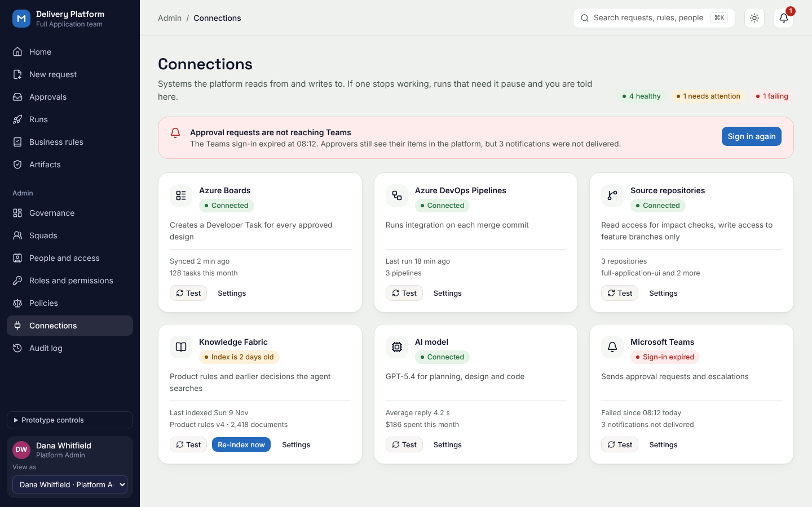

# Step 29 of 31: Screen 18: Connections (admin)

Health of the connected systems.

## What to tell Copilot

Open this file in the editor, then paste this into Copilot Chat (Agent or Edit mode):

```text
Using #file:29-screen-connections.md, create the file exactly as given in the "Files" section: src/v3/Connections.jsx.
Copy the code character for character. Do not rename, reformat, shorten, "improve" or convert to TypeScript.
Do not leave placeholders such as "// rest of the code". When done, list the files you created with their line counts.
Then add the route for this screen in src/App.jsx as described under "Wire it into the router".
```

## What it should look like

Reference screenshots (1440 × 900):

- `../screens/19-connections.png`



## Files

Create this file with **exactly** this content.

### File: `src/v3/Connections.jsx` (45 lines)

`````jsx
// Admin · Connections: the systems the platform reads from and writes to, and whether they are healthy.
import { useState } from 'react';
import { Button } from '@/components/ui/button';
import { Shell, Card, Pill } from './ui';
import { useToast } from '@/components/friendly';
import { useProto } from './store';
import { LayoutList, Workflow, GitBranch, BookOpen, Cpu, Bell, RefreshCw } from 'lucide-react';

const SYS = [
  [LayoutList, 'Azure Boards', 'Creates a Developer Task for every approved design', 'done', 'Connected', 'Synced 2 min ago', '128 tasks this month'],
  [Workflow, 'Azure DevOps Pipelines', 'Runs integration on each merge commit', 'done', 'Connected', 'Last run 18 min ago', '3 pipelines'],
  [GitBranch, 'Source repositories', 'Read access for impact checks, write access to feature branches only', 'done', 'Connected', '3 repositories', 'full-application-ui and 2 more'],
  [BookOpen, 'Knowledge Fabric', 'Product rules and earlier decisions the agent searches', 'wait', 'Index is 2 days old', 'Last indexed Sun 9 Nov', 'Product rules v4 · 2,418 documents'],
  [Cpu, 'AI model', 'GPT-5.4 for planning, design and code', 'done', 'Connected', 'Average reply 4.2 s', '$186 spent this month'],
  [Bell, 'Microsoft Teams', 'Sends approval requests and escalations', 'bad', 'Sign-in expired', 'Failed since 08:12 today', '3 notifications not delivered'],
];

export default function V3Connections() {
  const toast = useToast();
  const { teamsOk, fixTeams, undo } = useProto();
  const [openCfg, setOpenCfg] = useState(null);
  const list = SYS.map(x => x[1] === 'Microsoft Teams' && teamsOk ? [x[0], x[1], x[2], 'done', 'Connected', 'Signed in again just now', 'All notifications delivered'] : x);
  return (
    <Shell admin active="connections" crumbs={['Admin', 'Connections']}>
      <div className="mx-auto flex max-w-[1180px] flex-col gap-6">
        <div className="flex flex-wrap items-end gap-4"><div className="min-w-0 flex-1"><h1 className="font-display text-[28px] font-semibold">Connections</h1><p className="mt-1 text-[15px] text-[var(--v-ink-2)]">Systems the platform reads from and writes to. If one stops working, runs that need it pause and you are told here.</p></div>
          <div className="flex gap-2"><Pill tone="done">{teamsOk ? 5 : 4} healthy</Pill><Pill tone="wait">1 needs attention</Pill>{!teamsOk && <Pill tone="bad">1 failing</Pill>}</div></div>
        {!teamsOk && <div className="flex items-start gap-4 rounded-2xl border border-[var(--v-red-line)] bg-[var(--v-red-soft)] px-5 py-4">
          <Bell className="mt-0.5 size-5 shrink-0 text-[var(--v-red)]" /><div className="min-w-0 flex-1"><b className="font-semibold">Approval requests are not reaching Teams</b><p className="text-[13.5px] text-[var(--v-ink-2)]">The Teams sign-in expired at 08:12. Approvers still see their items in the platform, but 3 notifications were not delivered.</p></div>
          <Button className="h-9 shrink-0 rounded-lg" onClick={() => { const t = fixTeams(); toast('Signed in to Teams. The 3 missed notifications have been sent.', () => undo(t)); }}>Sign in again</Button>
        </div>}
        <div className="grid grid-cols-3 gap-5">
          {list.map(([I, n, d, tone, st, last, meta]) => (
            <Card key={n} className="flex flex-col p-5">
              <div className="flex items-start gap-3"><span className="grid size-10 shrink-0 place-items-center rounded-xl bg-[var(--v-sunken)] text-[var(--v-ink)]"><I className="size-5" /></span><div className="min-w-0 flex-1"><b className="font-semibold">{n}</b><div className="mt-1"><Pill tone={tone}>{st}</Pill></div></div></div>
              <p className="mt-3 flex-1 text-[13.5px] text-[var(--v-ink-2)]">{d}</p>
              <dl className="mt-3 flex flex-col gap-0.5 border-t border-[var(--v-line)] pt-3 text-[12.5px] text-[var(--v-ink-3)]"><dt className="sr-only">Last activity</dt><dd>{last}</dd><dt className="sr-only">Usage</dt><dd>{meta}</dd></dl>
              <div className="mt-3 flex gap-2"><Button size="sm" variant="outline" className="rounded-lg" onClick={() => toast(`Testing ${n}… connection works.`)}><RefreshCw className="size-3.5" />Test</Button>{tone === 'wait' && <Button size="sm" className="rounded-lg" onClick={() => toast('Re-indexing the Knowledge Fabric. About 20 minutes.')}>Re-index now</Button>}<Button size="sm" variant="ghost" className="rounded-lg" aria-expanded={openCfg === n} onClick={() => setOpenCfg(openCfg === n ? null : n)}>Settings</Button></div>
              {openCfg === n && <dl className="mt-3 grid grid-cols-[auto_1fr] gap-x-3 gap-y-1 rounded-lg bg-[var(--v-sunken)] p-3 text-[12.5px]"><dt className="text-[var(--v-ink-3)]">Signs in as</dt><dd>svc-delivery-platform</dd><dt className="text-[var(--v-ink-3)]">Scope</dt><dd>{n === 'Source repositories' ? 'Read all, write feature branches' : 'Full Application, Advisor Portal, Client Services'}</dd><dt className="text-[var(--v-ink-3)]">Owner</dt><dd>Dana Whitfield</dd></dl>}
            </Card>))}
        </div>
      </div>
    </Shell>
  );
}
`````

## Wire it into the router

If you are using the temporary router from step 12, add these two lines to `src/App.jsx` (the final router in step 31 already has them):

```jsx
import V3Connections from '@/v3/Connections';   // with the other imports
  'v3-connections': V3Connections,                 // inside ROUTES
```

## Check before the next step

- [ ] Open `#v3-connections` with **View as → Dana Whitfield**. It matches `../screens/19-connections.png`.
- [ ] Every button and link on the screen does what the specification below says.
- [ ] Switch the theme to dark: nothing is unreadable and no white boxes remain.
- [ ] No errors in the browser console.

## Specification

This explains what the code above does, in words. If you later change the screen, keep to these rules.

### 6.18 Connections (`#v3-connections`)

- H1 "Connections"; lede "Systems the platform reads from and writes to. If one stops working, runs that need it pause and you are told here."; Pills "4 healthy" (5 after fixing), "1 needs attention", "1 failing".
- Failure banner (red): Bell, "**Approval requests are not reaching Teams** The Teams sign-in expired at 08:12. Approvers still see their items in the platform, but 3 notifications were not delivered." [Sign in again] → `fixTeams`, toast "Signed in to Teams. The 3 missed notifications have been sent." + Undo.
- Grid of 3 columns, one card per system: 40px sunken icon tile, name, status Pill, description, two meta lines, buttons (↻ Test → "Testing <name>… connection works."), [Re-index now] for the amber one ("Re-indexing the Knowledge Fabric. About 20 minutes."), ghost (Settings) toggling a details box (Signs in as svc-delivery-platform · Scope · Owner Dana Whitfield).

| System | Icon | Purpose | Status | Meta |
|---|---|---|---|---|
| Azure Boards | LayoutList | Creates a Developer Task for every approved design | Connected | Synced 2 min ago · 128 tasks this month |
| Azure DevOps Pipelines | Workflow | Runs integration on each merge commit | Connected | Last run 18 min ago · 3 pipelines |
| Source repositories | GitBranch | Read access for impact checks, write access to feature branches only | Connected | 3 repositories · full-application-ui and 2 more |
| Knowledge Fabric | BookOpen | Product rules and earlier decisions the agent searches | Index is 2 days old (amber) | Last indexed Sun 9 Nov · Product rules v4 · 2,418 documents |
| AI model | Cpu | GPT-5.4 for planning, design and code | Connected | Average reply 4.2 s · $186 spent this month |
| Microsoft Teams | Bell | Sends approval requests and escalations | Sign-in expired (red) → Connected | Failed since 08:12 today · 3 notifications not delivered |
